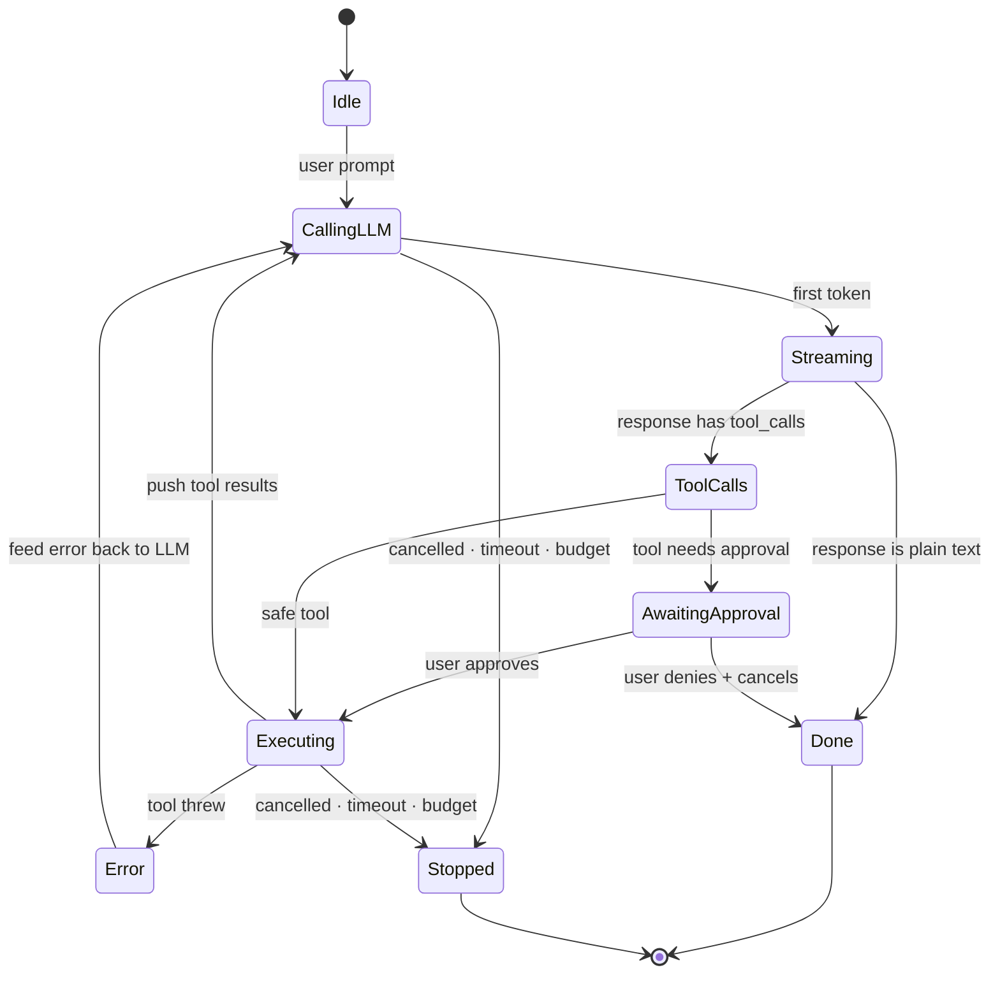
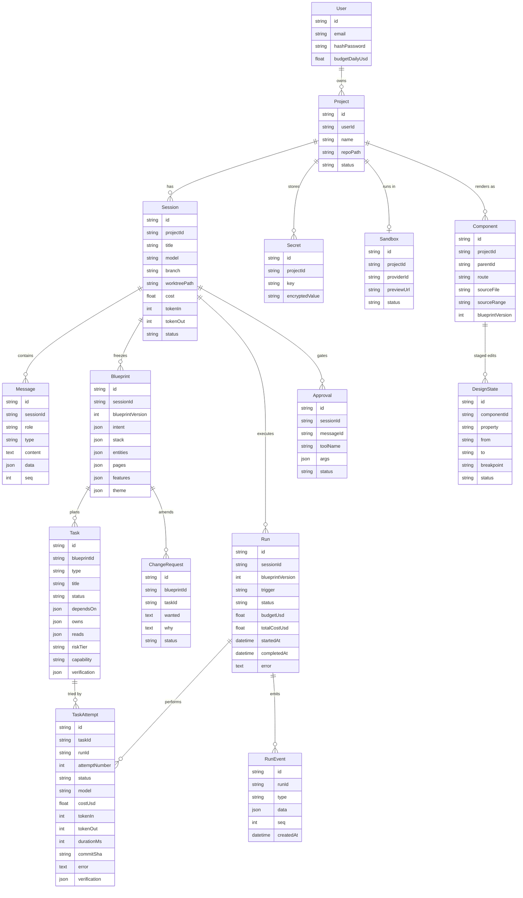

# Appwright — Architecture

> **What we are building:** an AI app builder in the shape of **Emergent / Lovable** —
> a user types *"build me a food delivery app"*, a planner turns that into requirements +
> architecture + a task list, a coding agent executes those tasks inside an **isolated cloud
> sandbox**, the user watches a live preview, reviews, iterates, and deploys.
>
> Source material: the `Coding agents + cloud` deck (100xdevs) + the cloud/planner extension.
> This document is the single architectural reference. Version plan lives in
> [VERSIONS.md](./VERSIONS.md), per-version TODOs in [versions/](./versions/),
> the learning curve in [LEARNING.md](./LEARNING.md).

---

## Table of contents

1. [The product in one picture](#1-the-product-in-one-picture)
2. [Where the repo actually is today](#2-where-the-repo-actually-is-today)
3. [Layer 0 — The agent loop](#3-layer-0--the-agent-loop)
4. [Layer 1 — Persistence + web app](#4-layer-1--persistence--web-app)
5. [Layer 2 — Isolation & control (worktrees, approvals)](#5-layer-2--isolation--control)
6. [Track B — Remote control & handoff (deferred)](#6-track-b--remote-control--handoff-deferred)
7. [Layer 3 — The cloud pivot](#7-layer-3--the-cloud-pivot)
8. [Layer 4 — The App Builder / Planner](#8-layer-4--the-app-builder--planner)
   · [8.7 UI system](#87-the-ui-system--a-registry-and-a-scale-not-a-style-guide) · [8.8 design block](#88-the-blueprints-design-block) · [8.9 UI DAG](#89-the-ui-task-dag) · [8.10 component graph](#810-the-component-graph--layer-45) · [8.11 visual editor](#811-the-visual-editor-and-designstate)
9. [Full target architecture](#9-full-target-architecture)
10. [Component responsibility map](#10-component-responsibility-map)
11. [Data model](#11-data-model)
12. [End-to-end sequence](#12-end-to-end-sequence)
13. [Deviations from the deck (and why)](#13-deviations-from-the-deck-and-why)
14. [The generated application](#14-the-generated-application--what-it-is-and-what-it-owns)
15. [Open questions](#15-open-questions)

---

## 1. The product in one picture

```
                         USER
                          │  "Build me a food delivery app"
                          ▼
                   ┌─────────────┐
                   │ Web / Mobile│
                   └──────┬──────┘
                          │ https
                          ▼
                   ┌─────────────┐
                   │ API Gateway │  auth, rate limits, routing
                   └──────┬──────┘
                          ▼
                   ┌─────────────┐        ┌──────────┐
                   │  PLANNER    │───────►│ Postgres │
                   │ requirements│        └──────────┘
                   │ architecture│
                   │ tasks + deps│
                   └──────┬──────┘
                          ▼
                   ┌─────────────┐        ┌──────────┐
                   │ ORCHESTRATOR│───────►│  Queue   │
                   └──────┬──────┘        └────┬─────┘
                          │                    ▼
                          │            ┌───────────────┐
                          └───────────►│ Sandbox Mgr   │
                                       └───────┬───────┘
                        ┌──────────────────────┼──────────────────────┐
                        ▼                      ▼                      ▼
                  ┌───────────┐          ┌───────────┐          ┌───────────┐
                  │ Sandbox A │          │ Sandbox B │          │ Sandbox C │
                  │ ┌───────┐ │          │ ┌───────┐ │          │ ┌───────┐ │
                  │ │ AGENT │ │          │ │ AGENT │ │          │ │ AGENT │ │
                  │ └───┬───┘ │          │ └───────┘ │          │ └───────┘ │
                  │  ┌──┼──┐  │          └───────────┘          └───────────┘
                  │  ▼  ▼  ▼  │
                  │ Files Bash│
                  │    Git    │
                  │     │     │
                  │  PROJECT  │  Next.js · Backend · DB · Auth · Tests
                  └─────┬─────┘
                        ▼
                    PREVIEW URL
                        ▼
                  USER REVIEWS ──► agent continues ──► DEPLOY
```

**The one sentence that defines the whole architecture:**
> The agent does **not** run on the user's machine and does **not** run inside our API server.
> It runs inside a **disposable, isolated sandbox**, one per project, and everything else in the
> system exists to schedule, observe, and persist what happens in there.

---

## 2. Where the repo actually is today

An honest audit — the docs were describing a system that is no longer on disk.

```
appwright/
├── services/                     ← deployable units
│   ├── web/          TS   React + Vite   ── 255-line chat UI from the DELETED architecture.
│   │                                        Hardcodes http://localhost:4000; the API is on 3001.
│   │                                        Dead code, not a starter. V1 replaces it.
│   ├── api/          TS   Express        ── src/index.ts is 30 lines: /health + /hello (stub)
│   └── orchestrator/ TS   —              ── src/index.ts is 0 bytes. V3 fills it in
├── libs/ts/                      ← importable code. TypeScript only (D4)
│   ├── agent-core/        the loop, Message/AgentEvent types, providers   ◄ V0
│   │                      index.ts 8 lines · cli.ts 11 lines · types.ts 0 BYTES
│   ├── tools/             fs, bash, grep, git + the path fence            ◄ V0
│   │                      index.ts 18 lines — a hello() stub, nothing else
│   ├── contracts/         Zod schemas + projectFiles.ts ── ⚠️ BROKEN, see below
│   ├── db/                Prisma + POSTGRES ── User, Project, ConversationHistory, Secret
│   └── ui/ config/ eslint-config/ typescript-config/
├── templates/
│   └── vite-react/       the pristine starter the agent copies per project (16-line App.tsx)
├── ref-ai/packages/           10 MIT TS packages, 252k lines, 438 tests — READ-ONLY reference
│                              the loop is at packages/agent/src/agent-loop.ts
├── docs/                 ← you are here
├── docker-compose.yml    runs the stack (D11)
└── package.json          bun workspaces + the script surface (D11)

  DELETED 2026-08-10:  apps/opencode/ · apps/agent-engine/ · apps/worker/
                       script/reset-project.mjs · turbo.json
```

**Critical fact:** `apps/opencode/` — which contained the *working* TypeScript agent loop
(`agentLoop.ts`, tools, subagents) — has been **deleted** from the working tree. The only
surviving agent-loop reference is `ref-ai/packages/`. It is TypeScript and so is our engine
([D4](./DECISIONS.md#decision-4-typescript-end-to-end--active-supersedes-d1)) — so V0 can port its
**structure** directly, and may simply *install* the provider layer rather than rewrite it.

### ⚠️ `projectFiles.ts` is not the fence these docs promised

Three documents used to say *"`workspaceRoot` + `safeResolve` are already correct — import them,
do not write a second one."* Verified 2026-08-11 against the file. **Both claims are false:**

| Claim | Reality |
|---|---|
| `workspaceRoot` / `safeResolve` are importable | **Neither is exported.** Both are module-private. `index.ts` re-exports the file, but only `listProjectFiles`, `listProjectPaths`, `readProjectFile`, `writeProjectFile` are public |
| the fence root is correct | `PROJECTS_DIR = ../../../../apps/projects` resolves to **`libs/apps/projects`** — and `apps/` was deleted on 2026-08-10. It fences a directory that does not exist |

The *escape logic* inside `safeResolve` is sound and worth keeping. Everything around it is stale.
**V0 Slice 3 must export the two functions and repoint `PROJECTS_DIR` before importing anything.**
That is a code change in `libs/ts/contracts`, not a copy-paste.

**So the true starting position is:**

| Thing | Status |
|---|---|
| Agent loop | ❌ gone. `libs/ts/agent-core` scaffolded, `types.ts` **0 bytes**. Reference in `ref-ai/packages` |
| Tools | ❌ `libs/ts/tools` exports a `hello()` stub. No fs, no bash, no fence |
| API | 🟡 stub — `/health` + `/hello` prove the workspace resolves. Nothing else |
| Orchestrator | ❌ empty file (V3) |
| DB schema | 🟡 exists, but modelled for the *old* shape (no Session, no worktree, no sandbox) |
| Contracts | 🔴 **worse than empty** — the fence is unexported and points at a deleted directory |
| Web UI | 🔴 dead 255-line UI from the deleted architecture, wired to a port nothing listens on |
| Tests | ❌ **zero test files in the whole project** |
| Sandboxing | ❌ nothing |
| Planner | ❌ nothing |

This is close to greenfield with a very good map. **V0 starts by writing the agent loop.**

---

## 3. Layer 0 — The agent loop

### 3.1 What we have conceptually

```
Terminal/CLI  ──►  Backend  ──►  LLM
     ▲                 │          │
     └─────────────────┴──────────┘
        request upgraded to an event stream
```

The client sends a prompt, the backend forwards it to the LLM, and tokens stream back over an
upgraded connection (SSE) so output appears as it is generated.

### 3.2 The tool-call handshake (the deck's code)

```js
let res = axios.post("/conversation", { prompt: "what is weather in delhi" });

if (res.toolCall && res.toolCall.name == "get_weather") {
  let weather = axios.get("api.weather.com/" + city);

  axios.post("/conversation", {
    prompts: [
      { message: "What is the weather in delhi" },
      res,
      { type: "toolCallResponse", toolCallId: res.toolCallId, message: weather }
    ]
  });
}
```

### 3.3 ⚠️ The bug in that code

> **Q: What if there is another tool call from the LLM here?**

The snippet handles exactly **one** tool call and then stops. Real coding agents chain many:
`read_file` → `grep` → `edit_file` → `bash` → `read_file` again. Each LLM response may contain
zero, one, or several tool calls, and the conversation only ends when the model returns a
message with **no** tool calls.

> **A: tool handling is a `while` loop, not an `if`.**

Our engine is TypeScript ([D4](./DECISIONS.md#decision-4-typescript-end-to-end--active-supersedes-d1)),
so the shape we actually build is:

```ts
const messages: Message[] = [{ role: "user", type: "text", content: prompt }];

while (true) {
  const res = await provider.stream(messages, tools);  // tokens stream as they arrive
  messages.push(res);
  await emit(assistantEvent(res));                     // → SSE → browser

  if (!res.toolCalls?.length) break;                   // final answer → done

  // independent calls can run in parallel; dependent ones must be sequential
  for (const call of res.toolCalls) {
    const result = await tools[call.name].execute(call.args, ctx);
    messages.push({
      role: "tool", type: "toolResponse",
      toolCallId: call.id, content: result,
    });
    await emit(toolResultEvent(call, result));
  }
}
```

Note what the loop does **not** do: it never writes to the database. Persistence is the API's job
(`services/api`), reached through `emit`. The loop stays a pure function of its inputs, which is
what lets V1 reuse it unchanged and V3 move it inside a sandbox.

### 3.4 The loop as a state machine



**`Done` is one of six exits, not the exit**
([D26](./DECISIONS.md#decision-26-the-agent-loop-has-six-exits-not-one--active-target-v0)).
`completed` · `cancelled` · `timeout` · `maxIterations` · `budgetExceeded` · `fatalError`. The loop
returns which one; every other exit is the one that happens when something has gone wrong or a
human is waiting. Note that `Error` above is a **tool** error — it feeds back to the model and the
loop continues. Only the loop breaking is `fatalError`.

### 3.5 Loop concerns that bite in production

| Concern | What goes wrong | Handling |
|---|---|---|
| **Token truncation** | Response stops mid-tool-call; JSON args are unparseable | Detect `finish_reason: length`, retry or ask the model to continue |
| **Infinite loops** | Agent reads the same file 40 times | Max-iteration budget + repeated-call detection |
| **Parallel tools** | `Promise.all` on tool calls that depend on each other → race | Only parallelise read-only tools; writes stay sequential |
| **Context overflow** | History outgrows the window | Summarise/compact old turns; keep tool results truncated |
| **Provider drift** | OpenAI vs Anthropic vs Gemini tool-call shapes differ | Provider abstraction layer — normalise to one internal `Message` type |
| **No cancellation** | The user presses Stop; the run keeps spending | `AbortSignal` checked between **every tool call**, not every iteration ([D26](./DECISIONS.md#decision-26-the-agent-loop-has-six-exits-not-one--active-target-v0)) |
| **Unbounded cost** | A loop stays inside every sandbox limit and still burns $40 on one file | Budget on the loop context — `maxTokens`, `maxCostUsd`, `deadline`. Sandbox caps bound the *box*, not the *loop* |
| **Agent touching the disk directly** | Moving into a sandbox at V3 means rewriting every tool | Tools go through a `Runtime` from V0 ([D27](./DECISIONS.md#decision-27-the-agent-is-a-client-of-the-runtime-not-a-resident--active-target-v0-shapes-v3)) |

`ref-ai/packages/agent/src/agent-loop.ts` already solves streaming (`AgentEventSink`), multi-provider,
truncation, and parallel-vs-sequential tool execution. **Port it, don't reinvent it.**

---

## 4. Layer 1 — Persistence + web app

Goal: drive the agent from a browser instead of a terminal, with history that survives a refresh.

### 4.1 Topology

```
┌──────────┐        ┌──────────┐        ┌──────────┐
│ Website  │ ─────► │ Backend  │ ─────► │ Database │
└──────────┘        └────┬─────┘        └──────────┘
                         │  ▲
                         ▼  │
                    ┌──────────┐
                    │   LLM    │
                    └──────────┘
```

The website is a **thin client**. All agent state lives in backend + DB, never in the browser —
that is precisely what makes history, resume, multi-device, and handoff possible later.

### 4.2 The schema from the deck

```
Projects                         Session
┌──────────────────┐             ┌───────────────────────────────┐
│ id               │   1:many    │ id                            │
│ path             │ ──────────► │ project_id                    │
│ name             │             │ title                         │
└──────────────────┘             │ model                         │
                                 │ cost                          │
                                 │ token_in                      │
                                 │ token_out                     │
                                 └──────────────┬────────────────┘
                                                │ 1:many
                                                ▼
                                 Messages
                                 ┌───────────────────────────────────────┐
                                 │ id                                    │
                                 │ session_id                            │
                                 │ content      "hi there"               │
                                 │ role         user│assistant│tool      │
                                 │ type         text│toolCall│toolResp   │
                                 │ data         {}   (JSON blob)         │
                                 └───────────────────────────────────────┘
```

Why each field earns its place:

- `Projects.path` — the directory the agent operates in. Becomes the git-worktree anchor in V2,
  and the sandbox mount point in V3.
- `Session.model` — model is **per session** and changeable mid-session (hence `PUT /session`).
- `Session.cost / token_in / token_out` — usage accounting rolled up per session. Add this on
  day one; retrofitting billing telemetry is miserable.
- `Messages.type` + `Messages.data` — one table stores text, tool calls, and tool results.
  `data` holds the structured payload (tool name, args, `toolCallId`, diff, exit code).

### 4.3 Backend routes

```
POST /project                    create a project (register a path / repo)
GET  /projects                   list projects
POST /session                    start a session inside a project
PUT  /session                    change the model for a session
GET  /session/:sessionId         session metadata (model, cost, tokens)
GET  /conversations/:sessionId   full message history

POST /conversation               ← the agent turn. long-lived. streaming.
```

The first six are boring CRUD. **`POST /conversation` is the entire product.**

### 4.4 The `/conversation` flow, step by step

**Step 1 — website sends the prompt, backend persists it**

```
Website ──/conversation──► Backend ──► Database        (persist user message)
```

**Step 2 — backend calls the LLM**

```
                            ┌─────┐
                      ┌────►│ LLM │
Website ─────────► Backend  └─────┘
```

**Step 3 — LLM responds with a tool call: `read_file`**

```
                            ┌─────┐
                            │ LLM │
Website ─────────► Backend ◄───┴──   read_file
                      │
                      └────► Database        (persist toolCall)
```

**Step 4 — backend executes the tool, returns `file_contents` to the LLM**

```
                            ┌─────┐
                      ┌────►│ LLM │   file_contents
Website ─────────► Backend  └─────┘
```

**Step 5 — LLM returns the final answer**

```
                            ┌─────┐
                            │ LLM │
Website ◄────────  Backend ◄───┴──   answer
                      │
                      └────► Database        (persist answer)
```

Steps 3–4 repeat for as long as the model keeps emitting tool calls — that is the `while` loop
from §3. The website receives all of it as a **stream of events**, so the user watches tools
execute in real time instead of staring at a spinner for 60 seconds.

### 4.5 Which DB?

The deck's answer:

| Option | Deck verdict |
|---|---|
| MongoDB | ✗ |
| Postgres | ✗ |
| **SQLite** | ✅ |

**SQLite** is a lightweight, self-contained database engine, different from MySQL/Postgres:

1. **Serverless** — no separate server process. The engine runs *inside* your application,
   reading and writing directly to a file on disk.
2. **Zero-configuration** — no setup, no admin, no user accounts.
3. **Single-file storage** — the entire database (tables, indexes, everything) is one ordinary
   file, trivially easy to copy, move, or back up.
4. **Self-contained** — a small C library with almost no external dependencies.

**Why the deck is right *for its product*:** a local coding agent is single-user and
single-writer, the data is inherently per-machine, and shipping a desktop app that also demands
"install Postgres first" is a non-starter. One file = the user's whole agent history.

**Why we do NOT follow it:** see [§13](#13-deviations-from-the-deck-and-why). We are building a
**hosted multi-tenant** product; `libs/ts/db` is already Prisma + Postgres. SQLite's single-writer
model is a hard blocker the moment two API instances exist.

---

## 5. Layer 2 — Isolation & control

Even with the web UI working, two things are missing: **git worktrees** and **approvals**.

### 5.1 Git worktrees

> **Q. What does `git checkout -b branch_name` do?**
> **A.** Checks out the current branch to a new branch — **in place**. One working directory,
> one branch at a time. Two agents cannot work at once; switching branches yanks the files out
> from under a running agent.

> **Q. What does `git worktree add ../task1 -b agent/task1 main` do?**

It creates a **second physical directory** on disk, checked out to a **new branch** `agent/task1`
branched from `main`, sharing the same `.git` object store:

```
Mac machine / sandbox
┌───────────────────────────────────────────────────┐
│                                                   │
│    📁 todo-app                📁 task1            │
│    main branch                agent/task1         │
│    (you)                      (the agent)         │
│                                                   │
│         └────── shared .git object store ─────┘   │
└───────────────────────────────────────────────────┘
```

> **Q. What does `cd todo_app && git merge agent/task1` do?**
> **A.** Merges it back to main.

**Lifecycle per agent task:**

```
1. git worktree add ../task-N -b agent/task-N main   ← isolate
2. agent works and commits inside ../task-N          ← work
3. user reviews the diff in the web UI               ← review
4. cd main-repo && git merge agent/task-N            ← integrate
5. git worktree remove ../task-N                     ← clean up
```

**This maps straight onto the schema:** one **Session** ≈ one **worktree** ≈ one **branch**.
That equivalence is why `Session` is a first-class table and not just a chat thread.

### 5.2 Approvals

Before running a destructive tool (`bash`, `write_file`, `git push`), the agent should pause and
ask. Mechanically this means **the loop must be able to suspend mid-stream**:

```
        LLM emits tool call
                │
                ▼
     ┌──────────────────────┐
     │ needs approval?      │
     └───┬──────────────┬───┘
         │ no           │ yes
         ▼              ▼
    execute      persist Messages row (type=toolCall, status=pending)
         │              │
         │              ▼
         │       emit approval_request event down the stream
         │              │
         │              ▼
         │       ⏸  wait for approve/deny from ANY connected surface
         │              │
         │       ┌──────┴──────┐
         │       ▼             ▼
         │   approve         deny
         │       │             │
         └───────┴─────────────┴──► push result into messages, resume loop
```

The state must live in the **DB**, not in an in-memory promise — otherwise a server restart, or
approving from a different device than the one that asked, breaks the flow.

Permission modes worth supporting (mirrors the reference tools): `default` (ask on writes/bash),
`accept-edits` (auto-approve file writes, ask on bash), `bypass` (approve everything —
appropriate *only* inside a sandbox), `plan` (read-only, no writes at all).

---

## 6. Track B — Remote control & handoff (deferred)

The deck's milestones 2 and 3. **Excellent to understand, not on our critical path** — see the
reasoning at the end of this section.

### 6.1 The problem

Your agent, with full filesystem access, runs on **your Mac**. You want to drive it from the web
or your phone while you are away. But **your machine is not addressable from the internet**:
behind NAT, no public IP, no open inbound ports.

### 6.2 Do we need another service? Yes — a **Bridge**

```
┌──────────┐                    ┌──────────┐
│ Website  │──https──┐          │   LLM    │
└──────────┘         │          └────┬─────┘
                     │             ▲ │ answer
                     │             │ ▼
                     │        ┌──────────┐      ┌──────────┐
                     │        │ Backend  │─────►│ Database │
                     │        └──────────┘      └──────────┘
                     ▼
┌──────────┐     ┌────────┐
│ Local mac│─ws─►│ Bridge │
└──────────┘     └────────┘
```

### 6.3 Which protocol?

| Link | Protocol | Why |
|---|---|---|
| Website → Bridge | **HTTPS** | Browser initiates; plain request/response is enough |
| Local Mac → Bridge | **WebSocket** | The machine must hold a **persistent, outbound-initiated** connection. Outbound traverses NAT/firewalls; inbound does not. The bridge then pushes commands down the socket whenever it likes |

**The key insight: the local machine always dials out.** The bridge never has to reach *in*.

An alternative used by shipped products is **HTTPS long-polling + SSE** instead of WebSockets:
higher latency, but far more survivable through corporate proxies and middleboxes that mangle
WS upgrades. Both are valid; `ws` is simpler to reason about, polling is more robust.

### 6.4 Auth — the part you cannot skip

> **a. Only I should be able to access my remote control.**

The bridge must bind a **device to an account**, not merely trust a session id. Without that,
anyone who guesses your endpoint gets a shell on your Mac. (The reference CLI literally warns
`SERVER_PASSWORD is not set; server is unsecured` for exactly this reason.)

> **b. How does a CLI sign in via a browser?**

The standard shape (OAuth device/loopback flow):

```
1. CLI starts a listener on http://localhost:PORT/callback
2. CLI opens the browser to  https://app/auth?redirect=localhost:PORT&state=XYZ
3. User authenticates in the browser (they already have a session there)
4. Browser redirects to localhost:PORT/callback?code=ABC&state=XYZ
5. CLI verifies `state`, exchanges `code` for a long-lived token over HTTPS
6. Token stored in the OS keychain / ~/.config
```

`state` prevents CSRF; the code is short-lived and single-use; the token never travels through
the URL bar. Replicate this rather than inventing something.

### 6.5 Handoff

Start in the terminal, continue in the browser, approve a tool call from your phone, finish in
the terminal. This is **almost free** if Layers 1–2 are built correctly, because:

- All state already lives in the DB, not in any client (§4.1)
- Every message — including tool calls and results — is persisted (§4.2)
- Every surface already talks to the same backend

Handoff then reduces to: *given a `sessionId`, any authenticated client attaches to the live
event stream and replays history from `GET /conversations/:sessionId`.*

### 6.6 Why this is deferred for us

In the Emergent-shaped product the agent runs in **our cloud**, not on the user's laptop. Our
sandboxes *are* addressable — they are ours. So the Bridge solves a problem we do not have.

It becomes valuable later as a **"local mode / bring-your-own-machine"** feature (run the agent
against a private repo that must never leave the user's machine). Parked as **Track B**, after V4.

---

## 7. Layer 3 — The cloud pivot

This is the difference between "a coding agent" and "a product".

### 7.1 Local model vs cloud model

```
        LOCAL (deck, V0–V2)                     CLOUD (us, V3+)
┌─────────────────────────────┐        ┌─────────────────────────────┐
│ Backend process             │        │ Backend / API               │
│   └── agent loop            │        │   (never executes anything) │
│         └── fs / bash       │        └────────────┬────────────────┘
│               └── YOUR disk │                     │ enqueue job
└─────────────────────────────┘                     ▼
                                             ┌─────────────┐
  ✗ agent crash = API crash                  │    Queue    │
  ✗ `rm -rf /` hits your machine             └──────┬──────┘
  ✗ one machine = one concurrent build              ▼
  ✗ no per-user isolation                    ┌─────────────┐
                                             │ Sandbox Mgr │
                                             └──────┬──────┘
                                        ┌───────────┼───────────┐
                                        ▼           ▼           ▼
                                    Sandbox A   Sandbox B   Sandbox C
                                     (agent)     (agent)     (agent)
```

### 7.2 The cloud-agent architecture

```
                     USER
                       │
                       ▼
                  Web / Mobile
                       │
                       ▼
                 API / Gateway          auth · rate limit · routing
                       │
                       ▼
                 Orchestrator           owns job lifecycle & state machine
                       │
             ┌─────────┴─────────┐
             ▼                   ▼
          Database              Queue
                                 │
                                 ▼
                          Sandbox Manager    provision · warm pool · reap
                                 │
                    ┌────────────┼────────────┐
                    ▼            ▼            ▼
                Sandbox A    Sandbox B    Sandbox C
                    │            │            │
                  Agent        Agent        Agent
                    │            │            │
              ┌─────┼─────┐      │            │
              ▼     ▼     ▼      │            │
            Files  Bash  Git     │            │
                    │            │            │
                    ▼            ▼            ▼
                 Project      Project      Project
```

**Now the agent itself runs inside the cloud sandbox. That's the key difference.**

### 7.3 What each new box is for

| Box | Responsibility | Why it must exist separately |
|---|---|---|
| **API / Gateway** | AuthN/Z, validation, rate limiting, streaming to clients | Must stay responsive; it is the only public surface |
| **Orchestrator** | Job state machine: queued → provisioning → running → awaiting-approval → done/failed. Retries, timeouts, cancellation | Agent runs are long (minutes) and failure-prone; that lifecycle needs an owner |
| **Queue** | Decouples request rate from execution capacity; back-pressure | 100 users clicking "build" must not mean 100 simultaneous sandboxes |
| **Sandbox Manager** | Provision/destroy sandboxes, warm pool, resource limits, snapshot/restore of the project filesystem | Cold-boot is the biggest latency cost; pooling is the fix |
| **Sandbox** | Untrusted execution: agent + fs + bash + git + dev server | LLM-authored `bash` is arbitrary code execution by definition |
| **Worker** | Long-running process that drives one agent session inside a sandbox and streams events out | Keeps the loop out of the request/response cycle |

### 7.4 Sandbox non-negotiables

- **Network egress policy** — the agent needs npm/pip; it does not need your internal network.
- **No production credentials inside.** Ever. The sandbox proxies through a service that holds
  the secrets; the sandbox holds a scoped, short-lived token at most.
- **CPU / memory / disk / wall-clock caps** with hard kill. These bound the **box**. They do not
  bound the **loop** — that needs its own token and cost budget
  ([D26](./DECISIONS.md#decision-26-the-agent-loop-has-six-exits-not-one--active-target-v0)).
  An agent can sit inside every limit here and still spend $40 re-reading one file.
- **The project is always at `/workspace`** — every backend, no exceptions
  ([D28](./DECISIONS.md#decision-28-workspace-is-the-only-root--active-target-v0-slice-3)). The
  fence root is that constant, so it cannot differ between the backend you test on and the one
  you ship on.
- **The environment is prepared before the agent starts**
  ([D29](./DECISIONS.md#decision-29-the-environment-is-prepared-before-the-agent-starts--active-target-v3)) —
  runtime, package manager, deps, DB, migrations. The agent spends its tokens on the user's
  problem, not on `nvm`.
- **Ephemeral by default** — the durable artifacts are the git repo and object storage, not
  the container's disk.
- **Preview served from the sandbox** (`https://preview-<id>.ourdomain`), never `localhost`.
- **Everything the agent reads is untrusted** — files, compiler output, npm READMEs, and the pages
  of the app it just built ([D23](./DECISIONS.md#decision-23-everything-the-agent-reads-is-untrusted-input--active-target-v0-slice-3)).
- **Dependencies come from a list, not from the model**
  ([D24](./DECISIONS.md#decision-24-the-agent-may-not-install-packages-it-invented--active-target-v4-enforced-in-v0s-bash-tool)).
  Egress policy allows npm, which makes `npm install` the one hole every other control leaves open.

**The boundary is HTTP** ([D22](./DECISIONS.md#decision-22-the-sandbox-boundary-is-an-http-contract-not-a-typescript-interface--active-target-v3-shapes-v0)).
A supervisor inside the box serves a fixed, versioned contract — `exec`, `files/*`, `git/*`,
`events`, `health`, and `browser/*` reserved for V5. `SandboxProvider` is a client for it.

```
agent-core ──► sandbox client ──HTTP──► supervisor ──► fs · bash · git
                                   ▲
                  local child process · E2B · Fly Machine · Firecracker
                  all the same caller code
```

**Provider: E2B**, decided 2026-08-11
([D25](./DECISIONS.md#decision-25-e2b-is-the-sandbox-provider--active-target-v3-closes-o1)).
Raw Firecracker was considered and deferred — it needs Linux + KVM, and choosing it means also
building rootfs images, a kernel, `jailer` config, CNI networking, a snapshot manager, a warm pool,
and capacity scheduling. Behind the contract above, adopting it later is **a new adapter, not a
rewrite**. Two triggers would reopen it: sandbox spend becoming a real invoice line, or a customer
requiring an isolation guarantee E2B will not put in writing.

### 7.5 Streaming through the layers

The user must see tokens and tool calls in real time even though execution is three hops away:

```
Sandbox(agent) ──events──► Worker ──pub/sub──► API ──SSE/WS──► Browser
                              │
                              └──batched writes──► Postgres  (durable history)
```

Two channels on purpose: a **hot path** for latency and a **durable path** for replay. On
reconnect the client replays from Postgres, then re-attaches to the live stream by sequence
number.

---

## 8. Layer 4 — The App Builder / Planner

The Emergent/Lovable layer. Everything below the Planner is "a coding agent"; the Planner is
what makes it "an app builder".

```
User
 │  "Build me a food delivery app"
 ▼
Planner
 ├── Requirements        who are the users, what must the app do
 ├── Architecture        stack, pages, data model, services  (FROZEN once decided)
 ├── Tasks               ordered, individually verifiable units of work
 └── Dependencies        task DAG — what blocks what
 │
 ▼
Cloud Agent              executes tasks one at a time
 │
 ▼
Sandbox
 ├── Next.js
 ├── Backend
 ├── Database
 ├── Auth
 └── Tests
 │
 ▼
Preview                  live URL, HMR
 │
 ▼
User reviews
 │
 ▼
Agent continues          follow-up prompts re-enter the planner, not the raw agent
 │
 ▼
Deploy
```

### 8.1 Why a planner instead of "just prompt the agent harder"

| Without a planner | With a planner |
|---|---|
| One giant prompt → the model improvises architecture mid-file | Architecture is decided once, frozen, then referenced |
| No progress to show — a spinner for 3 minutes | A visible task list ticking off, one by one |
| A failure kills the whole run | A failure kills **one task**; retry just that task |
| Cannot resume | Task DAG state is in the DB; resume from the last green task |
| Non-deterministic and unrepeatable | The plan is an inspectable **artifact** you can diff, cache, and replay |

**The core thesis:** push intelligence *out* of the LLM into deterministic engines. The LLM does
intent classification, clarifying questions, and app-specific code generation. Everything else —
selecting a stack, choosing components, composing the workspace — is code, not a prompt.

### 8.2 The planner pipeline

```
  ┌──────────────────────┐
  │ Intent Understanding │  LLM   {project, industry, users, complexity}
  └──────────┬───────────┘
             ▼
  ┌──────────────────────┐
  │ Requirement Engine   │  DET   infer needs: auth? payments? realtime? dashboard?
  └──────────┬───────────┘
             ▼
  ┌──────────────────────┐
  │ Adaptive Questions   │  LLM   ask ONLY the low-confidence ones (2–3 max)
  └──────────┬───────────┘
             ▼
  ┌──────────────────────┐
  │ Architecture Decision│  DET   freeze the stack. No downstream step may override it.
  └──────────┬───────────┘
             ▼
  ┌══════════════════════┐
  ║   BLUEPRINT (JSON)   ║  ← the IR. Inspectable BEFORE any code is written.
  └══════════┬═══════════┘
             ▼
  ┌──────────────────────┐
  │ Task Graph Builder   │  DET   blueprint → ordered task DAG with dependencies
  └──────────┬───────────┘
             ▼
  ┌──────────────────────┐
  │ Workspace Composer   │  DET   copy template + theme + selected blocks (NO AI yet)
  └──────────┬───────────┘
             ▼
  ┌──────────────────────┐
  │ Generation Agent     │  LLM   app-specific code ONLY, one task at a time
  └──────────┬───────────┘
             ▼
  ┌──────────────────────┐
  │ Verification Engine  │  DET   tsc → build → lint → tests → runtime smoke
  └──────────┬───────────┘
             ▼
        Preview + HMR
```

`DET` = deterministic code. `LLM` = a model call. **The ratio of DET to LLM is the moat.**

### 8.3 The task DAG

```
                    ┌──────────────┐
                    │ T1  scaffold │
                    └──────┬───────┘
              ┌────────────┼────────────┐
              ▼            ▼            ▼
        ┌──────────┐ ┌──────────┐ ┌──────────┐
        │T2 schema │ │T3 theme  │ │T4 layout │     ← parallelisable
        └────┬─────┘ └────┬─────┘ └────┬─────┘
             ▼            │            │
        ┌──────────┐      │            │
        │T5 api    │      │            │
        └────┬─────┘      │            │
             └────────────┼────────────┘
                          ▼
                   ┌─────────────┐
                   │ T6  pages   │
                   └──────┬──────┘
                          ▼
                   ┌─────────────┐
                   │ T7  auth    │
                   └──────┬──────┘
                          ▼
                   ┌─────────────┐
                   │ T8  tests   │
                   └─────────────┘
```

Each node has: `id, type, title, dependsOn[], owns[], reads[], status, attempts, riskTier,
capability, blueprintVersion, verification`. Status is persisted, so a crash resumes at the first
non-green node instead of restarting.

**The edges are computed, not authored** ([D30](./DECISIONS.md#decision-30-a-task-declares-what-it-owns-and-what-it-reads--and-that-declaration-is-the-graph--active-target-v4)).
A task declares the files it writes (`owns`) and the files it must see (`reads`):

```
T7 checkout   reads  src/auth/**   ← owned by T3
                     src/cart/**   ← owned by T5

              ⇒  T7 dependsOn T3, T5
```

`reads` ∩ another task's `owns` **is** the edge. The planner never reasons about dependencies in
prose — it answers the much easier, much more checkable question of what each task touches. One
declaration then does four jobs: the graph, the per-task write fence, the context builder's file
list, and parallel eligibility.

**No integrator.** Two tasks whose `owns` overlap are serialised — one runs, the other waits. There
is no merge stage, because an LLM resolving another LLM's merge conflict is a coin flip and
[D8](./DECISIONS.md#decision-8-session--worktree--branch--active-target-v2) already refuses silent
conflict resolution.

**The graph is validated before anything executes:** no cycles, no dangling `dependsOn`, no two
tasks owning the same path, every entity and route a task needs present in the blueprint. Rejected,
not repaired.

### 8.4 Verification — never trust generated code

After **every** task, inside the sandbox. How far up the ladder a task climbs is set by its
**risk tier**, and risk may only ever *add* checks
([D32](./DECISIONS.md#decision-32-risk-is-its-own-axis-and-it-can-only-raise-the-bar--active-target-v4)):

```
every task   tier 1   tsc --noEmit · prisma validate · lint        ← never skipped
medium       + tier 2  build · migrate · boot dev server · hit /
high         + tier 3  interact + security checks        (V5, D21)
                            │
                    any red → structured error
                            │
                            ▼
                    Self-heal loop: classify → fix → re-verify
                    (bounded retry budget, loop detection)
```

`riskTier` comes from the **task type** — `schema`, `auth`, `payment`, `migration` are high — not
from a model rating itself. Written the other way round (*"low risk → only lint"*), one bad
prediction skips verification on precisely the task that needed it.

A generated app that compiles is the minimum bar. Verification is what turns a demo into a
product — and it gates parallelism, because **parallelism multiplies whatever quality verification
produces, including negative quality.**

### 8.5 Model routing — capability, not model name

A task carries `capability: strong_reasoning | strong_coding | fast_coding | cheap`, assigned at
**planning** time from its type and risk tier. A registry resolves that to whatever model is
currently best ([D31](./DECISIONS.md#decision-31-tasks-request-a-capability-never-a-model-name--active-target-v4)).

```
task.capability = "strong_coding"  ──►  Model Registry  ──►  today's best model
```

No model id ever enters a task row, so replacing a provider is a config edit rather than a
migration. Same habit as [D22](./DECISIONS.md#decision-22-the-sandbox-boundary-is-an-http-contract-not-a-typescript-interface--active-target-v3-shapes-v0)'s
HTTP contract and [D27](./DECISIONS.md#decision-27-the-agent-is-a-client-of-the-runtime-not-a-resident--active-target-v0-shapes-v3)'s
`Runtime` seam: **name the requirement, not the thing currently satisfying it.**

Routing is built **last**, behind per-task cost telemetry. Its whole claim is *better quality where
it matters, cheaper elsewhere* — without tokens and dollars recorded per task, that claim cannot be
falsified.

### 8.6 The stack is frozen — and unfreezing it is a protocol

A generation agent blocked by the frozen architecture **raises an Architecture Change Request; it
does not improvise** ([D34](./DECISIONS.md#decision-34-architecture-change-requests--the-frozen-stack-is-unfrozen-only-by-the-planner--active-target-v4-closes-o6)).

```
agent hits a wall ──► ACR ──► planner reviews ──► blueprintVersion++
                                    │                    │
                                 reject               diff ──► recompute ONLY affected tasks
                                    │
                          task fails with a real reason
```

A stack change needs user confirmation first. Without this channel, "frozen" produces the
[V4 trap](./versions/V4_APP_BUILDER.md#traps) where task 3 uses Prisma and task 6 invents Drizzle —
silently. Same shape as [D24](./DECISIONS.md#decision-24-the-agent-may-not-install-packages-it-invented--active-target-v4-enforced-in-v0s-bash-tool)
(an unlisted package becomes an approval): **an agent that wants more authority asks through a
mechanism that can say no.**

---

### 8.7 The UI system — a registry and a scale, not a style guide

Everything above plans *what the app does*. This plans *what it looks like*, and it uses the
identical move: **push the decision out of the prompt into a structure the machine can check**
([D46](./DECISIONS.md#decision-46-the-ui-system-is-a-registry-and-a-token-scale-and-the-agent-composes-from-it--active-target-v11-enforced-at-v4)).

```
libs/ts/ui-system/
├── tokens/     colors · spacing · typography · radius · shadows · breakpoints
├── registry/   Button → shadcn/ui · variants [default|secondary|outline|ghost] · allowed
├── layouts/    predefined shells
└── rules/      accessibility · responsive
```

The fixed ecosystem — Next.js · React · TypeScript · Tailwind · shadcn/ui · Radix · Lucide — says
what may be used. The registry says **which primitives exist and in what shapes**, so the agent
never writes a `Button` that already exists. The token scale says **which numbers exist**:

```
p-4   gap-4   rounded-lg          composed from the scale
px-[17px]  rounded-[11px]         invented — defensible alone, incoherent across 30 files
```

Same shape as [D24](./DECISIONS.md#decision-24-the-agent-may-not-install-packages-it-invented--active-target-v4-enforced-in-v0s-bash-tool):
**a list the model chooses from beats an instruction the model is asked to honour.**

### 8.8 The Blueprint's `design` block

The IR gains visual decisions, frozen at plan time exactly like the stack
([D47](./DECISIONS.md#decision-47-the-blueprint-has-a-design-section-and-it-is-the-source-of-truth-for-visual-decisions--active-target-v4)).

```json
{
  "design": { "style": "minimal-premium", "density": "comfortable", "fontFamily": "Inter",
              "colorMode": "light", "primaryColor": "#111111", "accentColor": "#6366F1",
              "radius": "md", "maxContentWidth": "1280px" },
  "layout": { "header": "72px", "sidebar": "240px", "content": "12-column",
              "mobileNavigation": "bottom" },
  "responsive": { "desktop": {}, "tablet": {}, "mobile": {} }
}
```

`§8.6`'s frozen-stack trap has a visual twin that is harder to see: page 3 comfortable, page 6
dense, and the app feels wrong with no bug to point at. **An ACR covers a design change too** — no
new mechanism. And **responsive is declared, never retrofitted**, or every session ends with the
same "now fix mobile" task that nobody verifies.

A reference image (screenshot, sketch, Figma export) is **parsed once into that block** and never
re-shown to the model ([D52](./DECISIONS.md#decision-52-a-visual-reference-is-compiled-to-structure-once-never-re-shown-to-the-model--active-target-v4)) —
a recurring per-turn cost becomes a fixed one, and a varying answer becomes a stable one.

Because the design is frozen before anything renders, it is **reviewed before it is built**
([D53](./DECISIONS.md#decision-53-the-design-is-reviewed-before-it-is-built--active-target-v4)):
two or three directions, the user picks one, then thirty tasks run. *"I don't like this layout"*
costs one planner call instead of one application.

### 8.9 The UI task DAG

`§8.3`'s graph, with the shape UI work actually has:

```
T1 Design System
 ├── T2 App Shell
 ├── T3 Typography
 ├── T4 Layout
 └── T5 Shared Components
          ▼
       T6 Pages  ──►  T7 Responsive  ──►  T8 Visual Verification
```

Edges are still computed from `owns`/`reads`
([D30](./DECISIONS.md#decision-30-a-task-declares-what-it-owns-and-what-it-reads--and-that-declaration-is-the-graph--active-target-v4)) —
nothing new is invented for UI. For a later edit the same compiler runs backwards:

```
ChangeSet ──► affected components ──► affected files ──► the sub-DAG that must re-run
```

### 8.10 The component graph — Layer 4.5

Knowing that `src/components/Card.tsx` exists is not enough to answer *"the user clicked **that**"*.
The generated app's **UI tree** is built deterministically from the AST at generation time:

```
Dashboard
└── DashboardShell
    ├── Sidebar
    ├── Header
    └── Main
        ├── RevenueCard        id: dashboard.revenue-card
        ├── OrdersCard             file: src/components/revenue-card.tsx
        └── ActivityTable          route: /dashboard  ·  parent: dashboard.metrics-grid
```

```
user clicks ──► data-aw-id ──► component graph ──► file + range
```

`data-aw-id` is **injected by an SWC plugin during the dev build only**
([D49](./DECISIONS.md#decision-49-appwright-identity-is-injected-at-build-time-never-written-into-source--active-target-v45)).
The generated repo never contains one — §14's export promise and
[D33](./DECISIONS.md#decision-33-machine-state-lives-in-postgres-and-context-is-assembled-not-generated--active-target-v4)'s
*no agent state in the user's repo* both hold, with no strip pass to forget.

### 8.11 The visual editor and `DesignState`

```
drag ──► DesignState (PENDING) ──► Submit ──► ChangeSet compiler (deterministic)
                                                  │
                                    ┌─────────────┴─────────────┐
                                    ▼                           ▼
                            exact → codemod              intent → agent loop
                            zero tokens                  a normal task
                                    └─────────────┬─────────────┘
                                                  ▼
                                    verify the request that was made
                                                  ▼
                                    DesignState DISCARDED — repo is the truth
```

Three rules carry this, and each one is an existing decision applied to a new input:

| Rule | Decision | The older decision it echoes |
|---|---|---|
| The buffer is not a source of truth | [D48](./DECISIONS.md#decision-48-designstate-is-a-staging-buffer--the-repo-is-the-only-durable-visual-truth--active-target-v45) | [D44](./DECISIONS.md#decision-44-a-restored-checkpoint-invalidates-the-transcript-written-after-it--active-target-v3-schema-at-v4) — two writers, one fact, guaranteed drift |
| Exact edits never reach the model | [D50](./DECISIONS.md#decision-50-two-interaction-modes--exact-edits-never-reach-the-model--active-target-v45) | [D43](./DECISIONS.md#decision-43-three-kinds-of-operation--the-agent-decides-the-executor-runs-the-user-authorises--active-target-v0-onward-the-test-for-every-new-capability) — `286px` is not a judgement call |
| Conflicts are surfaced, never resolved | [D50](./DECISIONS.md#decision-50-two-interaction-modes--exact-edits-never-reach-the-model--active-target-v45) | [D39](./DECISIONS.md#decision-39-plan-validation-is-a-gate-never-a-repair--active-target-v4) — reject and ask, never repair |

**Verification checks the request, not a vibe**
([D51](./DECISIONS.md#decision-51-verification-checks-the-request-that-was-made-not-a-general-notion-of-good--active-target-v45-deepens-at-v5)):
asked `286px` → `boundingBox().width === 286`. That narrow check needs no browser agent, which is
what lets the editor ship at V4.5 rather than waiting for V5. A UI quality score may exist, but
every dimension is **measured** — contrast from computed colors, spacing from distance to the
scale, reuse from registry hits — and it generates optimisation tasks rather than gating them.
A model scoring its own UI is [D32](./DECISIONS.md#decision-32-risk-is-its-own-axis-and-it-can-only-raise-the-bar--active-target-v4)'s
refused mistake with a friendlier number on it.

---

## 9. Full target architecture

```
   ┌────────────┐   ┌────────────┐   ┌────────────┐
   │  Web app   │   │  Mobile    │   │    CLI     │
   └─────┬──────┘   └─────┬──────┘   └─────┬──────┘
         │  https/SSE     │                │
         └────────────────┼────────────────┘
                          ▼
                  ┌───────────────┐
                  │  API Gateway  │   authn/z · validation · rate limit · stream fan-out
                  └───────┬───────┘
                          ▼
                  ┌───────────────┐        ┌──────────────┐
                  │   Planner     │───────►│   Postgres   │
                  └───────┬───────┘        │              │
       blueprint ─► validate ─► task DAG   │ users        │
                          ▼                │ projects     │
                  ┌───────────────┐        │ sessions     │
                  │ ORCHESTRATOR  │◄──────►│ messages     │
                  │ run lifecycle │        │ blueprints   │
                  │ retry · cancel│        │ runs         │
                  └───────┬───────┘        │ tasks        │
                          ▼                │ taskAttempts │
                  ┌───────────────┐        │ runEvents    │
                  │   SCHEDULER   │        │ approvals    │
                  │ ready · owns  │        └──────────────┘
                  │ capacity·prio │
                  └───────┬───────┘
                          ▼
                  ┌───────────────┐
                  │     Queue     │
                  └───────┬───────┘
                          ▼
                  ┌───────────────┐        ┌──────────────┐
                  │ Sandbox Mgr   │───────►│ Object store │  snapshots · artifacts
                  └───────┬───────┘        └──────────────┘
        ┌─────────────────┼─────────────────┐
        ▼                 ▼                 ▼
  ┌───────────┐     ┌───────────┐     ┌───────────┐
  │ Sandbox A │     │ Sandbox B │     │ Sandbox C │
  │           │     │           │     │           │
  │  Worker   │     │  Worker   │     │  Worker   │
  │    │      │     └───────────┘     └───────────┘
  │    ▼      │
  │  Agent ───┼──► LLM providers (OpenAI · Anthropic · Gemini)
  │    │      │
  │  ┌─┴──┐   │
  │  │fs  │   │  worktree: ../task-N on branch agent/task-N
  │  │bash│   │
  │  │git │   │
  │  └────┘   │
  │    │      │
  │  dev srv ─┼──► https://preview-<id>.ourdomain
  └───────────┘

  ─ ─ ─ ─ ─ ─ ─ ─ ─ ─ ─ ─  TRACK B (deferred)  ─ ─ ─ ─ ─ ─ ─ ─ ─ ─ ─ ─
  ┌───────────┐      ws      ┌────────┐
  │ Local Mac │◄────────────►│ Bridge │◄──── API Gateway
  └───────────┘              └────────┘
```

---

## 10. Component responsibility map

Mapping the architecture onto real directories in this repo.

| Component | Directory | Status | Responsibility |
|---|---|---|---|
| Web app | `services/web` | 🔴 dead code | 255-line UI from the deleted architecture, pointed at `localhost:4000`. **Delete it at V1**, don't extend it |
| API | `services/api` | 🟡 stub | REST + SSE, auth, validation, persistence. **Imports the agent directly** |
| Agent engine | `libs/ts/agent-core` | ❌ | The loop, `Message`/`AgentEvent` types, providers. V0 |
| Runtime | *(to create)* `libs/ts/agent-core/src/runtime.ts` | ❌ | The execution seam. `Runtime` interface + `LocalRuntime`. V0 ([D27](./DECISIONS.md#decision-27-the-agent-is-a-client-of-the-runtime-not-a-resident--active-target-v0-shapes-v3)) |
| Tools | `libs/ts/tools` | ❌ `hello()` only | fs · bash · grep · git · the path fence — **all through the Runtime**, never `node:fs`. V0 |
| Orchestrator | `services/orchestrator` | ❌ empty | **Run lifecycle** — start · pause · resume · cancel · retry policy · honest partial-completion reporting. Queue producer, sandbox lifecycle. V3 |
| Scheduler | *(to create)* `services/orchestrator/src/scheduler/` | ❌ | **What runs next** — dependency readiness · ownership conflicts · exclusive resources · capacity · priority. A separate module, not a separate service ([D36](./DECISIONS.md#decision-36-dependencies-make-a-task-eligible-not-runnable--and-the-scheduler-is-not-the-orchestrator--active-target-v4)). V4 |
| Worker | *(to create)* `services/worker` | ❌ | Consumes jobs, imports `agent-core`, runs beside a sandbox. V3. **The V3 doc calls this `services/agent` — same box, and `services/worker` is the name of record** |
| Planner | *(to create)* `libs/ts/planner` | ❌ | Intent → blueprint → tasks with `owns`/`reads` → computed DAG → validation. V4 ([D30](./DECISIONS.md#decision-30-a-task-declares-what-it-owns-and-what-it-reads--and-that-declaration-is-the-graph--active-target-v4)) |
| Context builder | *(to create)* `libs/ts/planner/src/context.ts` | ❌ | Assembles per-task context deterministically from `owns` + `reads` + `dependsOn` + blueprint. **No LLM, and a token budget.** V4 ([D33](./DECISIONS.md#decision-33-machine-state-lives-in-postgres-and-context-is-assembled-not-generated--active-target-v4) · [O8](./DECISIONS.md#open--not-yet-decided)) |
| Model registry | *(to create)* `libs/ts/agent-core/src/models/registry.ts` | ❌ | capability → current best model. The only place a model id appears. V4 ([D31](./DECISIONS.md#decision-31-tasks-request-a-capability-never-a-model-name--active-target-v4)) |
| Sandbox provider | *(to create)* `libs/ts/sandbox` | ❌ | `SandboxProvider` port + E2B/local adapters. V3 |
| Browser agent | *(to create)* `libs/ts/browser` | ❌ | Playwright session, accessibility snapshots, visual checks. V5 ([D20](./DECISIONS.md#decision-20-the-browser-agent-drives-by-meaning-not-pixels--active-target-v5)) |
| DB | `libs/ts/db` | 🟡 wrong shape | Prisma + Postgres; needs Session/Task/Approval models |
| Contracts | `libs/ts/contracts` | 🔴 broken | Zod schemas OK. `projectFiles.ts` fences `libs/apps/projects` (deleted) and **does not export** `safeResolve`/`workspaceRoot`. Fix before V0 Slice 3 — see [§2](#2-where-the-repo-actually-is-today) |
| Template | `templates/vite-react` | ✅ | Pristine starter copied into each new project |
| Tests | *(to create)* | ❌ **none** | Zero test files exist. Root `bun test` has no `bunfig.toml`, so it walks `ref-ai/`'s 438 tests and hangs |

### No language boundary

```
   Browser ──SSE──► services/api ──import──► @repo/agent-core ──► @repo/tools ──► Runtime ──► files
                          │                        │                                 ▲
                          ▼                        └──► LLM providers                │
                     Postgres                                      V0: LocalRuntime (same process)
                                                                   V3: HTTP to the supervisor (D22)
```

**The agent is a client of that runtime, not a resident of it**
([D27](./DECISIONS.md#decision-27-the-agent-is-a-client-of-the-runtime-not-a-resident--active-target-v0-shapes-v3)).
Same interface both times. V3 swaps what is behind the arrow, not what calls it.

The agent is a **library**, not a service ([D4](./DECISIONS.md#decision-4-typescript-end-to-end--active-supersedes-d1)).
No serialisation, no second process, no codegen — `Message` and `AgentEvent` are Zod schemas the
API and the browser both `import`.

At **V3** a `services/worker` appears and imports the same package, running beside a sandbox. That
separation exists for **isolation**, which is a real reason — not as a side effect of a language
choice.

---

## 11. Data model

Target schema (extends the deck's three tables with what cloud + planner require):



### The one distinction to hold onto here

```
Blueprint ──► Task ──► TaskAttempt ◄── Run
                 PLAN            EXECUTION
```

**A Task is what should be built. A TaskAttempt is one time we tried**
([D35](./DECISIONS.md#decision-35-plan-and-execution-are-separate-tables--run-task-taskattempt--active-target-v4)).
A Task is deliberately *not* owned by a Run — a retry run re-executes a task an earlier run created,
and a follow-up run adds tasks to a new blueprint version while leaving the old ones green
([D18](./DECISIONS.md#decision-18-the-returning-user-flow--active-target-v4)).

Notes:

- `Message.seq` — a monotonic per-session sequence number. Essential for resuming a stream
  ("send me everything after seq 412") and for ordering when writes are batched.
- `Session.branch` / `worktreePath` — the session↔worktree equivalence from §5.1.
- **`Blueprint` is immutable per version.** An approved `ChangeRequest` writes a *new* row with
  `blueprintVersion + 1`; it never edits the old one. That is what makes "diff the blueprint"
  possible ([D18](./DECISIONS.md#decision-18-the-returning-user-flow--active-target-v4)) — and
  diffing two versions is how a follow-up becomes a sub-DAG instead of a rebuild.
- **`Task.owns` / `Task.reads`** — the declaration that generates `dependsOn`, scopes the write
  fence, scopes the context, and decides what may run in parallel
  ([D30](./DECISIONS.md#decision-30-a-task-declares-what-it-owns-and-what-it-reads--and-that-declaration-is-the-graph--active-target-v4)).
  `dependsOn` is stored rather than recomputed so the executor never re-derives the graph mid-run.
- **`Task.riskTier` / `capability`** — written from day one even while unused
  ([D31](./DECISIONS.md#decision-31-tasks-request-a-capability-never-a-model-name--active-target-v4) ·
  [D32](./DECISIONS.md#decision-32-risk-is-its-own-axis-and-it-can-only-raise-the-bar--active-target-v4)).
  Adding a column later means migrating every persisted task — the `seq` argument again.
- **Telemetry lives on `TaskAttempt`, never on `Task`.** `model`, `costUsd`, tokens, duration, and
  the error are per *execution*. Overwriting them onto the task keeps only the last try — and then
  D31's routing cannot be evaluated, V6's loop detection has nothing to compare, and the heal rate
  is uncomputable. `Task.status` is a denormalised roll-up of the latest attempt, written in the
  same transaction; **the attempt is the source of truth.**
- **`TaskAttempt.commitSha`** — [D17](./DECISIONS.md#decision-17-recovery-model--git-is-the-checkpoint--active-target-v3)'s
  checkpoint made queryable. The push that happened when this attempt went green is where a crash
  resumes.
- **`Run.trigger`** — `initial | followup | retry | heal`. A run is what the UI shows progress for,
  what Stop cancels, and what a budget is enforced against.
- **`RunEvent` is the execution timeline; `Message` is the conversation**
  ([D40](./DECISIONS.md#decision-40-runevent-is-the-durable-execution-log--message-is-the-conversation--active-target-v1-grows-per-version)).
  Two ordered logs, two independent `seq` counters. §7.5's durable path writes here. **The type
  vocabulary grows one version at a time** — V4's task events are not declared at V1.
- **Budgets nest** ([D38](./DECISIONS.md#decision-38-budgets-nest--user--run--task--active-target-v4)):
  `User.budgetDailyUsd` → `Run.budgetUsd` → the loop's own `Budget`
  ([D26](./DECISIONS.md#decision-26-the-agent-loop-has-six-exits-not-one--active-target-v0)). A task
  cannot spend what its run has left; a run cannot spend what its user has left.
- **Nothing here is duplicated into the generated repo.** No `.project/` directory, no state files
  shipped to the user ([D33](./DECISIONS.md#decision-33-machine-state-lives-in-postgres-and-context-is-assembled-not-generated--active-target-v4)).
  Postgres holds the plan; the repo holds the application.
- `Approval` is its own table, not a flag on `Message`: approvals are queried, expire, and are
  answered from a different device than the one that asked.
- `Sandbox.previewUrl` — what the UI iframes.
- **`Component` is derived, never authored.** Built from the AST at generation time and rebuilt
  after any task that touches a component file. A stale graph maps a click to the file that used
  to be there, which is the worst failure V4.5 has. Note it carries `sourceFile`/`sourceRange` but
  **no visual values** — those live only in the code
  ([D48](./DECISIONS.md#decision-48-designstate-is-a-staging-buffer--the-repo-is-the-only-durable-visual-truth--active-target-v45)).
- **`DesignState` is the one table here that is meant to be empty.** Rows exist between *drag* and
  *applied*, and are discarded when the run goes green. It is a staging buffer, not a design layer
  — a durable one would be two writers over one fact, which is
  [D44](./DECISIONS.md#decision-44-a-restored-checkpoint-invalidates-the-transcript-written-after-it--active-target-v3-schema-at-v4)
  in a new costume. A non-empty `DesignState` outside an active editing session is a bug.

---

## 12. End-to-end sequence

```mermaid
sequenceDiagram
    participant U as User
    participant W as Web
    participant A as API
    participant P as Planner
    participant O as Orchestrator (run lifecycle)
    participant SC as Scheduler (what runs next)
    participant Q as Queue
    participant S as Sandbox (Worker+Agent)
    participant L as LLM
    participant D as Postgres

    U->>W: "build a food delivery app"
    W->>A: POST /project
    A->>D: insert project, session
    A->>P: plan(prompt)
    P->>L: intent + requirements
    L-->>P: structured intent
    P->>W: clarifying questions (SSE)
    U->>W: answers
    P->>P: blueprint → validate → compile tasks (owns/reads) → validate graph
    Note over P: invalid ⇒ reject + re-plan. Never LLM-repair (D39)
    P->>D: save Blueprint v1 + Tasks
    A->>O: start Run(sessionId, trigger=initial)
    O->>D: insert Run
    S->>S: provision sandbox, copy template, git worktree add

    loop until no ready tasks
        SC->>D: read task statuses + active ownership
        Note over SC: 5 gates — deps · owns · resources · capacity · budget (D36)
        SC->>Q: enqueue the eligible tasks (may be several)
        Q->>S: dispatch
        S->>D: insert TaskAttempt (runId, attemptNumber, model)

        loop agent loop (while tool_calls)
            S->>L: task-scoped context + tools
            L-->>S: tool_call(write_file)
            S->>D: persist Message + RunEvent (seq)
            A-->>W: SSE
            S->>S: execute tool — write fence = this task's owns (D30)
        end

        S->>S: verify to the task's risk floor (D32)
        alt red
            S->>D: attempt = failed (error, cost)
            S->>L: error context → retry as a NEW attempt
        else green
            S->>S: commit + push
            S->>D: attempt = green (commitSha); Task.status = done
            A-->>W: task ticked off
        end
    end

    O->>D: Run complete (or partial — blocked tasks reported honestly)
    S->>A: preview URL ready
    A-->>W: iframe preview
    U->>W: "make the cart sticky"
    W->>A: POST /conversation (follow-up)
    A->>P: re-plan — diff Blueprint v1 vs v2
    P->>D: save Blueprint v2 + ONLY the new tasks
    A->>O: start Run #2 (trigger=followup)
    Note over O,D: the original tasks stay green and are not re-run (D18)
```

---

## 13. Deviations from the deck (and why)

The deck builds a **local, single-user, terminal-first coding agent**. We are building a
**hosted, multi-tenant app builder**. Four deliberate divergences:

| # | Deck says | We do | Reason |
|---|---|---|---|
| 1 | **SQLite** | **Postgres** | Multi-tenant, multiple API instances, concurrent writers, row-level isolation between users, managed backups. SQLite has one writer and lives on one box — it cannot back a hosted product. `libs/ts/db` is already Postgres. *(SQLite stays correct for a local CLI mode — Track B.)* |
| 2 | Agent runs **on the user's machine** | Agent runs in a **cloud sandbox** | LLM-generated `bash` is arbitrary code execution. Also: the user's laptop being asleep must not stop a build, and we need N parallel builds |
| 3 | **Bridge + remote control** is milestone 2 | **Deferred to Track B** | The bridge exists to reach a machine we cannot address. Our sandboxes are ours — the problem does not exist. It returns as an optional "local mode" feature |
| 4 | Loop lives **in the backend** | Loop lives in a **worker inside the sandbox** | A 5-minute agent run must not occupy an HTTP handler; failures must not take down the API |

**What we take from the deck unchanged:** the `while`-not-`if` loop, the Projects/Session/Messages
shape, the route surface, streaming as the default UX, session≈worktree≈branch, and approvals
as a suspendable loop state.

---

## 14. The generated application — what it is, and what it owns

Everything above describes **Appwright**. This section describes **what Appwright produces**, because
the two are separate systems and conflating them causes real design damage.

Appwright generates **full-stack** apps — Next.js + Prisma + Postgres + Auth.js + API routes +
migrations + seed data ([D14](./DECISIONS.md#decision-14-the-generator-produces-full-stack-apps--active-target-v4-closes-o1)).

### Two of everything

| Appwright owns | The generated app owns |
|---|---|
| one Postgres — users, projects, sessions, messages | **one Postgres per project** — restaurants, orders ([D15](./DECISIONS.md#decision-15-the-generated-apps-database--one-per-project--active-target-v4)) |
| a bucket — snapshots, dumps ([D19](./DECISIONS.md#decision-19-object-storage--snapshots-and-dumps-not-git--active-target-v3)) | a bucket — restaurant photos, user avatars |
| our provider API keys | its own `DATABASE_URL` / `AUTH_SECRET` (generated) + the user's third-party keys — write-through at deploy ([D41](./DECISIONS.md#decision-41-deployment-targets-the-users-own-accounts-and-the-connect-moment-is-at-deploy--active-target-v6-slice-4)), open only for preview ([O5](./DECISIONS.md#open--not-yet-decided)) |
| one row per project | **two `Environment` rows** — `development` (sandbox Postgres) and `production` (the user's) ([D42](./DECISIONS.md#decision-42-environment-is-a-first-class-entity-and-it-ships-with-two-rows--active-target-v4-tables-used-at-v6)). ⚠️ **§11's ER diagram does not have this entity yet** — add it when V4's tables are written |

**Per project, never per user.** Ten projects mean ten `User` tables — share a database and they
collide on day one.

### What the agent may and may not write

```
prisma/schema/
├── auth.prisma   ← template. FROZEN. denied by the path fence.
└── app.prisma    ← the agent's. write_file ONCE, then edit_file forever.
```

Rewriting a schema is destructive: a forgotten field is not a compile error, it is
`DROP COLUMN` ([D16](./DECISIONS.md#decision-16-schema-ownership--template-models-are-frozen-app-models-are-edit-only--active-target-v4)).

### Lifecycle

```
build      db push + seed               preview data is disposable
deploy     one migrate dev --name init  →  migrate deploy  →  managed Postgres
after      migrate dev per change       ← now against real user data
```

### Coming back later

The sandbox is gone; Postgres and git are not
([D18](./DECISIONS.md#decision-18-the-returning-user-flow--active-target-v4)).

```
open a project    chat + files + plan from Postgres and git.  NO sandbox. Free.
send a message    provision → restore → install → migrate → seed → serve  (30–90s)
                  planner DIFFS the blueprint → sub-DAG of only what changed
```

A crashed sandbox uses the identical restore path — one checkpoint mechanism, two features
([D17](./DECISIONS.md#decision-17-recovery-model--git-is-the-checkpoint--active-target-v3)).

---

## 15. Open questions

**They live in [DECISIONS.md](./DECISIONS.md#open--not-yet-decided), not here.** This file used to
keep its own list; it drifted, and three entries stayed "open" for weeks after being decided.
One list, one place.

Closed since this document was first written: full-stack vs frontend-only
([D14](./DECISIONS.md#decision-14-the-generator-produces-full-stack-apps--active-target-v4-closes-o1)) ·
worktrees inside sandboxes ([D8](./DECISIONS.md#decision-8-session--worktree--branch--active-target-v2)) ·
the generated app's secrets ([D15](./DECISIONS.md#decision-15-the-generated-apps-database--one-per-project--active-target-v4)) ·
the sandbox boundary ([D22](./DECISIONS.md#decision-22-the-sandbox-boundary-is-an-http-contract-not-a-typescript-interface--active-target-v3-shapes-v0)) ·
**the sandbox provider — E2B** ([D25](./DECISIONS.md#decision-25-e2b-is-the-sandbox-provider--active-target-v3-closes-o1)).

**Cost control now has a home** — [D38](./DECISIONS.md#decision-38-budgets-nest--user--run--task--active-target-v4).
Three nesting levels (user → run → task), with the innermost already specified as the loop's
`Budget` at V0 ([D26](./DECISIONS.md#decision-26-the-agent-loop-has-six-exits-not-one--active-target-v0)).
It used to be restated here because nothing else owned it; that is no longer true.

---

*Next:* [VERSIONS.md](./VERSIONS.md) · [versions/](./versions/) · [DECISIONS.md](./DECISIONS.md)
