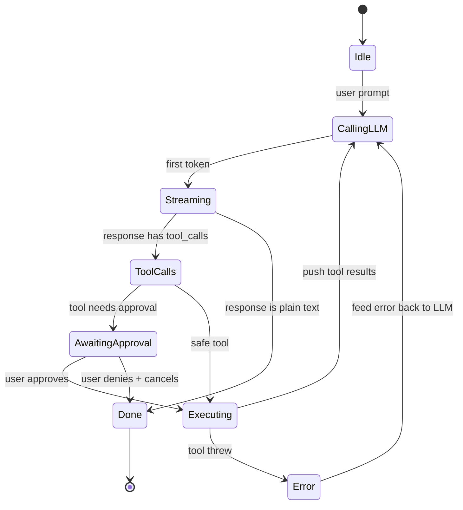
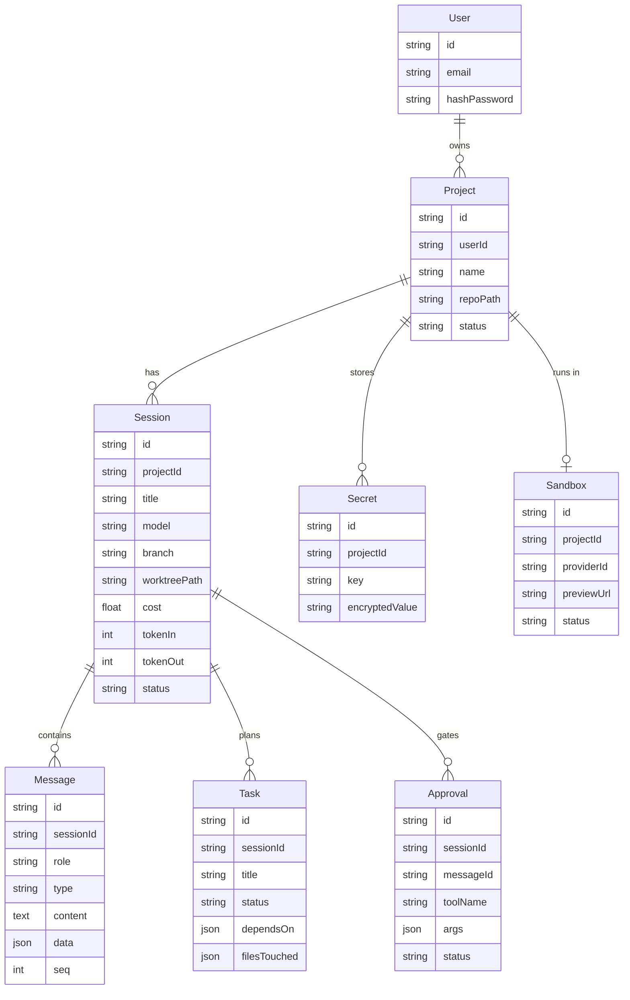
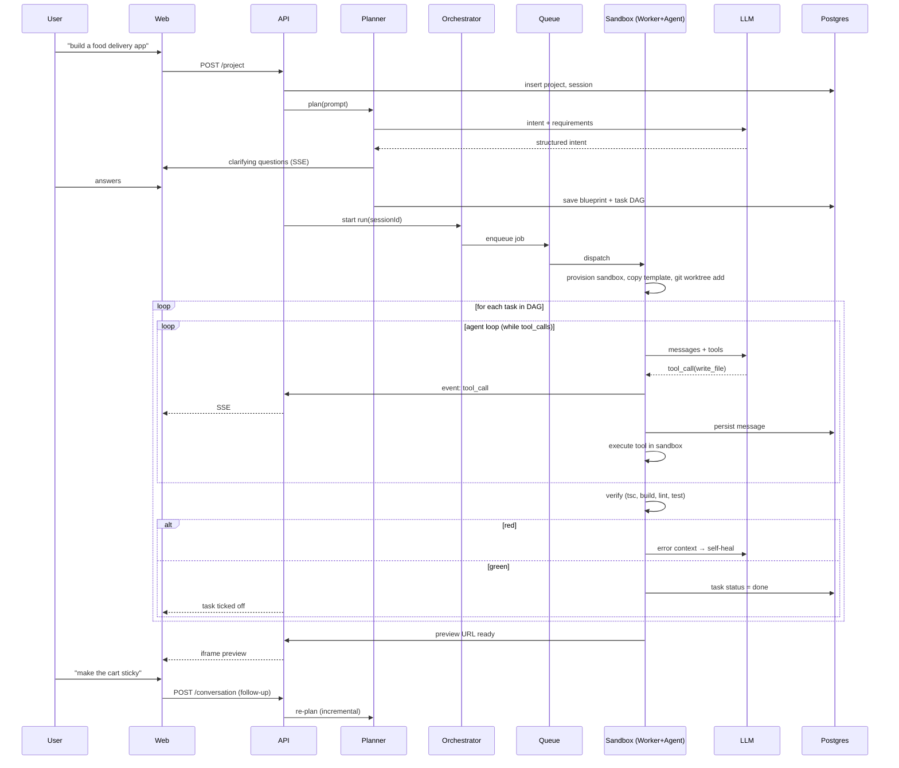

# Devian — Architecture

> **What we are building:** an AI app builder in the shape of **Emergent / Lovable** —
> a user types *"build me a food delivery app"*, a planner turns that into requirements +
> architecture + a task list, a coding agent executes those tasks inside an **isolated cloud
> sandbox**, the user watches a live preview, reviews, iterates, and deploys.
>
> Source material: the `Coding agents + cloud` deck (100xdevs) + the cloud/planner extension.
> This document is the single architectural reference. Version plan lives in
> [VERSIONS.md](./VERSIONS.md), per-version TODOs in [versions/](./versions/),
> the learning curve in [LEARNING_PATH.md](./LEARNING_PATH.md).

---

## Table of contents

1. [The product in one picture](#1-the-product-in-one-picture)
2. [Where the repo actually is today](#2-where-the-repo-actually-is-today)
3. [Layer 0 — The agent loop](#3-layer-0--the-agent-loop)
4. [Layer 1 — Persistence + web app](#4-layer-1--persistence--web-app)
5. [Layer 2 — Isolation & control (worktrees, approvals)](#5-layer-2--isolation--control)
6. [Track B — Remote control & handoff (deferred)](#6-track-b--remote-control--handoff-deferred)
7. [Layer 3 — The cloud pivot](#7-layer-3--the-cloud-pivot)
8. [Layer 4 — The App Builder / Planner](#8-layer-4--the-app-builder--planner)
9. [Full target architecture](#9-full-target-architecture)
10. [Component responsibility map](#10-component-responsibility-map)
11. [Data model](#11-data-model)
12. [End-to-end sequence](#12-end-to-end-sequence)
13. [Deviations from the deck (and why)](#13-deviations-from-the-deck-and-why)
14. [Open questions](#14-open-questions)

---

## 1. The product in one picture

```
                         USER
                          │  "Build me a food delivery app"
                          ▼
                   ┌─────────────┐
                   │ Web / Mobile│
                   └──────┬──────┘
                          │ https
                          ▼
                   ┌─────────────┐
                   │ API Gateway │  auth, rate limits, routing
                   └──────┬──────┘
                          ▼
                   ┌─────────────┐        ┌──────────┐
                   │  PLANNER    │───────►│ Postgres │
                   │ requirements│        └──────────┘
                   │ architecture│
                   │ tasks + deps│
                   └──────┬──────┘
                          ▼
                   ┌─────────────┐        ┌──────────┐
                   │ ORCHESTRATOR│───────►│  Queue   │
                   └──────┬──────┘        └────┬─────┘
                          │                    ▼
                          │            ┌───────────────┐
                          └───────────►│ Sandbox Mgr   │
                                       └───────┬───────┘
                        ┌──────────────────────┼──────────────────────┐
                        ▼                      ▼                      ▼
                  ┌───────────┐          ┌───────────┐          ┌───────────┐
                  │ Sandbox A │          │ Sandbox B │          │ Sandbox C │
                  │ ┌───────┐ │          │ ┌───────┐ │          │ ┌───────┐ │
                  │ │ AGENT │ │          │ │ AGENT │ │          │ │ AGENT │ │
                  │ └───┬───┘ │          │ └───────┘ │          │ └───────┘ │
                  │  ┌──┼──┐  │          └───────────┘          └───────────┘
                  │  ▼  ▼  ▼  │
                  │ Files Bash│
                  │    Git    │
                  │     │     │
                  │  PROJECT  │  Next.js · Backend · DB · Auth · Tests
                  └─────┬─────┘
                        ▼
                    PREVIEW URL
                        ▼
                  USER REVIEWS ──► agent continues ──► DEPLOY
```

**The one sentence that defines the whole architecture:**
> The agent does **not** run on the user's machine and does **not** run inside our API server.
> It runs inside a **disposable, isolated sandbox**, one per project, and everything else in the
> system exists to schedule, observe, and persist what happens in there.

---

## 2. Where the repo actually is today

An honest audit — the docs were describing a system that is no longer on disk.

```
devian/
├── services/                     ← deployable units
│   ├── web/          TS   React + Vite   ── still the Vite starter (App.tsx untouched)
│   ├── api/          TS   Express        ── src/index.ts is 5 lines (stub)
│   ├── agent/        PY   FastAPI        ── scaffolded 2026-08-10, no loop yet  ◄ V0
│   └── orchestrator/ TS   —              ── empty. V3 fills it in
├── libs/                         ← importable code
│   ├── py/
│   │   ├── agent_core/    the loop, Message/AgentEvent types, providers   ◄ V0
│   │   └── tools/         fs, bash, grep, git + the path fence            ◄ V0
│   └── ts/
│       ├── contracts/     Zod schemas + projectFiles.ts ── workspaceRoot(projectId)
│       │                  + safeResolve(projectId, path) — already correct, reuse it
│       ├── db/            Prisma + POSTGRES ── User, Project, ConversationHistory, Secret
│       └── ui/ config/ eslint-config/ typescript-config/
├── templates/
│   └── vite-react/       the pristine starter the agent copies per project
├── ref-ai/packages/           TypeScript reference agent (agentLoop.ts) — READ-ONLY reference
├── docs/                 ← you are here
├── docker-compose.yml    runs the stack (D11)
├── Makefile              the command surface (D11)
├── pyproject.toml        uv workspace root
└── package.json          bun workspaces (TS only)

  DELETED 2026-08-10:  apps/opencode/ · apps/agent-engine/ · apps/worker/
                       script/reset-project.mjs · turbo.json
```

**Critical fact:** `apps/opencode/` — which contained the *working* TypeScript agent loop
(`agentLoop.ts`, tools, subagents) — has been **deleted** from the working tree. The only
surviving agent-loop reference is `ref-ai/packages/`, and it is TypeScript while the engine is now
Python ([D4](./DECISIONS.md)) — so V0 ports its **structure**, not its code.

**So the true starting position is:**

| Thing | Status |
|---|---|
| Agent loop | ❌ gone. Python package scaffolded, empty. Reference in `ref-ai/packages` |
| API | 🟡 stub |
| Orchestrator | ❌ empty (V3) |
| DB schema | 🟡 exists, but modelled for the *old* shape (no Session, no worktree, no sandbox) |
| Web UI | ❌ Vite starter |
| Sandboxing | ❌ nothing |
| Planner | ❌ nothing |

This is close to greenfield with a very good map. **V0 starts by writing the agent loop.**

---

## 3. Layer 0 — The agent loop

### 3.1 What we have conceptually

```
Terminal/CLI  ──►  Backend  ──►  LLM
     ▲                 │          │
     └─────────────────┴──────────┘
        request upgraded to an event stream
```

The client sends a prompt, the backend forwards it to the LLM, and tokens stream back over an
upgraded connection (SSE) so output appears as it is generated.

### 3.2 The tool-call handshake (the deck's code)

```js
let res = axios.post("/conversation", { prompt: "what is weather in delhi" });

if (res.toolCall && res.toolCall.name == "get_weather") {
  let weather = axios.get("api.weather.com/" + city);

  axios.post("/conversation", {
    prompts: [
      { message: "What is the weather in delhi" },
      res,
      { type: "toolCallResponse", toolCallId: res.toolCallId, message: weather }
    ]
  });
}
```

### 3.3 ⚠️ The bug in that code

> **Q: What if there is another tool call from the LLM here?**

The snippet handles exactly **one** tool call and then stops. Real coding agents chain many:
`read_file` → `grep` → `edit_file` → `bash` → `read_file` again. Each LLM response may contain
zero, one, or several tool calls, and the conversation only ends when the model returns a
message with **no** tool calls.

> **A: tool handling is a `while` loop, not an `if`.**

Our engine is Python ([D4](./DECISIONS.md#decision-4-python-for-the-agent-engine--active-confirms-d1)),
so the shape we actually build is:

```python
messages: list[Message] = [Message(role="user", content=prompt)]

while True:
    res = await provider.stream(messages, tools)   # tokens stream out as they arrive
    messages.append(res)
    await emit(assistant_event(res))               # → SSE → the TS API → browser

    if not res.tool_calls:                         # final answer → done
        break

    # independent calls can run in parallel; dependent ones must be sequential
    for call in res.tool_calls:
        result = await tools[call.name].execute(call.args)
        messages.append(Message(
            role="tool", type="tool_response",
            tool_call_id=call.id, content=result,
        ))
        await emit(tool_result_event(call, result))
```

Note what the loop does **not** do: it never writes to the database. Persistence is the API's job
(`services/api`), reached through `emit`. The loop stays a pure function of its inputs, which is
what lets V1 reuse it unchanged and V3 move it inside a sandbox.

### 3.4 The loop as a state machine



### 3.5 Loop concerns that bite in production

| Concern | What goes wrong | Handling |
|---|---|---|
| **Token truncation** | Response stops mid-tool-call; JSON args are unparseable | Detect `finish_reason: length`, retry or ask the model to continue |
| **Infinite loops** | Agent reads the same file 40 times | Max-iteration budget + repeated-call detection |
| **Parallel tools** | `Promise.all` on tool calls that depend on each other → race | Only parallelise read-only tools; writes stay sequential |
| **Context overflow** | History outgrows the window | Summarise/compact old turns; keep tool results truncated |
| **Provider drift** | OpenAI vs Anthropic vs Gemini tool-call shapes differ | Provider abstraction layer — normalise to one internal `Message` type |

`ref-ai/packages/agent/src/agent-loop.ts` already solves streaming (`AgentEventSink`), multi-provider,
truncation, and parallel-vs-sequential tool execution. **Port it, don't reinvent it.**

---

## 4. Layer 1 — Persistence + web app

Goal: drive the agent from a browser instead of a terminal, with history that survives a refresh.

### 4.1 Topology

```
┌──────────┐        ┌──────────┐        ┌──────────┐
│ Website  │ ─────► │ Backend  │ ─────► │ Database │
└──────────┘        └────┬─────┘        └──────────┘
                         │  ▲
                         ▼  │
                    ┌──────────┐
                    │   LLM    │
                    └──────────┘
```

The website is a **thin client**. All agent state lives in backend + DB, never in the browser —
that is precisely what makes history, resume, multi-device, and handoff possible later.

### 4.2 The schema from the deck

```
Projects                         Session
┌──────────────────┐             ┌───────────────────────────────┐
│ id               │   1:many    │ id                            │
│ path             │ ──────────► │ project_id                    │
│ name             │             │ title                         │
└──────────────────┘             │ model                         │
                                 │ cost                          │
                                 │ token_in                      │
                                 │ token_out                     │
                                 └──────────────┬────────────────┘
                                                │ 1:many
                                                ▼
                                 Messages
                                 ┌───────────────────────────────────────┐
                                 │ id                                    │
                                 │ session_id                            │
                                 │ content      "hi there"               │
                                 │ role         user│assistant│tool      │
                                 │ type         text│toolCall│toolResp   │
                                 │ data         {}   (JSON blob)         │
                                 └───────────────────────────────────────┘
```

Why each field earns its place:

- `Projects.path` — the directory the agent operates in. Becomes the git-worktree anchor in V2,
  and the sandbox mount point in V3.
- `Session.model` — model is **per session** and changeable mid-session (hence `PUT /session`).
- `Session.cost / token_in / token_out` — usage accounting rolled up per session. Add this on
  day one; retrofitting billing telemetry is miserable.
- `Messages.type` + `Messages.data` — one table stores text, tool calls, and tool results.
  `data` holds the structured payload (tool name, args, `toolCallId`, diff, exit code).

### 4.3 Backend routes

```
POST /project                    create a project (register a path / repo)
GET  /projects                   list projects
POST /session                    start a session inside a project
PUT  /session                    change the model for a session
GET  /session/:sessionId         session metadata (model, cost, tokens)
GET  /conversations/:sessionId   full message history

POST /conversation               ← the agent turn. long-lived. streaming.
```

The first six are boring CRUD. **`POST /conversation` is the entire product.**

### 4.4 The `/conversation` flow, step by step

**Step 1 — website sends the prompt, backend persists it**

```
Website ──/conversation──► Backend ──► Database        (persist user message)
```

**Step 2 — backend calls the LLM**

```
                            ┌─────┐
                      ┌────►│ LLM │
Website ─────────► Backend  └─────┘
```

**Step 3 — LLM responds with a tool call: `read_file`**

```
                            ┌─────┐
                            │ LLM │
Website ─────────► Backend ◄───┴──   read_file
                      │
                      └────► Database        (persist toolCall)
```

**Step 4 — backend executes the tool, returns `file_contents` to the LLM**

```
                            ┌─────┐
                      ┌────►│ LLM │   file_contents
Website ─────────► Backend  └─────┘
```

**Step 5 — LLM returns the final answer**

```
                            ┌─────┐
                            │ LLM │
Website ◄────────  Backend ◄───┴──   answer
                      │
                      └────► Database        (persist answer)
```

Steps 3–4 repeat for as long as the model keeps emitting tool calls — that is the `while` loop
from §3. The website receives all of it as a **stream of events**, so the user watches tools
execute in real time instead of staring at a spinner for 60 seconds.

### 4.5 Which DB?

The deck's answer:

| Option | Deck verdict |
|---|---|
| MongoDB | ✗ |
| Postgres | ✗ |
| **SQLite** | ✅ |

**SQLite** is a lightweight, self-contained database engine, different from MySQL/Postgres:

1. **Serverless** — no separate server process. The engine runs *inside* your application,
   reading and writing directly to a file on disk.
2. **Zero-configuration** — no setup, no admin, no user accounts.
3. **Single-file storage** — the entire database (tables, indexes, everything) is one ordinary
   file, trivially easy to copy, move, or back up.
4. **Self-contained** — a small C library with almost no external dependencies.

**Why the deck is right *for its product*:** a local coding agent is single-user and
single-writer, the data is inherently per-machine, and shipping a desktop app that also demands
"install Postgres first" is a non-starter. One file = the user's whole agent history.

**Why we do NOT follow it:** see [§13](#13-deviations-from-the-deck-and-why). We are building a
**hosted multi-tenant** product; `libs/ts/db` is already Prisma + Postgres. SQLite's single-writer
model is a hard blocker the moment two API instances exist.

---

## 5. Layer 2 — Isolation & control

Even with the web UI working, two things are missing: **git worktrees** and **approvals**.

### 5.1 Git worktrees

> **Q. What does `git checkout -b branch_name` do?**
> **A.** Checks out the current branch to a new branch — **in place**. One working directory,
> one branch at a time. Two agents cannot work at once; switching branches yanks the files out
> from under a running agent.

> **Q. What does `git worktree add ../task1 -b agent/task1 main` do?**

It creates a **second physical directory** on disk, checked out to a **new branch** `agent/task1`
branched from `main`, sharing the same `.git` object store:

```
Mac machine / sandbox
┌───────────────────────────────────────────────────┐
│                                                   │
│    📁 todo-app                📁 task1            │
│    main branch                agent/task1         │
│    (you)                      (the agent)         │
│                                                   │
│         └────── shared .git object store ─────┘   │
└───────────────────────────────────────────────────┘
```

> **Q. What does `cd todo_app && git merge agent/task1` do?**
> **A.** Merges it back to main.

**Lifecycle per agent task:**

```
1. git worktree add ../task-N -b agent/task-N main   ← isolate
2. agent works and commits inside ../task-N          ← work
3. user reviews the diff in the web UI               ← review
4. cd main-repo && git merge agent/task-N            ← integrate
5. git worktree remove ../task-N                     ← clean up
```

**This maps straight onto the schema:** one **Session** ≈ one **worktree** ≈ one **branch**.
That equivalence is why `Session` is a first-class table and not just a chat thread.

### 5.2 Approvals

Before running a destructive tool (`bash`, `write_file`, `git push`), the agent should pause and
ask. Mechanically this means **the loop must be able to suspend mid-stream**:

```
        LLM emits tool call
                │
                ▼
     ┌──────────────────────┐
     │ needs approval?      │
     └───┬──────────────┬───┘
         │ no           │ yes
         ▼              ▼
    execute      persist Messages row (type=toolCall, status=pending)
         │              │
         │              ▼
         │       emit approval_request event down the stream
         │              │
         │              ▼
         │       ⏸  wait for approve/deny from ANY connected surface
         │              │
         │       ┌──────┴──────┐
         │       ▼             ▼
         │   approve         deny
         │       │             │
         └───────┴─────────────┴──► push result into messages, resume loop
```

The state must live in the **DB**, not in an in-memory promise — otherwise a server restart, or
approving from a different device than the one that asked, breaks the flow.

Permission modes worth supporting (mirrors the reference tools): `default` (ask on writes/bash),
`accept-edits` (auto-approve file writes, ask on bash), `bypass` (approve everything —
appropriate *only* inside a sandbox), `plan` (read-only, no writes at all).

---

## 6. Track B — Remote control & handoff (deferred)

The deck's milestones 2 and 3. **Excellent to understand, not on our critical path** — see the
reasoning at the end of this section.

### 6.1 The problem

Your agent, with full filesystem access, runs on **your Mac**. You want to drive it from the web
or your phone while you are away. But **your machine is not addressable from the internet**:
behind NAT, no public IP, no open inbound ports.

### 6.2 Do we need another service? Yes — a **Bridge**

```
┌──────────┐                    ┌──────────┐
│ Website  │──https──┐          │   LLM    │
└──────────┘         │          └────┬─────┘
                     │             ▲ │ answer
                     │             │ ▼
                     │        ┌──────────┐      ┌──────────┐
                     │        │ Backend  │─────►│ Database │
                     │        └──────────┘      └──────────┘
                     ▼
┌──────────┐     ┌────────┐
│ Local mac│─ws─►│ Bridge │
└──────────┘     └────────┘
```

### 6.3 Which protocol?

| Link | Protocol | Why |
|---|---|---|
| Website → Bridge | **HTTPS** | Browser initiates; plain request/response is enough |
| Local Mac → Bridge | **WebSocket** | The machine must hold a **persistent, outbound-initiated** connection. Outbound traverses NAT/firewalls; inbound does not. The bridge then pushes commands down the socket whenever it likes |

**The key insight: the local machine always dials out.** The bridge never has to reach *in*.

An alternative used by shipped products is **HTTPS long-polling + SSE** instead of WebSockets:
higher latency, but far more survivable through corporate proxies and middleboxes that mangle
WS upgrades. Both are valid; `ws` is simpler to reason about, polling is more robust.

### 6.4 Auth — the part you cannot skip

> **a. Only I should be able to access my remote control.**

The bridge must bind a **device to an account**, not merely trust a session id. Without that,
anyone who guesses your endpoint gets a shell on your Mac. (The reference CLI literally warns
`SERVER_PASSWORD is not set; server is unsecured` for exactly this reason.)

> **b. How does a CLI sign in via a browser?**

The standard shape (OAuth device/loopback flow):

```
1. CLI starts a listener on http://localhost:PORT/callback
2. CLI opens the browser to  https://app/auth?redirect=localhost:PORT&state=XYZ
3. User authenticates in the browser (they already have a session there)
4. Browser redirects to localhost:PORT/callback?code=ABC&state=XYZ
5. CLI verifies `state`, exchanges `code` for a long-lived token over HTTPS
6. Token stored in the OS keychain / ~/.config
```

`state` prevents CSRF; the code is short-lived and single-use; the token never travels through
the URL bar. Replicate this rather than inventing something.

### 6.5 Handoff

Start in the terminal, continue in the browser, approve a tool call from your phone, finish in
the terminal. This is **almost free** if Layers 1–2 are built correctly, because:

- All state already lives in the DB, not in any client (§4.1)
- Every message — including tool calls and results — is persisted (§4.2)
- Every surface already talks to the same backend

Handoff then reduces to: *given a `sessionId`, any authenticated client attaches to the live
event stream and replays history from `GET /conversations/:sessionId`.*

### 6.6 Why this is deferred for us

In the Emergent-shaped product the agent runs in **our cloud**, not on the user's laptop. Our
sandboxes *are* addressable — they are ours. So the Bridge solves a problem we do not have.

It becomes valuable later as a **"local mode / bring-your-own-machine"** feature (run the agent
against a private repo that must never leave the user's machine). Parked as **Track B**, after V4.

---

## 7. Layer 3 — The cloud pivot

This is the difference between "a coding agent" and "a product".

### 7.1 Local model vs cloud model

```
        LOCAL (deck, V0–V2)                     CLOUD (us, V3+)
┌─────────────────────────────┐        ┌─────────────────────────────┐
│ Backend process             │        │ Backend / API               │
│   └── agent loop            │        │   (never executes anything) │
│         └── fs / bash       │        └────────────┬────────────────┘
│               └── YOUR disk │                     │ enqueue job
└─────────────────────────────┘                     ▼
                                             ┌─────────────┐
  ✗ agent crash = API crash                  │    Queue    │
  ✗ `rm -rf /` hits your machine             └──────┬──────┘
  ✗ one machine = one concurrent build              ▼
  ✗ no per-user isolation                    ┌─────────────┐
                                             │ Sandbox Mgr │
                                             └──────┬──────┘
                                        ┌───────────┼───────────┐
                                        ▼           ▼           ▼
                                    Sandbox A   Sandbox B   Sandbox C
                                     (agent)     (agent)     (agent)
```

### 7.2 The cloud-agent architecture

```
                     USER
                       │
                       ▼
                  Web / Mobile
                       │
                       ▼
                 API / Gateway          auth · rate limit · routing
                       │
                       ▼
                 Orchestrator           owns job lifecycle & state machine
                       │
             ┌─────────┴─────────┐
             ▼                   ▼
          Database              Queue
                                 │
                                 ▼
                          Sandbox Manager    provision · warm pool · reap
                                 │
                    ┌────────────┼────────────┐
                    ▼            ▼            ▼
                Sandbox A    Sandbox B    Sandbox C
                    │            │            │
                  Agent        Agent        Agent
                    │            │            │
              ┌─────┼─────┐      │            │
              ▼     ▼     ▼      │            │
            Files  Bash  Git     │            │
                    │            │            │
                    ▼            ▼            ▼
                 Project      Project      Project
```

**Now the agent itself runs inside the cloud sandbox. That's the key difference.**

### 7.3 What each new box is for

| Box | Responsibility | Why it must exist separately |
|---|---|---|
| **API / Gateway** | AuthN/Z, validation, rate limiting, streaming to clients | Must stay responsive; it is the only public surface |
| **Orchestrator** | Job state machine: queued → provisioning → running → awaiting-approval → done/failed. Retries, timeouts, cancellation | Agent runs are long (minutes) and failure-prone; that lifecycle needs an owner |
| **Queue** | Decouples request rate from execution capacity; back-pressure | 100 users clicking "build" must not mean 100 simultaneous sandboxes |
| **Sandbox Manager** | Provision/destroy sandboxes, warm pool, resource limits, snapshot/restore of the project filesystem | Cold-boot is the biggest latency cost; pooling is the fix |
| **Sandbox** | Untrusted execution: agent + fs + bash + git + dev server | LLM-authored `bash` is arbitrary code execution by definition |
| **Worker** | Long-running process that drives one agent session inside a sandbox and streams events out | Keeps the loop out of the request/response cycle |

### 7.4 Sandbox non-negotiables

- **Network egress policy** — the agent needs npm/pip; it does not need your internal network.
- **No production credentials inside.** Ever. The sandbox proxies through a service that holds
  the secrets; the sandbox holds a scoped, short-lived token at most.
- **CPU / memory / disk / wall-clock caps** with hard kill.
- **Ephemeral by default** — the durable artifacts are the git repo and object storage, not
  the container's disk.
- **Preview served from the sandbox** (`https://preview-<id>.ourdomain`), never `localhost`.

Candidate providers: **E2B** (built for exactly this), Firecracker microVMs, Fly Machines,
gVisor-hardened containers, Modal. E2B is the fastest path; the interface should be behind a
`SandboxProvider` port so it can be swapped.

### 7.5 Streaming through the layers

The user must see tokens and tool calls in real time even though execution is three hops away:

```
Sandbox(agent) ──events──► Worker ──pub/sub──► API ──SSE/WS──► Browser
                              │
                              └──batched writes──► Postgres  (durable history)
```

Two channels on purpose: a **hot path** for latency and a **durable path** for replay. On
reconnect the client replays from Postgres, then re-attaches to the live stream by sequence
number.

---

## 8. Layer 4 — The App Builder / Planner

The Emergent/Lovable layer. Everything below the Planner is "a coding agent"; the Planner is
what makes it "an app builder".

```
User
 │  "Build me a food delivery app"
 ▼
Planner
 ├── Requirements        who are the users, what must the app do
 ├── Architecture        stack, pages, data model, services  (FROZEN once decided)
 ├── Tasks               ordered, individually verifiable units of work
 └── Dependencies        task DAG — what blocks what
 │
 ▼
Cloud Agent              executes tasks one at a time
 │
 ▼
Sandbox
 ├── Next.js
 ├── Backend
 ├── Database
 ├── Auth
 └── Tests
 │
 ▼
Preview                  live URL, HMR
 │
 ▼
User reviews
 │
 ▼
Agent continues          follow-up prompts re-enter the planner, not the raw agent
 │
 ▼
Deploy
```

### 8.1 Why a planner instead of "just prompt the agent harder"

| Without a planner | With a planner |
|---|---|
| One giant prompt → the model improvises architecture mid-file | Architecture is decided once, frozen, then referenced |
| No progress to show — a spinner for 3 minutes | A visible task list ticking off, one by one |
| A failure kills the whole run | A failure kills **one task**; retry just that task |
| Cannot resume | Task DAG state is in the DB; resume from the last green task |
| Non-deterministic and unrepeatable | The plan is an inspectable **artifact** you can diff, cache, and replay |

**The core thesis:** push intelligence *out* of the LLM into deterministic engines. The LLM does
intent classification, clarifying questions, and app-specific code generation. Everything else —
selecting a stack, choosing components, composing the workspace — is code, not a prompt.

### 8.2 The planner pipeline

```
  ┌──────────────────────┐
  │ Intent Understanding │  LLM   {project, industry, users, complexity}
  └──────────┬───────────┘
             ▼
  ┌──────────────────────┐
  │ Requirement Engine   │  DET   infer needs: auth? payments? realtime? dashboard?
  └──────────┬───────────┘
             ▼
  ┌──────────────────────┐
  │ Adaptive Questions   │  LLM   ask ONLY the low-confidence ones (2–3 max)
  └──────────┬───────────┘
             ▼
  ┌──────────────────────┐
  │ Architecture Decision│  DET   freeze the stack. No downstream step may override it.
  └──────────┬───────────┘
             ▼
  ┌══════════════════════┐
  ║   BLUEPRINT (JSON)   ║  ← the IR. Inspectable BEFORE any code is written.
  └══════════┬═══════════┘
             ▼
  ┌──────────────────────┐
  │ Task Graph Builder   │  DET   blueprint → ordered task DAG with dependencies
  └──────────┬───────────┘
             ▼
  ┌──────────────────────┐
  │ Workspace Composer   │  DET   copy template + theme + selected blocks (NO AI yet)
  └──────────┬───────────┘
             ▼
  ┌──────────────────────┐
  │ Generation Agent     │  LLM   app-specific code ONLY, one task at a time
  └──────────┬───────────┘
             ▼
  ┌──────────────────────┐
  │ Verification Engine  │  DET   tsc → build → lint → tests → runtime smoke
  └──────────┬───────────┘
             ▼
        Preview + HMR
```

`DET` = deterministic code. `LLM` = a model call. **The ratio of DET to LLM is the moat.**

### 8.3 The task DAG

```
                    ┌──────────────┐
                    │ T1  scaffold │
                    └──────┬───────┘
              ┌────────────┼────────────┐
              ▼            ▼            ▼
        ┌──────────┐ ┌──────────┐ ┌──────────┐
        │T2 schema │ │T3 theme  │ │T4 layout │     ← parallelisable
        └────┬─────┘ └────┬─────┘ └────┬─────┘
             ▼            │            │
        ┌──────────┐      │            │
        │T5 api    │      │            │
        └────┬─────┘      │            │
             └────────────┼────────────┘
                          ▼
                   ┌─────────────┐
                   │ T6  pages   │
                   └──────┬──────┘
                          ▼
                   ┌─────────────┐
                   │ T7  auth    │
                   └──────┬──────┘
                          ▼
                   ┌─────────────┐
                   │ T8  tests   │
                   └─────────────┘
```

Each node has: `id, title, description, dependsOn[], status, filesTouched[], verification`.
Status is persisted, so a crash resumes at the first non-green node instead of restarting.

### 8.4 Verification — never trust generated code

After **every** task, inside the sandbox:

```
tsc --noEmit  →  build  →  lint  →  unit tests  →  boot dev server  →  hit /
     │              │        │           │                │
     └──────────────┴────────┴───────────┴────────────────┘
                            │
                    any red → structured error
                            │
                            ▼
                    Self-heal loop: classify → fix → re-verify
                    (bounded retry budget, loop detection)
```

A generated app that compiles is the minimum bar. Verification is what turns a demo into a
product.

---

## 9. Full target architecture

```
   ┌────────────┐   ┌────────────┐   ┌────────────┐
   │  Web app   │   │  Mobile    │   │    CLI     │
   └─────┬──────┘   └─────┬──────┘   └─────┬──────┘
         │  https/SSE     │                │
         └────────────────┼────────────────┘
                          ▼
                  ┌───────────────┐
                  │  API Gateway  │   authn/z · validation · rate limit · stream fan-out
                  └───────┬───────┘
                          ▼
                  ┌───────────────┐        ┌──────────────┐
                  │   Planner     │───────►│              │
                  └───────┬───────┘        │   Postgres   │
                          ▼                │              │
                  ┌───────────────┐        │ users        │
                  │ Orchestrator  │◄──────►│ projects     │
                  └───────┬───────┘        │ sessions     │
                          │                │ messages     │
                          ▼                │ tasks        │
                  ┌───────────────┐        │ approvals    │
                  │     Queue     │        └──────────────┘
                  └───────┬───────┘
                          ▼
                  ┌───────────────┐        ┌──────────────┐
                  │ Sandbox Mgr   │───────►│ Object store │  snapshots · artifacts
                  └───────┬───────┘        └──────────────┘
        ┌─────────────────┼─────────────────┐
        ▼                 ▼                 ▼
  ┌───────────┐     ┌───────────┐     ┌───────────┐
  │ Sandbox A │     │ Sandbox B │     │ Sandbox C │
  │           │     │           │     │           │
  │  Worker   │     │  Worker   │     │  Worker   │
  │    │      │     └───────────┘     └───────────┘
  │    ▼      │
  │  Agent ───┼──► LLM providers (OpenAI · Anthropic · Gemini)
  │    │      │
  │  ┌─┴──┐   │
  │  │fs  │   │  worktree: ../task-N on branch agent/task-N
  │  │bash│   │
  │  │git │   │
  │  └────┘   │
  │    │      │
  │  dev srv ─┼──► https://preview-<id>.ourdomain
  └───────────┘

  ─ ─ ─ ─ ─ ─ ─ ─ ─ ─ ─ ─  TRACK B (deferred)  ─ ─ ─ ─ ─ ─ ─ ─ ─ ─ ─ ─
  ┌───────────┐      ws      ┌────────┐
  │ Local Mac │◄────────────►│ Bridge │◄──── API Gateway
  └───────────┘              └────────┘
```

---

## 10. Component responsibility map

Mapping the architecture onto real directories in this repo.

| Component | Directory | Lang | Status | Responsibility |
|---|---|---|---|---|
| Web app | `services/web` | TS | 🟡 starter | Project list, session view, chat, diff pane, preview iframe |
| API / Gateway | `services/api` | TS | 🟡 stub | REST + SSE, auth, validation, persistence. **Never executes agent code** |
| Agent service | `services/agent` | **PY** | 🟡 scaffold | HTTP/SSE wrapper around the loop. Plays the worker role from V3 |
| Agent engine | `libs/py/agent_core` | **PY** | ❌ | The loop, `Message`/`AgentEvent` types, providers. V0 |
| Tools | `libs/py/tools` | **PY** | ❌ | fs · bash · grep · git · the path fence. V0 |
| Orchestrator | `services/orchestrator` | TS | ❌ empty | Job state machine, queue producer, sandbox lifecycle. V3 |
| Planner | *(to create)* `libs/py/planner` | **PY** | ❌ | Intent → blueprint → task DAG. V4 |
| Sandbox provider | *(to create)* `libs/py/sandbox` | **PY** | ❌ | `SandboxProvider` port + E2B/local adapters. V3 |
| DB | `libs/ts/db` | TS | 🟡 wrong shape | Prisma + Postgres; needs Session/Task/Approval models |
| Contracts | `libs/ts/contracts` | TS | 🟡 partial | Zod for HTTP; **generated** agent-event types (D10). `projectFiles.ts` is ✅ — reuse it |
| Template | `templates/vite-react` | — | ✅ | Pristine starter copied into each new project |

### The language boundary

```
   Browser ──SSE──► services/api  (TS)  ──HTTP/SSE──►  services/agent  (PY)
                          │                                   │
                          ▼                                   ▼
                     Postgres                            agent_core.run_agent_loop
                     (persistence)                            │
                                                              ▼
                                                        devian_tools → workspace files
```

**The API owns state; the agent owns execution.** The API never runs a loop; the agent never
touches Postgres. Events cross as JSON, typed by the Pydantic models the agent already uses
([D10](./DECISIONS.md#decision-10-pydantic-is-the-source-of-truth-for-cross-language-types--active)).

Both sides need the same idea of "a workspace". `libs/ts/contracts/src/utils/projectFiles.ts`
(reads the file tree for the UI) and `libs/py/tools/fence.py` (writes files for the agent) must
agree on `workspaceRoot(id)` and the path-escape rule. That shared definition is the one place
this split can silently break.

---

## 11. Data model

Target schema (extends the deck's three tables with what cloud + planner require):



Notes:

- `Message.seq` — a monotonic per-session sequence number. Essential for resuming a stream
  ("send me everything after seq 412") and for ordering when writes are batched.
- `Session.branch` / `worktreePath` — the session↔worktree equivalence from §5.1.
- `Approval` is its own table, not a flag on `Message`: approvals are queried, expire, and are
  answered from a different device than the one that asked.
- `Sandbox.previewUrl` — what the UI iframes.

---

## 12. End-to-end sequence



---

## 13. Deviations from the deck (and why)

The deck builds a **local, single-user, terminal-first coding agent**. We are building a
**hosted, multi-tenant app builder**. Four deliberate divergences:

| # | Deck says | We do | Reason |
|---|---|---|---|
| 1 | **SQLite** | **Postgres** | Multi-tenant, multiple API instances, concurrent writers, row-level isolation between users, managed backups. SQLite has one writer and lives on one box — it cannot back a hosted product. `libs/ts/db` is already Postgres. *(SQLite stays correct for a local CLI mode — Track B.)* |
| 2 | Agent runs **on the user's machine** | Agent runs in a **cloud sandbox** | LLM-generated `bash` is arbitrary code execution. Also: the user's laptop being asleep must not stop a build, and we need N parallel builds |
| 3 | **Bridge + remote control** is milestone 2 | **Deferred to Track B** | The bridge exists to reach a machine we cannot address. Our sandboxes are ours — the problem does not exist. It returns as an optional "local mode" feature |
| 4 | Loop lives **in the backend** | Loop lives in a **worker inside the sandbox** | A 5-minute agent run must not occupy an HTTP handler; failures must not take down the API |

**What we take from the deck unchanged:** the `while`-not-`if` loop, the Projects/Session/Messages
shape, the route surface, streaming as the default UX, session≈worktree≈branch, and approvals
as a suspendable loop state.

---

## 14. Open questions

Not yet decided — each one changes what gets built.

1. **Sandbox provider** — E2B (fastest to ship, per-sandbox cost) vs Fly Machines vs raw
   Firecracker (cheapest at scale, weeks of work). *Recommendation: E2B behind a
   `SandboxProvider` port so it can be replaced without touching the agent.*
2. **Sandbox lifetime** — one long-lived sandbox per project (fast follow-ups, expensive idle)
   vs ephemeral per-run with filesystem snapshot restore (cheap, slower cold start). *Probably:
   ephemeral + warm pool + object-store snapshots.*
3. **Full-stack or frontend-only for V4?** The existing `ROADMAP.md` locks "frontend-only, mock
   data layer" for the MVP. Emergent is full-stack. Pick one and write it down — this decides
   how many generation agents exist.
4. **Blueprint vs freeform** — how rigid is the frozen architecture? Can a later task amend it,
   or does an amendment force a re-plan?
5. **Worktrees inside sandboxes** — if every session gets its own sandbox, is a worktree still
   needed, or is the sandbox itself the isolation? *(Worktrees still earn their place for
   diff/review/merge semantics and for multiple parallel tasks within one project.)*
6. **Secrets** — `.env` is gitignored, so a fresh worktree/sandbox has none. Who injects them,
   and how do we keep them out of LLM context? (`libs/ts/db` already has a `Secret` model.)
7. **Approval timeout** — what happens if nobody answers for an hour? Cancel, or park and resume?
8. **Cost control** — per-user token budgets, max tasks per plan, sandbox wall-clock caps. Cheap
   to add in V1 (`Session.cost` exists), painful to retrofit at V4.

---

*Next:* [VERSIONS.md](./VERSIONS.md) — the version ladder ·
[versions/](./versions/) — per-version TODOs ·
[LEARNING_PATH.md](./LEARNING_PATH.md) — what to learn, in order
