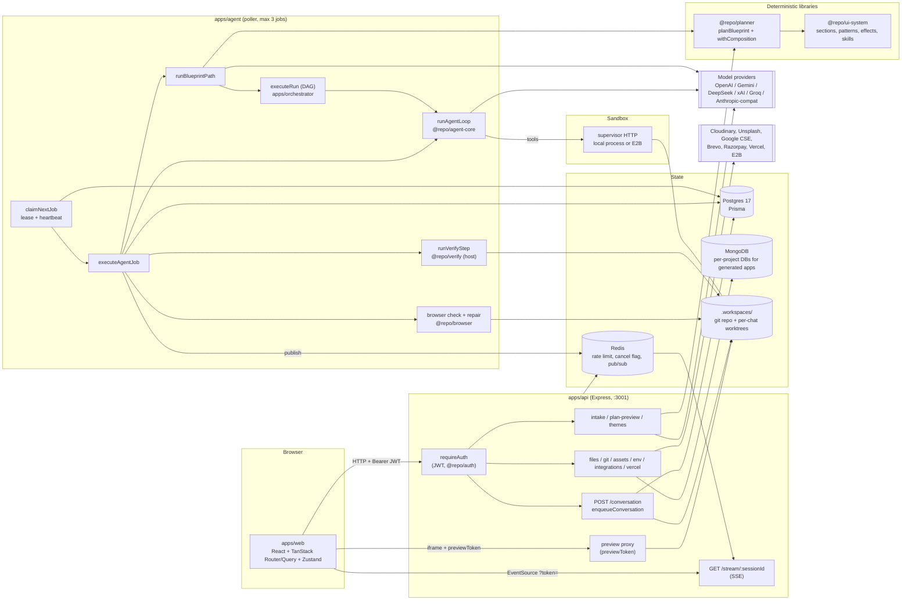

# Appwright: Architecture, Workflow and Risk Audit

Audit date: 2026-10-29. Branch `main`, HEAD `f72ad7b`. Read-only investigation: no code, config, database or Git state was changed, no tests or evals were run, no model calls were made, and no `.env` values were read (only variable names from `.env.example`).

**Update the same day (D86).** Prompt context was tightened after this audit. Section 1 item 1, section 4.2 step 9, section 7, the glossary, and recommendation 5 describe the code after that change. The rest of this file is the original read.

**Labels used throughout**

- **[V]** verified by reading the cited source.
- **[I]** reasonable inference from the cited source.
- **[?]** unknown or not traced; the section says how to confirm it.

**Name note.** The product is `Appwright` (repo directory, `package.json` name, `.env.example`). Some code and env vars still say `Appwrite` / `APPWRITE_*` (for example `APPWRITE_API_URL`, `APPWRITE_INTEGRATION_TOKEN`). They refer to the same system.

**Existing docs are partly stale.** `docs/ARCHITECTURE.md` section 2 describes a repo with an empty API and a deleted agent loop. That is no longer true. Treat `docs/DECISIONS.md` (D1 to D86) and `docs/INVARIANTS.md` as design intent, and the source as the truth. `docs/INVARIANTS.md` itself says its statuses are unverified unless marked ✅.

---

## 1. Executive summary

Appwright is an AI app builder in the Lovable/Emergent mould. A user types a prompt in a React web app. The API asks a few intake questions, optionally shows a plan preview and theme choices, then queues a job in Postgres. A separate agent-worker process claims the job, attaches a sandbox to a per-chat git worktree, and runs one of **three** generation paths:

| Path | When | What runs |
|---|---|---|
| **Direct agent loop** | The decision classifier says the request is not a detailed new build (follow-ups, edits, small asks) | One `runAgentLoop` with the full tool set, up to 3 verify-and-fix rounds |
| **Blueprint, single-pass** | Detailed plan, and the blueprint is a small static site (no DB, no auth/payments, no required admin, at most 4 pages) | Deterministic plan, then pattern delivery, then a `<build-brief>` appended to the conversation, then the same direct loop as above |
| **Blueprint, task-based** | Detailed plan, anything bigger | Plan persisted as a task DAG (`Blueprint`, `Task`), `Run`, an in-process scheduler runs up to 2 tasks in parallel, each in its own agent loop, with per-task verification and up to 3 attempts |

After generation, the host runs `tsc`/build/lint (`@repo/verify`). A passing result optionally triggers a Playwright browser check, a visual review, and at most one repair turn. The turn is then committed on the host and auto-merged to `main`. The user watches everything over Server-Sent Events fed by Redis pub/sub.

**What is strong.** Plan, section choice, pattern delivery and effect choice are deterministic code. Only the intent classifier, content generator, theme generator and the coding agent itself are model-driven. Guardrails are real: a run guard blocks imports of undeclared packages, the filesystem fence blocks path escapes, loop budgets are explicit, and the Postgres job queue uses `FOR UPDATE SKIP LOCKED` with leases.

**What needs attention** (details in section 14):

1. Three execution paths still differ, and D86 now records the prompt differences. Design skills and art-direction prose load only on a later task attempt after a non-verification failure. Project memory and chat history reach only the direct and single-pass paths. Only the task-based path has model fallback. Direct and single-pass runs still include the file tree and the reference section.
2. Planner-side model calls are not billed to user credits. Only agent-loop usage is.
3. The capacity and worktree-busy checks are check-then-act and count only `RUNNING` sessions, so queued jobs are invisible to them.
4. An approved plan can be silently dropped when the user chose "decide the design for me" and the classifier scores the request below the detail threshold.
5. `apps/orchestrator`'s dispatcher, queue, lease manager and state machine are not used by any production code path. Only its `executeRun` executor and run store are.
6. There is no CI configuration in the repo, and the end-to-end generation evals are manual and paid.

---

## 2. Repository map

Bun workspaces plus Turborepo (`package.json`, `turbo.json`). TypeScript throughout. About 3,380 tracked files, of which about 1,279 are `ref-ai/`.

### 2.1 Applications

| Path | Responsibility | Entry point | Talks to |
|---|---|---|---|
| `apps/web` | React 19 + Vite 8 + TanStack Router/Query + Zustand + Tailwind 4 SPA. Dashboard (`/`), project workspace (`/p/$projectId`), section catalog (`/sections`). Features under `src/features/*` (agent, plan, theme, preview, workspace, database, deployments, environment, logs, billing, visual-editor, section-catalog, and others) | `src/main.tsx`, `src/app/router/routes.tsx` | API over HTTP + SSE (`shared/lib/httpClient.ts`, `realtime/connectionManager.ts`) |
| `apps/api` | Express HTTP API. Auth wall, intake, plan preview, themes, conversation enqueue, SSE, files, git, preview proxy, assets, integrations, Vercel, environment, project DB | `src/index.ts` | Postgres (`@repo/db`), Redis (`@repo/cache`), model providers (intake/plan/themes), host filesystem worktrees |
| `apps/agent` | The worker process. Polls Postgres for jobs and runs `executeAgentJob`. Also a health server (port 3003 by default) | `src/index.ts`, `src/poller/poller.ts`, `src/worker/job-worker.ts` | Postgres, Redis, sandbox provider, model providers, Playwright, host worktree |
| `apps/orchestrator` | Library imported as `orchestrator` by `@repo/blueprint`. Provides `executeRun`, the DAG scheduler, retry loop and Prisma run store. Also contains a `Dispatcher`, `MemoryQueue`, `LeaseManager` and job state machine (see section 14, finding R5) | `src/index.ts`, `src/executor/execute-run.ts` | Postgres via `@repo/db` |

### 2.2 Packages

| Path | Responsibility | Key exports / entry points |
|---|---|---|
| `packages/contracts` | Zod schemas and shared constants: `Blueprint`, `SendMessageRequest`, `ThemeOption`, `AGENT_LOOP_LIMITS`, `ALLOWED_PACKAGES`, `projectFiles` (`safeResolve`, `workspaceRoot`, `writeProjectFile`) | `src/billing/limits.ts`, `deps.allow.json` |
| `packages/db` | Prisma schema (Postgres), job queue helpers, project-memory loader, secrets | `prisma/schema.prisma`, `src/lib/job-store.ts` |
| `packages/auth` | argon2id password hashing, 7-day bearer JWT, `requireAuth`, `requireAuthAllowingQueryToken` | `src/index.ts` |
| `packages/cache` | Redis wrapper: counters, cancel flag, pub/sub, `sessionChannel` | `src/pubsub`, `src/cancel-flag.ts` |
| `packages/agent-core` | The agent loop, `Provider` abstraction (`OpenAiProvider` speaking the chat-completions wire format to OpenAI, xAI, Groq, DeepSeek, Anthropic-compatible and Gemini-compatible hosts), model-per-plan resolution, system prompt builder, project memory, multimodal analysis, visual review | `src/loop.ts`, `src/prompt.ts`, `src/providers/*`, `prompts/system.md` |
| `packages/tools` | Agent tools (fs, bash, grep, git), path fence, **run guard** (blocks undeclared imports, blocks overwriting an unread file), turn commit/revert | `src/run-guard`, `src/fence.ts`, `src/turn-commit` |
| `packages/decision-engine` | Request classifier (`classify`), policy (`resolvePolicy`), `needsDetailedPlan`, verify-retry rule | `src/classify.ts`, `src/policy.ts` |
| `packages/planner` | Deterministic planning: needs detection, architecture decisions, requirement resolution, blueprint validation, **section composition**, task compilation, task graph validation, themes, intake question catalog | `src/plan/plan-blueprint.ts`, `src/compile`, `src/discovery`, `src/requirements` |
| `packages/blueprint` | Orchestrates planning with LLM calls (`buildBlueprint`), persists plans, loads approved plans, delivers patterns, builds task prompts and the single-pass brief, runs task generators, applies themes | `src/build-blueprint.ts`, `src/persist-blueprint.ts`, `src/run-task-generator.ts`, `src/execute-blueprint-run.ts`, `src/patterns`, `src/single-pass` |
| `packages/ui-system` | The design system: tokens, UI primitives (`components/`), pattern library (`patterns/`), section catalog and selection, composition, experience (effects) engine, design skills (`skills/*.md`) | `src/sections`, `src/patterns`, `patterns/*`, `bin/emit.ts` |
| `packages/sandbox` | Sandbox contract (HTTP routes), supervisor server, `LocalSandboxProvider`, `E2BSandboxProvider`, warm pool, `SandboxRuntime` | `src/providers/create-provider.ts`, `src/supervisor` |
| `packages/verify` | Host-side `tsc`, build, lint runners and error parsers | `src/runner.ts` |
| `packages/browser` | Playwright check: starts the app, visits routes at risk-scaled viewports, collects findings, live frames | `src/check/run-browser-check.ts` |
| `packages/assets`, `packages/media` | Asset slots/requests per blueprint; image providers (Gemini generation, Unsplash, Cloudinary, Google CSE, Wikimedia fallback) | `createAssetRequest`, `detectAssetSlots` |
| `packages/workspace` | Worktree path helpers (`sessionWorktreePath`, `worktreeSessionIdOf`, report paths) | |
| `packages/selection`, `packages/admin-crud`, `packages/events`, `packages/logger`, `packages/config` | Element-selection edits, generated admin CRUD, Kafka-style event helper, structured logger with `AsyncLocalStorage` trace context, config | |
| `packages/agent-evals` | Eval harness: agent-build cases, design eval, site eval matrix | `src/cli/main.ts`, `src/design/cli.ts`, `src/site/cli.ts` |
| `packages/eslint-config`, `packages/typescript-config` | Shared lint/TS config | |

### 2.3 Other top-level directories

| Path | Responsibility |
|---|---|
| `workers/{evaluation,indexing,ingestion,maintenance}` | Three-file skeletons that subscribe to event topics. `workers/evaluation/src/index.ts` is verified to log and do nothing (its own TODO says there is nothing to evaluate yet). The other three were not read **[?]** |
| `templates/vite-react`, `templates/nextjs-fullstack` | Pristine starters copied per project. Next.js is the target for sections and patterns (`isNextProject` checks for `next.config*`) |
| `infrastructure/` | `docker/{api,agent,orchestrator,web,workers}`, `compose/docker-compose.{dev,prod}.yml`, `k8s/` and `terraform/` (READMEs only, per file listing **[I]**) |
| `docker-compose.yml` | Local stack: Postgres 17, Mongo 7, Redis 8, plus an `api` service |
| `scripts/` | `bootstrap.ts`, `health-check.ts`, `seed.ts`, `agent.ts` (CLI agent) |
| `docs/` | Design intent: `ARCHITECTURE.md`, `DECISIONS.md` (2,830 lines), `INVARIANTS.md`, `EVALS.md`, `sessions/`, `versions/` |
| `ref-ai/` | Read-only reference copy of a third-party agent framework (about 1,279 files). The root `test` script excludes it. It is not part of the product |
| `.workspaces/` | Runtime directory (`WORKSPACE_ROOT`): generated projects and per-chat git worktrees. Gitignored |
| `.weave/`, `.claude/` | Tooling metadata. Not part of the runtime |

### 2.4 Dependency direction

`contracts ← db ← (planner, agent-core, tools, sandbox) ← blueprint ← apps/agent, apps/api`. `apps/web` imports no workspace packages by the evidence of its `package.json` greps **[I]**. It talks to the API over HTTP and validates responses with its own Zod schemas in `src/shared/schemas`.

---

## 3. System architecture

### 3.1 Diagram



### 3.2 Components: inputs, outputs, neighbours

| Component | Receives | Produces | Notes |
|---|---|---|---|
| **Web** | User actions; SSE frames; REST JSON | HTTP requests, EventSource | Stores the JWT in `localStorage` (`shared/lib/httpClient.ts`, key `appwright.token`) **[V]**. See R10 |
| **API** | HTTP; Redis messages | Postgres rows, a queued `Job`, SSE frames, proxied preview traffic | One auth wall (`app.use(requireAuth)` in `src/index.ts`) after the explicitly public routers (auth, Vercel callback, integration runtime, preview, stream) **[V]** |
| **Postgres** | Prisma writes from API, agent, blueprint, orchestrator | The only durable state besides git worktrees | Also the job queue |
| **Redis** | Counters, cancel flags, pub/sub frames | Fan-out to SSE connections | Rate limiting **fails open** when Redis is down (`conversationRateLimitOk`) **[V]** |
| **Agent worker** | `Job` rows | `Message` rows, `Blueprint`/`Task`/`Run` rows, SSE frames, git commits in the worktree, credit deductions | Separate process. Max concurrency 3 per worker (`DEFAULT_MAX_CONCURRENCY`) |
| **Sandbox** | HTTP calls from `SandboxClient` (exec, file read/write, git) | Command output, file contents | `SANDBOX_PROVIDER=local` starts an in-process supervisor rooted at the worktree dir; `e2b` uses E2B. See 3.4 |
| **Planner / ui-system** | Blueprint JSON | Composed blueprint (sections, art direction), task list, pattern file lists, prompt text | Pure and deterministic |

### 3.3 Trust boundaries and where checks happen

| Boundary | Control | Where |
|---|---|---|
| Browser → API | Bearer JWT (HS256 via `AUTH_SECRET`, 7-day TTL, no refresh or revocation) | `packages/auth/src/index.ts` |
| SSE | Same JWT passed as `?token=` because `EventSource` cannot set headers; the token therefore appears in access logs (acknowledged in code) | `requireAuthAllowingQueryToken` |
| Preview iframe | Unguessable `previewToken` on `Session`, rotated on each `/session/:id/preview`; cookie `HttpOnly; SameSite=Lax; Max-Age=86400` | `routes/preview.ts`, `schema.prisma` `Session.previewToken` |
| Tenant isolation | `ownedProjectId`, `ownedSessionProjectId`, `ownedBlueprintSessionId` put `userId` in the `where` clause so "not yours" equals "not found" (404) | `apps/api/src/ownership.ts` |
| Request validation | Zod at the route (`SendMessageRequest.parse`, `PromptQuestionsRequest.safeParse`). Note `POST /conversation` uses `.parse` (throws), which the global error handler turns into **400** with the Zod message | `routes/conversation.ts`, `src/index.ts` |
| Agent filesystem | `safeResolve` fence; sandbox supervisor has its own `fence.ts` | `packages/contracts/src/files`, `packages/sandbox/src/supervisor/fence.ts` |
| Agent actions | `guardTools` run guard: refuses code that imports packages not in `ALLOWED_PACKAGES`/`package.json`; refuses `write_file` over an existing file not read in the same run | `packages/tools/src/run-guard` |
| Prompt injection | Untrusted text is wrapped in tags with the closing tag escaped (for example `<build-brief>`, `<page-goal>`) | `build-brief.ts`, `compose/format.ts` |
| Generated app secrets | Provider keys stay server-side; generated apps call an integration gateway with `APPWRITE_INTEGRATION_TOKEN` | `build-task-prompt.ts` `gatewayLines`, `routes/integrations/*` |
| Credits | Checked at enqueue paths (402) and at job start; decremented from agent-loop usage events | `routes/conversation.ts`, `job-worker.ts`, `emit-adapter.ts` |

### 3.4 Where the sandbox actually runs code

**[V]** In local mode the "sandbox" is a supervisor HTTP server started in the **same host** with `sandboxRoot` set to the session worktree directory (`LocalSandboxProvider.create`). It is path-fenced but is not a container or VM. `HostMirrorRuntime` then mirrors every sandbox write to the host worktree via `writeProjectFile`. In E2B mode the code runs remotely and the mirror copies changes back by diffing `git status --porcelain -z` (`apps/agent/src/mirror`). **Verification (`tsc`, build, lint), the browser check and git commits always run on the host worktree**, not in the sandbox **[V]** (`runVerifyStep` calls `verifyWorkspace(worktreeDir)`).

---

## 4. The main user journey, step by step

The journey traced: **a signed-in user creates a project and sends "build me a bakery website" in a new chat.** Everything below is verified against the cited source unless marked.

### 4.1 Pre-queue (web and API)

| # | Step | Implementation | Data in → out | Side effects | On failure |
|---|---|---|---|---|---|
| 1 | Register / login | `routes/auth.ts`; `hashPassword` (argon2id), `signToken` | email + password → JWT | `User` row (default `credits: 10000000`, `plan: FREE`) | 401; login has a Redis fixed-window limiter (same primitive as `conversationRateLimitOk`, per code comment) |
| 2 | Create project | `POST /project` in `routes/project.ts`; `createWorkspace`, `initProjectGit` in `workspace/manager.ts` | name, template → project id | `Project` row, template copied under `.workspaces/<projectId>`, git repo initialised | 4xx/5xx JSON |
| 3 | Intake questions | web `features/agent/api/agentApi.ts` → `POST /conversation/questions` → `runIntakeRound` | prompt, answers, attachments → `{questions, action}` | Possibly a persisted chat reply (`persistChatTurn`) | 400 invalid, 429 rate limit, 402 no credits, 503 `GENERATION_TIMEOUT` / `GENERATION_FAILED` |
| 4 | Plan preview (optional) | `POST /v1/sessions/:sessionId/plan-previews` → `createPlanPreview` → `buildBlueprint` + `persistBlueprint` | request → `PlanPreview` (blueprintId, summary, asset slots) | `Blueprint` + `Task` rows written | Mapped by `planFailure` |
| 5 | Theme options (optional) | `themeRouter` → `generateThemeOptions` | prompt, answers, plan → themes | None. Falls back to `presetThemes` on model failure or timeout (35 s) | Falls back silently with `source: "preset"` |
| 6 | Send | `POST /conversation` | `SendMessageRequest` (prompt, answers, theme, blueprintId, attachments, selection) → `202 {jobId, sessionId}` | see below | 404 not owned, 429 (rate/capacity), 409 `WORKTREE_BUSY` |

Intake detail (step 3), `apps/api/src/intake/run-intake-round.ts`:

1. `projectHasBuiltApp` decides "follow-up". `isRepairPrompt` detects repair prompts.
2. For a first prompt, `promptKind` runs: a regex `isConversationalMessage`, then an LLM `classify`, falling back to keyword matching `isBuildByKeywords` if the classifier is unavailable. A follow-up skips the model and uses regex only (`kindWithoutModel`). This is the fix from the latest commit (`f72ad7b`, "Answer chat messages at intake without booting a sandbox").
3. `intakeAction` returns `reply` (chat answered directly, no sandbox), `send` (skip questions), or `plan` (ask questions).
4. For `plan`, `generateIntakeQuestions` calls the model with a 30 s-class timeout (`QUESTIONS_TIMEOUT_MS`) and falls back to the catalog in `@repo/planner/discovery`. `withCreativeChoiceQuestions` adds the "I'll choose / Decide for me" questions for design and images (D81).

`POST /conversation` guards, in order **[V]**: ownership of session; ownership of `blueprintId`; Redis rate limit (20/min/user); `hasRunCapacity` (3 active sessions per project); `hasUserSandboxCapacity` (5 per user); `isWorktreeBusy` (409).

`enqueueConversation` (`workflow/enqueue-conversation.ts`):

1. Reads the last `Message.seq`, then writes the user turn, the "requirement turns" derived from answers (`requirementTurns`, flagged `data.intake = true`), and either a theme turn (`themeTurn`) or a "Plan approved. Decide the design for me…" turn. Each is published to SSE as it is written.
2. `createSessionWorktree(projectId, worktreeSessionId)` creates a git worktree for the chat.
3. `enqueueJob({sessionId, projectId})` inserts `Job(status=QUEUED)`.

### 4.2 Worker side

`apps/agent/src/poller/poller.ts`: every 1 s, `reapExpiredLeases()` then, if fewer than 3 jobs are running, `claimNextJob(workerId, 30 s)`. The claim is `SELECT … FOR UPDATE SKIP LOCKED` inside a transaction that moves the job to `PROVISIONING`. `runClaimedJob` sets `RUNNING`, calls `executeAgentJob`, then maps the stop reason with `jobStatusFor`: `cancelled` → `CANCELLED`, `fatalError` → `FAILED`, anything else → `SUCCEEDED`. A thrown error sets `FAILED` with the message.

`executeAgentJob` (`apps/agent/src/worker/job-worker.ts`), in order:

| # | Step | Function | Notes |
|---|---|---|---|
| 1 | Load session, all prior `Message` rows, user credits/plan | Prisma | Missing session → `fatalError`. `credits <= 0` → persisted "out of credits" notice and `IDLE` |
| 2 | Pick the session model | `resolveModelForPlan(user.plan, session.model)` | Falls back to the best model the plan allows |
| 3 | Set `Session.status = RUNNING`, publish status | | |
| 4 | Create sandbox | `sandboxProvider.create({workspaceDir, maxWallClockMs: 45 min, onWallClockExceeded: abort})` | Failure → `reportSandboxStartFailure`, `fatalError` |
| 5 | Start 5 s lease heartbeat and 1 s cancel-flag poll (Redis `cancelFlagKey`) | `renewLease`, `cacheGet` | Cancel aborts the shared `AbortController` |
| 6 | If `job.retryCount > 0`: `restoreWorkspace` | `apps/agent/src/recovery` | Re-hydrates after a requeue |
| 7 | Wrap runtime in `HostMirrorRuntime`; inject project env | `injectProjectRuntimeEnv` | |
| 8 | Apply chosen theme (CSS tokens) if a theme row exists | `chosenThemeFromRows`, `applyTheme` (writes theme CSS and imports into globals) | |
| 9 | Build memory + system prompt + history | `loadProjectMemoryRows`, `formatProjectMemory`, `buildSystemPrompt`, `historyMessages` (`worker/history/`) | Memory is at most 1,200 bytes (D86). History is the last two turns. Reverted rows are not replayed (D83) |
| 10 | **Classify** the current turn | `classify(currentTurnText(...), OpenAiProvider(plannerModel))` | One model call per job, 10 s timeout, fails open to an `UNKNOWN_DECISION` |
| 11 | **Route** | `shouldRunBlueprintPath(theme, decision)` = `theme !== undefined \|\| needsDetailedPlan(decision)` (`intent=create`, `complexity>=6`, `confidence>=0.5`) | See R4 |
| 12a | If blueprint path: `runBlueprintPath` | Section 5 | Returns `{kind:"ran"}` or `{kind:"single-pass", brief}` |
| 12b | Else, or single-pass: direct loop, up to 3 rounds | `runAgentLoop` + `runVerifyStep` | Section 4.3 |
| 13 | Browser check and repair, only if verification passed and `BROWSER_CHECK !== "false"` | Section 4.4 | |
| 14 | Non-completed stop reasons → persisted notice | `resolveStopNotice` | |
| 15 | Commit the turn on the host | `recordTurnCommit` | D83: one commit per turn, no `.env*` except `.env.example` |
| 16 | If not `fatalError`: `checkpointSession`; if verification passed, `autoMergeSession` into `main` | | Merge conflict is reported, not forced |
| 17 | Set session `IDLE` or `ERROR` | | |
| 18 | `finally`: clear timers, publish final status, `destroy(sandbox)`, add `sandboxSeconds`, delete cancel flag | | |

### 4.3 Verification and the fix loop (direct and single-pass paths)

`for attempt in 0..2`: run `runAgentLoop`; if it ended `completed`, `flush()` the mirror and run `runVerifyStep`, which calls `verifyWorkspace(worktreeDir)` (`tsc --noEmit`, `bun run build` if a build script exists, `bun run lint` if a lint script exists; any missing script counts as ok) and stores results via `attachVerification`. On failure, `shouldRetryVerification(history, 2)` decides. If retrying, the errors are appended as a user message and the loop runs again. If the same error text repeats (`stuck`) or the budget is spent, the job ends `fatalError` with "Giving up".

### 4.4 Browser check and repair

`runBrowserCheckStep` → `runBrowserCheck` (`packages/browser`): classifies the change (`classifyChange`: none / functional / visual / page), picks routes (`selectCheckRoutes`) and viewports (`viewportsForRisk`), starts the app (`startAppServer`), drives Playwright and records findings plus screenshots and live frames. Copy-only edits skip the browser (D85). `reviewNewPages` sends screenshots to a vision model (`reviewScreenshots`), producing labelled AI judgement. `runBrowserRepair` allows **one** repair turn per job: `planRepair` → `formatRepairPrompt` → `createRepairTurn` (an agent loop that must pass `runVerifyStep` again) → a narrowed recheck of only the failing routes and viewports. It reports honestly: "fixed", "N problems remain", or "recheck unavailable".

**Browser findings never block the merge.** The merge depends only on `verificationPassed`.

### 4.5 What the user sees

Everything flows as frames through Redis `session:<id>` pub/sub into `attachSseClient` (`apps/api/src/stream/sse.ts`): message frames (replayable by `afterSeq`), text deltas, usage, status, approval, asset-request, agent-question, verification, integration-config. The preview is served by the API's reverse proxy (`routes/preview.ts`, `preview/*`) to the dev server started for the session (`startSessionDevServer`), with an inspector script injected into HTML for the visual editor.

---

## 5. The AI generation pipeline

### 5.1 Deterministic versus model-driven

| Stage | Kind | Where |
|---|---|---|
| Chat/new-app routing at intake | regex first, then **model** classifier, then keyword fallback | `intake/prompt-kind.ts` |
| Intake questions | catalog (code) + **model** | `intake/generate-questions.ts`, `planner/discovery` |
| Intent type/domain/complexity | **model** (`classifyIntent` via `createIntentClassifier`) | `planner`, `blueprint/classify-intent-llm.ts` |
| Needs detection, architecture/stack | code (`detectNeeds`, `decideArchitecture`) | `planner/architecture` |
| Pages, entities, features, theme preset (the "content") | **model**, JSON, 8,000-byte cap, strict parse (`parseGeneratedContent`) | `blueprint/generate-content-llm.ts` |
| Design direction | code (`generateDesignDirections`, default direction) | `planner/directions` |
| Theme options | **model** with code presets as fallback | `api/themes` |
| Requirements resolution, validation, graph checks | code | `resolveRequirements`, `validateBlueprint`, `validateTaskGraph` |
| **Section selection, art direction, rhythm, layout repair** | code | `ui-system/src/sections/select/*`, `direction/*` |
| **Signature effect and supporting effects** | code (seeded hash of `projectId|route`) | `ui-system/src/sections/experience` |
| Pattern/effect file delivery | code | `blueprint/src/patterns`, `ui-system planPatternDelivery` |
| Prompt text | code | `build-task-prompt.ts`, `single-pass/build-brief.ts` |
| Writing the actual app code | **model** (agent loop) | `agent-core/src/loop.ts` |
| Visual review of screenshots | **model** (vision) | `agent-core/src/visual-review` |
| Verification (tsc/build/lint/browser) | code | `@repo/verify`, `@repo/browser` |

### 5.2 Every model call site

| Call | Purpose | Model selection | Timeout / retry | Failure behaviour | Billed to credits? |
|---|---|---|---|---|---|
| `promptKind` → `classify` (API) | chat vs new app | `plannerModel(plan)`: `PLANNER_MODEL` env, else best model with a key for the plan | 10 s; no retry | Falls back to keyword rules | No |
| `replyToChat` | answer small talk without a sandbox | planner model | | Falls back to action `send` | No |
| `generateIntakeQuestions` | questions | planner model | `QUESTIONS_TIMEOUT_MS` | Catalog fallback | No |
| `generateThemeOptions` | themes | planner model | 35 s | Presets | No |
| `buildBlueprint` → `classifyIntent`, `generateBlueprintContent` | intent + pages/entities/features | planner model; content falls back to `bestAvailableModel()` if no provider is passed | whole build capped at 180 s (`BUILD_BLUEPRINT_TIMEOUT_MS`); no retry | `BuildBlueprintError` codes `INTENT_FAILED` / `CONTENT_FAILED` / `PLAN_INVALID` / `TIMEOUT`. Never LLM-repaired (D39) | No |
| `analyzeMultimodalPrompt` | spec from attachments | planner model | | If not ok, plan proceeds without a specification | No |
| `classify` (worker) | route to blueprint vs direct | planner model | 10 s | `UNKNOWN_DECISION`, which means direct path | No |
| `runAgentLoop` (direct, single-pass, repair) | write code | `resolveModelForPlan(plan, session.model)` | 3 provider attempts, exponential backoff from 200 ms, retryable failure kinds only | See 5.3 | **Yes** (usage events) |
| `runAgentLoop` per task | write code for one task | `providerChain(model, plan)`: session model then `bestModelsForPlan` as `fallbackProviders` | same, plus fallback to next model | Task attempt `failed` | **Yes** |
| `reviewScreenshots` | visual review | | | Issues omitted | **[?]** call site not traced for billing |

### 5.3 The agent loop (`packages/agent-core/src/loop.ts`)

A pure function returning a `StopReason`; it has no HTTP, printing or `node:fs`. Exits, checked each iteration in this order: `cancelled`, `timeout`, `maxIterations`, `budgetExceeded` (tokens), `budgetExceeded` (cost), then `completed` (a turn with no tool calls) or `fatalError` (an uncaught error). Per-turn behaviour:

- A `length` stop fails every tool call in the message instead of executing on possibly truncated arguments.
- Tool calls split into `parallel` (reads) and `sequential` (writes, bash). Parallel runs first, then sequential in the model's order. An optional `onApprovalRequired` hook can deny a call. Unknown tools and bad arguments return an error string to the model, not an exception.
- On any exit, unfinished tool calls are closed with `tool_error` so persisted history stays well-formed.
- Providers: `PROVIDER_ATTEMPTS = 3` per provider with backoff, then the next fallback provider. `classifyProviderFailure` / `isRetryableProviderFailure` decide what is retried.

Limits from `AGENT_LOOP_LIMITS` (`contracts/src/billing/limits.ts`): 250 iterations, 2,000,000 tokens, $5 per loop (also capped by the user's remaining credits through `loopSpendLimits`), 30-minute loop deadline, 45-minute sandbox wall clock, and for task loops 60 iterations, $2 and a 10-minute deadline.

### 5.4 Planning and composition in detail

`buildBlueprint` (`packages/blueprint/src/build-blueprint.ts`):

1. `classifyIntent` (model), then `detectNeeds(prompt)` and `decideArchitecture(needs)` (code). `validateArchitectureDecisions` checks packages against `ALLOWED_PACKAGES`.
2. `generateBlueprintContent` (model) or, when a multimodal `ProjectSpecification` has pages, `specificationToBlueprintContent` (code, no model call).
3. Assemble a `BlueprintSchema` draft with the chosen design direction and theme (`designWithTheme` stamps the user's palette, fonts, radius, mood, density and style onto the `DesignBlock`).
4. `resolveRequirements` then `planBlueprint`: `validateBlueprint` → **`withComposition`** (→ `applyComposition`) → `compileTasks` → `requirementCoverageIssues` + `completenessIssues` → `validateTaskGraph` → `analyzeReuseForTasks`.

**Composition** (`ui-system/src/sections/select/apply.ts`): per page, `directionFor` picks an art direction from the intent and page purposes (`detectArtDirection`). `purposesFor` lists the section purposes the page needs. `chooseAll` picks one catalog entry per purpose using `scoreSection` weights (style match 4, density 2, business 3, direction 5, placement 2, layout change +3 / repeat -6, dense repeat -3, expressive repeat -4, over expressive budget -8). `isEligible` hard-filters on `quality === "accepted"`, stack compatibility, source licence (`ingestionAllowed`), testimonials only if asked for, playful only if asked for, business type and direction. Ties break by section id so output is deterministic. `repairLayouts` and `assignRhythm` then smooth layout sequence and density. The result is stored in `page.sections` and `page.artDirection`.

### 5.5 Preventing invalid patterns, missing dependencies and unsupported effects

| Guard | Mechanism | Evidence |
|---|---|---|
| Only sections with real code are delivered | `patternIdsForPage` filters `patternById(id) !== undefined` | `blueprint/src/patterns/pattern-ids-for-task.ts` |
| Unknown pattern/effect ids are reported, not dropped | `planPatternDelivery` returns `skipped: [{id, reason}]`; callers log it | `ui-system/src/patterns/plan-delivery.ts`, `withPatterns` |
| A pattern's own dependency files and effects ship with it | `pattern.requires`, `pattern.effects`, `effect.requires`, `SHARED_PATTERN_FILES` all unioned | `planPatternDelivery` |
| Write failures abort the task | `PatternDeliveryError` thrown if any file fails to write | `deliver-patterns.ts` |
| Idempotent delivery | `deliverFile` skips files whose content already matches | `deliver-patterns.ts` |
| Path traversal in pattern source | `insideSourceDir` throws if a source path escapes the patterns dir | `ui-system/src/server/read-pattern-files.ts` |
| `"use client"` only on component files, only for Next projects | `useClientDirective: isNextProject(tree)` and `.tsx` test | same |
| One signature plus at most two supporting effects per page | `MAX_SUPPORTING_EFFECTS = 2`, one `chooseSignature` | `experience/plan.ts` |
| Brief and delivery agree on which effects exist | Both call `planComposition` then `planExperience` with the **same seed** `projectId|route` | `formatSectionBrief` (brief) and `effectIdsForPage` (delivery) |
| Agent cannot import undeclared packages | `RunGuard`: `missing-dependencies.ts`, `import-specifiers.ts` | `packages/tools/src/run-guard` |
| Agent cannot clobber an unread file | `RunGuard` | same; INVARIANTS marks it ✅ with `run-guard.test.ts` |
| Single-pass shell brief lists only delivered shell patterns | `shellLines` filters by `delivery.patternIds` | `single-pass/build-brief.ts` |

**Gap [V].** The invariant "a brief never references an effect that has not been delivered" holds by construction (same function, same seed, effects looked up with `effectById`). It is **not** enforced by a check at brief time: `effectLine` verifies the effect exists in the registry, not that delivery wrote it. In the single-pass path, `pageLines` (sections and effects) is not filtered by `delivery` the way `shellLines` is. A `skipped` pattern would still appear in the brief if `patternLine` finds it in the registry. Confirm with a test that stubs delivery to skip an id and asserts the brief omits it.

### 5.6 Termination and retry limits (all paths)

| Scope | Limit | Source |
|---|---|---|
| Provider call | 3 attempts per provider, backoff 200 ms × 2^n | `loop.ts` |
| Direct/single-pass agent loop | 250 iterations, $5 or remaining credits, 30 min | `AGENT_LOOP_LIMITS` |
| Verify-fix rounds | 3 loop runs (attempt 0 to 2); `shouldRetryVerification`; early stop if the same error repeats | `job-worker.ts`, `verify-step.ts` |
| Task attempts | 3 per task (`DEFAULT_MAX_ATTEMPTS_PER_TASK`) | `orchestrator/executor/constants.ts` |
| Task concurrency | 2 (`DEFAULT_MAX_CONCURRENT_TASKS`) | same |
| Per-task loop | 60 iterations, $2, 10 min | `AGENT_LOOP_LIMITS` |
| Browser repair | exactly 1 repair turn | `run-browser-repair.ts` |
| Job requeue after worker death | `maxRetries = 3` | `reapExpiredLeases`, schema default |
| Sandbox wall clock | 45 min | `AGENT_LOOP_LIMITS.wallClockCapMs` |
| Blueprint planning | 180 s | `BUILD_BLUEPRINT_TIMEOUT_MS` |

Worst-case spend for one turn is therefore not a single number: each task loop is capped at $2 and the run at the user's remaining credits and the run budget, but see R2/R6 for the gaps.

---

## 6. Design-system architecture

### 6.1 Layers (planning to rendered UI)

1. **Tokens.** `ui-system/src/tokens` and `emit/*` generate CSS and a Tailwind theme (`bun run ui:emit`, `ui:check`). A user-chosen `ThemeOption` becomes theme CSS in the generated project (`blueprint/src/theme/theme-css.ts`, `applyTheme`), so palette, fonts and radius are CSS variables rather than hard-coded values.
2. **Primitives.** `ui-system/components/` (17 tracked files) are copied into generated apps under `src/components/ui` (Modal, Carousel, toast, PageSkeleton, Spinner…). The page acceptance criteria tell the agent to import these rather than hand-roll them (`PAGE_UI_ACCEPTANCE`). `ui-system/src/ast` and `validator` hold rule checks over generated code **[?]** (not traced end to end).
3. **Section catalog.** `ui-system/src/sections/catalog/*` (home, chrome, commerce, creative, editorial, close, middle, product, app) defines `SectionEntry` metadata: purpose, layout pattern, styles, densities, businesses, directions, placement, assets, `patternId`, `quality`, `sourceId`. `registry/` carries licence and source rules (`ingestionAllowed`, `sourceAllowsIngestion`).
4. **Pattern library.** `ui-system/patterns/{hero,editorial,commerce,layout,shared,effects,examples}` are real TSX files. `patterns/manifest/{core,creative}.ts` maps pattern id → file, export name, `requires`, `effects`, motion level, usage text and anti-patterns.
5. **Art direction.** `detectArtDirection` (`sections/direction`) picks a direction (for example editorial, commerce, classic). It filters sections, scores them, and later selects signature ideas.
6. **Experience engine (D85).** `SIGNATURE_IDEAS` + `SUPPORTING_EFFECTS` per direction, `EFFECTS` registry (own and vendored effects with declared touch, reduced-motion and performance behaviour). `planExperience` returns the signature, supporting effects, per-section motion level, image treatments, mobile rules and performance rules.
7. **Delivery.** `planPatternDelivery` → `readPatternFiles` → `runtime.writeFile` into `src/components/patterns/**`.
8. **Briefing.** `formatSectionBrief` (page composition plan, experience strategy, one `Pattern ready on disk:` line per section, composition critique) and `formatShellBrief`.
9. **Rendering.** The agent writes pages that import from `@/components/patterns/...` (`patternImportPath`).
10. **Verification.** `data-section` markers (`verify/markers.ts`, `findRenderedSections`), `critique`, `compositionEvidence`, browser findings, `visual-quality-review` skill, design eval baselines.

### 6.2 Concrete trace: `hero.editorial`

(`ui-system/src/patterns/manifest/core.ts`: file `hero/editorial-hero.tsx`, export `EditorialHero`, effect `blur-text`, motion `expressive`.)

1. **Selection.** For a portfolio-style brief, `directionFor` yields `editorial`. In `composePage`, the `hero` purpose goes through `selectForPurpose`. `hero.editorial` is eligible if its `quality` is `accepted`, its stack is compatible, and its `directions` include `editorial`. It gets +5 for direction, plus style/density/business matches.
2. **Stored.** `page.sections[0].sectionId = "hero.editorial"` is saved in `Blueprint.pages` (JSON) by `persistBlueprint`.
3. **Experience.** `planComposition` marks it `anchor`. `planExperience` looks for `SIGNATURE_IDEAS` whose direction is `editorial` and whose `hostSectionIds` include `hero.editorial`, and picks one by `hashSeed("<projectId>|<route>") % pool.length`.
4. **Delivery.** Task path: `withPatterns(task)` before the page task → `deliverPatterns` → `patternIdsForTask` (this page's section ids that have code) and `effectIdsForTask`. Single-pass path: `prepareSinglePassBrief` → `deliverBlueprintPatterns` for all pages plus the shell ids from `shellSectionIdsFor`. `planPatternDelivery` unions `SHARED_PATTERN_FILES`, `hero/editorial-hero.tsx`, its `requires`, the `blur-text` effect file and that effect's `requires`, written under `src/components/patterns/`.
5. **Prompt.** `formatSectionBrief` lists the composition, names the signature effect with an `import { … } from "@/components/patterns/…"` line, "Reduced motion: …" text, per-section motion levels, and "Pattern ready on disk: …" for the hero.
6. **Import and render.** The agent imports `EditorialHero` from the delivered path. For Next projects the delivered `.tsx` files get a `"use client"` first line. The component renders its own `data-section` marker.
7. **Check.** The invariants file lists a patterns test that every catalog section with code renders its marker and guards motion with reduced motion (`ui-system/test/patterns.test.ts`); the browser check later exercises the real render.

### 6.3 Invariants that exist in code

- A page ships at most one signature plus two supporting effects, and delivery ships only those (`experience/plan.ts`, `effectIdsForPage`).
- Sections without code are never delivered (`patternById` filter) and are reported as `skipped`.
- Section purposes are rendered in the planned order and "do not add others" is in the prompt (`formatSectionBrief`).
- Testimonials appear only if the text asks for them; playful sections only when the text or style allows (`isEligible`).
- The task-path page prompt says: "Implement only the listed sections. Do not add a review block unless a testimonial section is listed" (`PLANNED_PAGE_ACCEPTANCE`).

---

## 7. Task-based versus single-pass generation (and the direct loop)

All three share `executeAgentJob` for sandbox setup, theme application, post-run verification (job-level), browser check, commit, merge and cleanup. They differ as follows.

| Aspect | Direct loop | Blueprint single-pass | Blueprint task-based |
|---|---|---|---|
| Chosen when | `!theme && !needsDetailedPlan` | `isSinglePassBlueprint`: `stack.db === "none"`, no `auth`/`payments` feature, no required admin, `pages.length <= 4` | Blueprint path and not single-pass |
| Plan persisted | No | Yes (`Blueprint`, `Task` rows created by `persistBlueprint`, but tasks are **not executed**) | Yes, plus `Run`, `TaskAttempt`, `RunEvent` |
| Plan source | none | approved plan by id, or `freshPlan` (`buildBlueprint`) | same |
| App shell | Agent decides | Shell patterns delivered up front (`shellSectionIdsFor`) | Delivered by the `app-shell` task via section ids parsed from the task title (`shellSectionIds`) |
| Page patterns | none | All pages' patterns and effects delivered once before the loop | Per page task, immediately before that task |
| Typography / layout | Agent, plus the reference section in the system prompt | In the brief (composition text) and the reference section | Section brief on the first attempt. `formatArtDirection` only after a non-verification failure |
| Design skills (`ui-system/skills/*.md`) | **Not loaded** | **Not loaded** | Loaded only when the previous attempt failed and the failure is not a verification failure (D86) |
| Stack standards | via `buildSystemPrompt` | via `buildSystemPrompt` | via `buildSystemPrompt` on the task's system message, not inside the task prompt |
| Project memory + chat history | Yes. Memory is the D86 block. History is the last two turns | Same as direct | **No.** System message plus the task or retry prompt |
| Interactive tools (agent questions, integration requests) | Yes (`createJobInteractiveTools`) | Yes (same loop) | **No** (`ALL_TOOLS` only) |
| Model fallback chain | No (single provider) | No | Yes (`providerChain`) |
| Deterministic generators | n/a | n/a | `schema`, `admin`, `seo`, `deploy`, `theme`, `api`, `seed`, `payment` tasks skip the model entirely |
| Prompt size control | File tree top 50; memory 1,200 bytes; last two turns; tool results 12,288 bytes | Same system prompt as direct. Brief 24,000 bytes; section prose dropped before shell, images, acceptance, and page lines | No file tree in the system message or the task prompt. Previous error flattened to 1,500 characters, or the 4,000-character retry prompt |
| Visual-verification evidence | none | In acceptance only | `visual-verification` task gets `formatEvidenceBrief` (data-section markers expected) |
| Verification | up to 3 loop runs with fix feedback | same | Per-task verifier (`createWorkspaceVerifier`) with up to 3 attempts, **then one** job-level `runVerifyStep` with `maxAttempts: 2` and no agent fix round; failure → "Giving up" |
| Concurrency | 1 loop | 1 loop | 2 task loops in the same worktree |
| Budget | loop-level | loop-level | run budget via `runBudgetCents`, task $2 cap |
| Failure mapping | stop reason | stop reason | `RunSummary.outcome` → `completed` / `partial→fatalError` / `cancelled` / `budget_exhausted→budgetExceeded` |
| Browser check | after verify | after verify | after verify |

**Intentional differences (supported by comments or decisions):** single-pass exists to avoid the task overhead for small static sites (constants and `SINGLE_PASS_RULES`: "Do not run installs, tsc or builds. Verification runs automatically"); deterministic generators for infrastructure-like task types.

**Recorded by D86, not left as an undocumented gap:**

1. Design skills and art-direction prose are absent on the first task attempt and on single-pass. Single-pass receives composition and experience text in the brief, and the reference section in the system prompt, but not the skill markdown.
2. The task path does not receive project memory or chat history. A follow-up that starts a new blueprint does not see earlier decisions unless they are inside that task's brief.
3. The task path has no agent fix round after job-level verification fails; the other paths do. This was not changed by D86.
4. Only the task path can fall back to another model. This was not changed by D86.

The original audit did not modify either path. D86 is the later decision.

---

## 8. Database and data lifecycle

Postgres via Prisma (`packages/db/prisma/schema.prisma`, 31 migrations, latest `20261025115203_add_integration_requests`). Generated apps use **MongoDB** (one logical database per project and environment, administered via `MONGO_DB_PROJECT_DATABASE`; the app receives a scoped `MONGODB_URI` through `Secret`) **[V from .env.example and schema comments]**. Redis holds ephemeral state only.

### 8.1 Core entities

| Model | Key fields / relations | Written by | Read by | Lifecycle |
|---|---|---|---|---|
| `User` | email unique, `hashPassword`, `credits` (default 10,000,000), `plan` enum | auth route; `emit-adapter` decrements credits | API checks, worker | Cascades to projects |
| `Project` | `templateId`, `starterId`, `workspacePath`, `status`, `userId`, `vercelProjectId` | `POST /project` | everything | Delete cascades sessions, secrets, assets, DBs, integrations |
| `Session` (a chat) | `status` (IDLE/RUNNING/AWAITING_APPROVAL/ERROR), `model`, `cost`, `tokenIn/Out`, `sandboxSeconds`, `branch`, `worktreePath`, `devPort`, `previewToken` | API (create, stop), worker (status, usage, sandbox seconds) | capacity checks use `status` | One worktree per chat unless sharing (`worktreeSessionIdOf`) |
| `Message` | `(sessionId, seq)` unique; `role`, `type`, `content`, `data` JSON | API `enqueueConversation`, worker `createPersist` | SSE replay, `historyMessages`, memory | Append-only; text deltas are not persisted (D45) |
| `Job` | `status` (QUEUED→PROVISIONING→RUNNING→SUCCEEDED/FAILED/CANCELLED), `workerId`, `leaseExpiresAt`, `retryCount`, `maxRetries` | `enqueueJob`; poller | poller | The queue; reaped when the lease expires |
| `Blueprint` | `(sessionId, blueprintVersion)` unique; JSON columns for intent, stack, entities, pages, features, theme, design, layout, responsive, requirements, `dependencyManifest`, `specification` | `persistBlueprint` (also stamped by `loadApprovedBlueprint`) | task path, plan routes, asset requests | New row per plan; version increments |
| `Task` | type, title, `status`, `dependsOn`/`owns`/`reads` JSON, `riskTier`, `capability`, `verification` | `persistBlueprint`; run store | executor | Statuses pending/running/done/failed/blocked |
| `Run`, `TaskAttempt`, `RunEvent` | Run: status, `budgetUsd`, `totalCostUsd`; attempt: model, cost, tokens, duration, `commitSha`, error | `startBlueprintRun`, Prisma run store | UI via `/v1/runs/:id` | Attempts keep telemetry (D35); events are the execution timeline (D40) |
| `ChangeRequest` | blueprint/task, `wanted`, `why`, status | **[?]** no writer found in the paths I read | | D34 design |
| `AssetRequest`, `ProjectAsset` | per blueprint/session; source, status | `createAssetRequest`, `assets/*` routes | worker waits on them (`waitForSectionImages`) | |
| `ProjectAttachment` | uploads for the prompt | attachment routes | multimodal analysis | |
| `Approval`, `AgentQuestion` | pending tool approvals and agent questions with `expiresAt` | worker interactive tools | API interaction routes | |
| `Secret`, `ProjectEnvironmentVariable` | encrypted values (key `SECRETS_ENCRYPTION_KEY`) | env/integration routes | `injectProjectRuntimeEnv` | |
| `ProjectDatabase`, `DatabaseDeletion` | per-environment Mongo metadata; URI lives in `Secret` | provisioning | | retention via `PROJECT_DATABASE_RETENTION_DAYS` |
| `Project*Integration*` models, `IntegrationRequest/Usage/Payment/WebhookEvent/AuditEvent` | third-party integration platform | `routes/integrations/*` | | |
| `VercelConnection` | one per user, encrypted token | OAuth callback | deploy routes | survives project deletion (D41 note) |

### 8.2 Transaction boundaries and status transitions

- **Job claim** is the only explicit transaction found in the queue (`prisma.$transaction` + `SKIP LOCKED`). **[V]**
- `persistBlueprint` writes the `Blueprint` and its `Task` rows in one nested `create`, then calls `syncManifestToRegistry` separately, which is not in the same transaction.
- `enqueueConversation` writes several `Message` rows and the `Job` in **separate** statements. No transaction wraps them **[V]**; a failure mid-way can leave messages without a job.
- Message `seq` is computed as "last + 1" in application code and protected only by the unique index.
- Credit decrement is an atomic `{ decrement }` per usage event. Credits can go negative; the notification clamps at 0 (`Math.max(0, …)`) **[V]**.
- Session `status` is set to `RUNNING` by the **worker**, not at enqueue time (see R3), and set `IDLE` immediately by the API on Stop.

### 8.3 Cleanup and retention

`pruneAllWorktrees()` runs at API boot. `removeSessionWorktree`, `deleteWorkspace` and `DatabaseDeletion` exist for removal. A TTL exists on the cancel flag (`CANCEL_FLAG_TTL_SECONDS`). I found no scheduled job that removes old `Message`, `Run` or `Job` rows **[?]**; the `workers/maintenance` skeleton was not read.

---

## 9. APIs, events and integrations

About 90 route handlers across `apps/api/src/routes`. Grouped by purpose (path details only where I read them):

| Group | Routes (representative) | Auth | Notes |
|---|---|---|---|
| Auth | `routes/auth.ts` | public | login limiter in Redis |
| Public by design | `previewRouter` (token-gated), `vercelCallbackRouter` (signed `state`), `integrationRuntimeRouter` (integration gateway: runtime token), SSE (`/stream/:sessionId` with query token) | see 3.3 | |
| Projects & sessions | `POST /project`, `GET /projects`, `GET/DELETE /project/:id`, `GET /v1/projects/:id/overview`, session routes | JWT + ownership | |
| Intake & planning | `POST /conversation/questions`, `POST /v1/sessions/:id/plan-previews`, `GET /v1/design-directions`, `GET /v1/blueprints/:id`, `GET /v1/runs/:id`, `GET /v1/runs/:id/plan`, themes | JWT + ownership | `GET /v1/design-directions` is deterministic and needs no model |
| Conversation | `POST /conversation`, `GET /conversations/:sessionId?afterSeq=`, `POST /conversation/:sessionId/stop` | JWT + ownership | Stop sets Redis cancel flag and `IDLE` |
| Workspace | files, git (diff/merge), dev-logs, zip, revert-turn | JWT + ownership | |
| Assets | uploads, Unsplash search, generate, stock fill | JWT + ownership | Unsplash 50 req/h demo tier; 10-minute cache (per `.env.example`) |
| Environment & DB | env vars, project database inspection | JWT + ownership | |
| Integrations | email (Brevo), Razorpay orders/verify, Cloudinary upload, management, cards, tests | mixed (JWT for management; runtime token for generated apps) | 17 files under `routes/integrations` were **not read in detail [?]** |
| Deploy | Vercel OAuth and sync | JWT; callback public | |
| Billing | `billing/upgrade-plan.ts` | JWT | **[?]** no payment verification traced |

**Background jobs.** The only job queue in use is Postgres `Job` (section 4.2). Kafka is optional (`KAFKA_BROKERS`, "events profile") and consumed by the `workers/*` skeletons **[V for evaluation]**. No webhook consumer for Razorpay was traced beyond the `IntegrationWebhookEvent` model **[?]**.

**Idempotency.** There is no `Idempotency-Key` handling on `POST /conversation` in the code I read (CLAUDE.md section 12 requires it for actions that create messages). A double-click or client retry enqueues two jobs unless the capacity checks happen to stop it (see R3).

**Rate limits.** 20 conversation requests per minute per user (Redis, fail-open); 3 active sessions per project; 5 per user; 1 active session per shared worktree.

---

## 10. Execution, deployment and infrastructure

**Local development.**
1. `bun install` (postinstall generates the Prisma client with a stub `DATABASE_URL` if none is set).
2. `bun run infra:up` starts Postgres, Redis and Mongo from `docker-compose.yml`.
3. Copy `.env.example` to `.env`; set `DATABASE_URL`, `AUTH_SECRET`, `SECRETS_ENCRYPTION_KEY`, at least one provider key matching `DEFAULT_MODEL`.
4. `bun run db:migrate` (Prisma migrate dev), optional `bun run db:seed`, `bun run bootstrap`.
5. `bun run dev` runs Turbo `dev` for `web`, `api`, `agent-worker` and `orchestrator`. `dev:workers` runs the three worker skeletons. `health:check` calls `scripts/health-check.ts`.
6. For the browser check, once per machine: `bun run --cwd packages/browser install-browser`.

Ports: API 3001, web 3000 (`WEB_APP_URL` default), agent health 3003. `apps/api/src/env.ts` sets `WORKSPACE_ROOT` to `.workspaces/` unless already set. In production, `PUBLIC_API_URL` / `WEB_APP_URL` pointing at localhost make the API **throw at boot** (verified in `env.ts`).

**Build and checks.** `turbo run build | lint | check-types`; tests with `bun test apps packages --path-ignore-patterns 'ref-ai/**'`. `ui:check` verifies that emitted token CSS is current.

**Production.** `infrastructure/docker/{api,agent,orchestrator,web,workers}` Dockerfiles and `infrastructure/compose/docker-compose.prod.yml` exist. `k8s/` and `terraform/` contain only READMEs by file count (10 files across `infrastructure/`) **[I]**. I did not read the Dockerfiles or prod compose **[?]**. **There is no `.github/` directory, so no CI/CD pipeline is defined in the repo [V].** Deployment of the user's generated app goes to Vercel through OAuth (`routes/vercel*.ts`, `VercelConnection`).

**Sandbox lifecycle.** One sandbox per job (`create` before, `destroy` in `finally`). `LocalSandboxProvider` also has a wall-clock timer that calls `onWallClockExceeded` then destroys. `E2BSandboxProvider` has a warm pool (`pool/warm-pool.ts`, `e2b-warm-size.ts`) **[?]** not traced.

**Observability.** `@repo/logger` structured logs with `requestId`/`traceId`/`userId` through `AsyncLocalStorage` (API middleware logs one line per request, skipping `/health`). Health endpoints: API `/health`; agent health server. There is no metrics or error-reporting service integration in what I read (no Sentry/OpenTelemetry references found by name **[?]** not exhaustively searched). Per-session `cost`, `tokenIn`, `tokenOut`, `sandboxSeconds` and per-attempt telemetry are the cost observability.

**Environments.** Local: `SANDBOX_PROVIDER=local`, Docker infra, worktrees on disk. Production intent: `e2b` sandboxes, hosted Postgres/Redis, per-user JWT. Test: tests use `FakeProvider` (`agent-core/src/providers/fake.ts`) and in-memory ports; DB-touching tests need Postgres **[I]**.

---

## 11. Testing and evaluation

Test file counts (excluding `ref-ai`): `apps/api` 45, `packages/planner` 25, `packages/agent-core` 20, `packages/db` 19, `apps/agent` 16, `packages/blueprint` 14, `packages/contracts` 12, `packages/browser` 11, `apps/web` 10, `packages/ui-system` 9, `packages/tools` 8, `packages/sandbox` 6, `packages/media` 5, `apps/orchestrator` 5, `packages/decision-engine` 4, `packages/assets` 4, and small numbers elsewhere. I did **not** run any of them, so I make no claim about their current pass state.

| Suite | Proves | Does not prove |
|---|---|---|
| Unit tests (`bun test`) on pure code: planner, composition, delivery plan, budgets, prompts, run guard, revert | Deterministic logic behaves as specified: section scoring, `planPatternDelivery`, brief byte budget, project-memory cap, `guardTools`, `executeRun` scheduling | Anything model-dependent; interactions between packages |
| `ui-system/test/{patterns,effects,experience,composition}.test.ts` | Catalog sections with code have markers and reduced-motion guards; effects declare touch/fallback; one signature + two support | That a *model* uses them correctly |
| `apps/agent/test` (for example `browser-repair`, `should-run-blueprint`, `approved-blueprint-id`) | Router predicates, repair runs at most once, labels | The full `executeAgentJob` with a live DB and sandbox **[?]** whether one test drives it end to end |
| `packages/agent-evals` **agent builds** (`bun run eval`) | Real loop on a throwaway template copy; graders (`typechecks`, `fileContains`, `readsBeforeWriting`…) | Planning, patterns, browser; the current cases are five small tasks |
| `packages/agent-evals` **design eval** (`eval:design`) | Builds a fixed **showcase** from the fixture cases in `design/cases.ts` and `build-showcase.ts`, grades prerendered HTML, runs interaction scripts and screenshot baselines (`baselines/*`), optionally a vision review | **Not the real pipeline.** It renders fixed examples; it does not call the planner, composer or agent |
| `packages/agent-evals` **site eval** (`eval:site`) | `--smoke` is a harness check; `--run --confirm-spend` runs the briefs × groups matrix through the single-pass and task paths (`site/paths/run-single-pass-path.ts` exists) and costs money | Not part of normal runs; manual and paid |
| `apps/api/evals/intake` | Offline eval (no key) and live eval of the questions asked | Quality beyond the six cases |
| `packages/decision-engine/evals` | 15-case live classification accuracy; "under-cautious" counter | A gate: described as a reporting tool (D70) |

**Critical gaps.**
- No test I could identify exercises *prompt → API → queue → worker → files → verified merge* in one process (the site eval comes closest but is paid and manual).
- No CI to run any of the above automatically (no `.github`).
- The design eval's passing state says nothing about generated sites, because it renders fixtures.
- `BROWSER_CHECK` depends on a locally installed Chromium; behaviour when it is absent is "skipped" (handled and reported), but not a failed build.
- Live evals are noisy by design (EVALS.md says to run `--trials 3`); one recorded run showed `vite-theme-tokens` at 1/2.

---

## 12. Request-to-code trace (task-based path)

Representative request: a new, detailed multi-page app with a database, theme chosen.

```
web: features/agent  → POST /conversation/questions            apps/api/src/routes/conversation.ts
  → runIntakeRound → promptKind → classify (LLM, regex/keyword fallbacks)   apps/api/src/intake/*
  → web shows questions / themes / plan preview
  → POST /v1/sessions/:id/plan-previews → createPlanPreview → buildBlueprint → persistBlueprint
        buildBlueprint: classifyIntent (LLM) → detectNeeds → decideArchitecture
          → generateBlueprintContent (LLM, 8 kB cap) → BlueprintSchema.safeParse
          → resolveRequirements → planBlueprint
             → validateBlueprint → withComposition/applyComposition (sections, art direction)
             → compileTasks → coverage/completeness → validateTaskGraph → reuse report
        packages/blueprint/src/build-blueprint.ts, packages/planner/src/plan/plan-blueprint.ts
  → POST /conversation (blueprintId, theme, answers)
        auth wall (requireAuth) → SendMessageRequest.parse → ownership → rate limit
        → hasRunCapacity → hasUserSandboxCapacity → isWorktreeBusy
        → enqueueConversation: Message rows → createSessionWorktree → enqueueJob   (202)
  → apps/agent poller: reapExpiredLeases → claimNextJob (SKIP LOCKED) → executeAgentJob
        job-worker.ts: credits check → sandboxProvider.create → HostMirrorRuntime
        → applyTheme → buildSystemPrompt + memory → classify (LLM)
        → shouldRunBlueprintPath  ─┬─ false → direct loop (section 4.3)
                                   └─ true  → runBlueprintPath
  runBlueprintPath (apps/agent/src/worker/run-blueprint-path.ts)
        approvedPlan(id) or freshPlan(buildBlueprint + persistBlueprint)
        → prepareBuildEnvironment (DB/integrations) → createAssetRequest (+ SSE frame)
        → persist "Plan: 1. … 2. …" → waitForSectionImages
        ├─ isSinglePassBlueprint → prepareSinglePassBrief
        │     loadSessionAssetSlots → deliverBlueprintPatterns → buildSinglePassBrief
        │     → returns {kind:"single-pass", brief} → job-worker appends brief → direct loop
        └─ runPlannedTasks → startBlueprintRun (Run row)
              → executeBlueprintRun (packages/blueprint/src/execute-blueprint-run.ts)
                  createPrismaRunStore → createRunTaskGenerator → createWorkspaceVerifier
                  → executeRun (apps/orchestrator/src/executor/execute-run.ts)
                       selectNextTasks (deps, capacity 2, budget) → startTask
                       → runTaskWithRetries (≤3 attempts) → ports.runAttempt
                           createRunTaskGenerator.generate:
                             deterministic generator for schema/admin/seo/deploy/theme/api/seed/payment
                             else: loadStackStandards ∥ withPatterns(deliverPatterns) ∥ loadDesignSkills
                                   → buildTaskPrompt → guardTools(ALL_TOOLS) → runAgentLoop
                                   → {completed | budgetExceeded | failed}
                           → verifyTask → recordAttempt (TaskAttempt row)
                       → setTaskStatus (SSE status per task)
                  → finishRun (Run status)
        → RunSummary.outcome → stop reason
  back in job-worker.ts: runVerifyStep (host tsc/build/lint) → attachVerification
        → runBrowserCheckStep → reviewNewPages → runBrowserRepair (≤1 repair turn)
        → recordTurnCommit → checkpointSession → autoMergeSession (only if verification passed)
        → Session IDLE/ERROR → sandbox destroy → publishStatus
  SSE: Redis session:<id> → attachSseClient → browser EventSource → React Query / Zustand
```

---

## 13. Reference: what the user sees at each state

`Session.status` + SSE `status` frames: `RUNNING` ("Analyzing request…", "Plan formulated. Building tasks…", "Building: <titles>", "Verifying workspace changes…", browser-check labels), `IDLE` (finished, stopped, or out of credits), `ERROR` (fatal), `AWAITING_APPROVAL` (tool approval). Task completion lines (`✅ <title>` / `❌ <title>`) are persisted as assistant messages. A `Stop` click sets a Redis cancel flag; the worker sees it within about 1 s (`CANCEL_POLL_MS`) and aborts via the shared `AbortController`, which tears down the loop.

---

## 14. Confirmed bugs and potential risks

Severity scale: **High** (money or data integrity), **Medium** (wrong behaviour in realistic use), **Low** (cosmetic or hardening). "Confirmed" means the defect is visible in the cited code without needing a runtime. "Hypothesis" means a plausible failure that needs reproduction.

### Confirmed (from code)

| ID | Sev. | Finding | Evidence | Why it matters | Verify | Fix | Smallest test |
|---|---|---|---|---|---|---|---|
| **R2** | High | **Planner-side model calls are not billed.** Credits are only decremented from agent-loop `usage` events. Intake classify, chat reply, question generation, theme generation, plan building (two calls), multimodal analysis, the worker's `classify`, and visual review all call `provider.stream` directly | The only `credits: { decrement }` is `apps/agent/src/worker/emit-adapter.ts:87`; other call sites listed in 5.2 use `readProviderText`/`provider.stream` with no usage hook | A user can drive unlimited planner spend while `credits > 0` only gates entry. Starting credits are 10,000,000 | Grep for `credits` writes (done); run a plan-preview request and compare `User.credits` before/after | Route planner calls through a metered wrapper that emits the same usage accounting, or log and cap planner cost per user per window | Unit: call `buildBlueprint` with a `FakeProvider` reporting usage and assert a credit decrement |
| **R3** | Medium | **Capacity and busy checks are check-then-act and blind to queued jobs.** They count sessions with `status ∈ {RUNNING, AWAITING_APPROVAL}`, but `enqueueConversation` never sets `RUNNING`; the worker sets it later at job start | `run-limit.ts`, `rate-limit.ts` (`ACTIVE_STATUSES`), `enqueue-conversation.ts` (no status write), `job-worker.ts` (`status: "RUNNING"`) | Two quick POSTs on one chat both pass `isWorktreeBusy` and both enqueue; two jobs can then run on one worktree. Per-user and per-project limits are exceeded by whatever is queued | Send two `POST /conversation` back to back with the worker stopped; both return 202 | Set `RUNNING`/`QUEUED` atomically in the enqueue transaction (conditional update), or count `Job` rows with non-terminal status | Integration: two concurrent enqueues → second gets 409 |
| **R5** | Low | **Dead orchestration code.** `Dispatcher`, `MemoryQueue`, `LeaseManager`, `transitionJob` are referenced only inside `apps/orchestrator` and its test | grep for `new Dispatcher / new MemoryQueue / new LeaseManager / transitionJob` over apps, packages, workers, scripts returned only orchestrator files | Readers (and `docs/ARCHITECTURE.md`) imply an orchestrator service; the real queue is Postgres + the poller. Misleads new engineers | Re-run the grep | Move live executor code to its own package or delete the dead modules in a reorg task | n/a |
| **R7** | Medium | **Approved plan routed on a model guess.** `shouldRunBlueprintPath(theme, decision)` never looks at the approved `blueprintId`. With the "decide the design for me" flow there is no theme row (`enqueue-conversation.ts` writes the plan-approved row instead), so routing falls to `needsDetailedPlan` (create, complexity ≥ 6, confidence ≥ 0.5) | `should-run-blueprint.ts`, `job-worker.ts` lines computing `planInDetail`, `enqueue-conversation.ts` | A small approved plan (complexity < 6) or a classifier timeout makes the worker skip the plan the user just approved and run the direct loop. The persisted blueprint and tasks are ignored | Approve a plan for a small site with "decide for me", with the classifier forced to return complexity 4 | Make `shouldRunBlueprintPath` return true when `approvedBlueprintId` is set | Unit: `shouldRunBlueprintPath(undefined, lowComplexity, "bp-1")` returns true |
| **R8** | Medium | **Stop is optimistic.** `POST /conversation/:id/stop` sets `Session.status = IDLE` immediately; the worker may still run for up to a poll interval plus teardown | `routes/conversation.ts` (stop), `job-worker.ts` (`CANCEL_POLL_MS`) | During that window the session is invisible to capacity checks and a new message can start a second job on the same worktree | Stop then immediately send | Set a `STOPPING` state and flip to `IDLE` from the worker's `finally` | Integration with a slow fake provider |
| **R9** | Low | **Messages and job are not one transaction.** Several `message.create` calls then `createSessionWorktree` then `enqueueJob`, each independent; `seq` is "last+1" read once | `enqueue-conversation.ts` | A crash mid-way leaves a user turn with no job. Concurrent enqueues on one session collide on `@@unique([sessionId, seq])` and one returns 400 via the global error handler | Run two enqueues concurrently | Wrap in `prisma.$transaction`; allocate `seq` inside it | Concurrency test on two enqueues |
| **R10** | Medium | **JWT in `localStorage`, 7-day lifetime, no revocation, and token in SSE query string** | `apps/web/src/shared/lib/httpClient.ts` (`TOKEN_STORAGE_KEY`), `packages/auth/src/index.ts` (7 days; header comment says no refresh/sessions), `requireAuthAllowingQueryToken` | XSS reads the token; leaked logs contain a 7-day credential. The project's own rules (CLAUDE.md section 13) forbid auth tokens in `localStorage` | Inspect browser storage after login | HttpOnly cookie plus CSRF, short access token, rotating refresh; for SSE use a short-lived stream ticket | Unit: stream ticket expires after N seconds |
| **R11** | Low | **`env.example` and `.env.example` both exist**; only `.env.example` was read | `git ls-files` | Drift risk; the less-maintained file could mislead setup | Diff the two | Delete one | n/a |
| **R12** | Low | **`packages/agent-core/src` has 9 loose files at its root** (`loop.ts`, `prompt.ts`, `planner.ts`, `types.ts`, `runtime.ts`, `verify.ts`, `collect-turn.ts`, `cli.ts`, `index.ts`) | `git ls-files agent-core/src` | Violates the repo's own folder rule; also `planner.ts` here is unrelated to `packages/planner` and confusing | n/a | Reorg task per CLAUDE.md section 1 (own commit, `git mv`) | n/a |

### Hypotheses (need reproduction)

| ID | Sev. | Hypothesis | Basis | How to confirm |
|---|---|---|---|---|
| **R1** | Medium | Three paths diverge in prompt content and tooling (section 7), so design quality and follow-up behaviour depend on an LLM complexity score | Table in section 7 | Run the same brief through each path with a stub provider and diff the assembled prompts |
| **R4** | Medium | A worker whose heartbeat stalls (GC pause, DB latency) for more than the 30 s lease can have its job reaped and requeued while the original is still running | `reapExpiredLeases` requeues on `leaseExpiresAt < now` with no fencing token; `renewLease` errors are swallowed (`.catch(() => {})`) | Pause a worker process for 40 s and watch for two workers on one job |
| **R6** | Medium | Task budget gate is weak: `executeRun` is called with `estimatedCostCents: 0`, so the scheduler never holds back a task for budget before it starts; spend is only reflected after a task settles. Parallel tasks (2) can both run past the run cap by up to two task caps ($2 each) | `execute-blueprint-run.ts` options; `execute-run.ts` `decide()` | Run with a tiny budget and a fake provider that reports cost |
| **R13** | Medium | Tasks run two at a time in one worktree. Ownership is enforced by `owns` lists in the prompt and a "write fence" in planning, but the runtime guard I read (`RunGuard`) does not check `owns` | `packages/planner/src/write-fence`, `run-guard` | Look for an `owns` check at write time in `tools`/`run-task-generator` (not found in my reads) and test with a prompt that writes outside `owns` |
| **R14** | Low | Pattern delivery can write over agent-edited files on later tasks. `deliverFile` rewrites a file whenever its on-disk content differs from the pattern source, so if the agent customised a delivered pattern in task A and task B delivers the same pattern again, the customisation is lost | `deliver-patterns.ts` `deliverFile` | Deliver, edit the file, call `deliverPatterns` again, diff |
| **R15** | Low | Single-pass brief can reference a section whose pattern was `skipped` (section 5.5 gap) | `build-brief.ts` | Test described in 5.5 |
| **R16** | Low | Worker `classify` runs for every job, including pure follow-ups that cannot take the blueprint path (no theme and not "create"), costing a model call and up to 10 s of latency each time, and is unbilled (R2) | `job-worker.ts` | Time a follow-up job |
| **R17** | Low | Browser findings do not gate the merge, and the repair prompt is advisory, so a visibly broken page can still be merged to `main` | `job-worker.ts` merge condition uses only `verificationPassed` | Introduce an overflow bug and observe the merge |
| **R18** | Low | No idempotency key on `POST /conversation` | Route code | Double-submit from the browser |

---

## 15. Recommended improvements, prioritised by impact

1. **Meter all model spend** (R2). Highest financial risk; small change if routed through one wrapper.
2. **Make enqueue atomic and visible to limits** (R3, R8, R9, R18): one transaction for messages + job + status, `QUEUED`/`STOPPING` states counted by capacity, an idempotency key.
3. **Route by plan, not by guess** (R7). One-line fix plus a test; also drop the unbilled `classify` call when no decision is needed (R16).
4. **Lease fencing** (R4): include `workerId` and a fencing value in every job-scoped write; do not swallow heartbeat failures silently.
5. **Prompt-path differences are decided** (R1, section 7, D86). Optional later trims, not blockers: filter the UI primitive list to the current composition, and drop or shrink the file tree on direct and single-pass runs if a measured session is still dominated by it.
6. **Auth hardening** (R10): cookie session, stream tickets.
7. **Add CI** with `check-types`, `lint`, `ui:check`, `bun test`, and the two key-less evals (`eval:intake:offline`, design-eval smoke). Keep paid evals manual.
8. **Add one end-to-end test with `FakeProvider`**: enqueue → poll → single-pass brief → scripted tool calls → verify → commit. This is the largest coverage hole.
9. **Run-budget realism** (R6): provide a non-zero `estimatedCostCents` per task type.
10. **Housekeeping** (R5, R11, R12): remove dead orchestration modules, fold `env.example`, reorganise `agent-core/src` as its own task.

---

## 16. Glossary

| Term | Meaning in this repo |
|---|---|
| **Blueprint** | The structured plan: intent, stack, entities, pages, features, theme, design, layout, responsive, requirements. Persisted per session with a version |
| **Plan** (`@repo/planner`) | A composed blueprint plus compiled tasks, a validated graph and a reuse report |
| **Task / Run / TaskAttempt** | Unit of work from the plan; one execution of a plan's tasks; one try at a task with telemetry |
| **Task-based / single-pass / direct** | The three generation paths (section 7) |
| **Intake** | The pre-build step that classifies the prompt and asks questions |
| **Decision engine** | `classify` + policy; says whether a request is chat, create, modify… and how complex |
| **Theme** (`ThemeOption`) | A palette, fonts, radius, mood the user chooses; applied as CSS tokens |
| **Design block** | `Blueprint.design`: style, density, colours, fonts, radius, theme |
| **Art direction** | A named visual direction (for example editorial, commerce) that filters sections and effects |
| **Section** | A catalog entry for a page region (hero, nav, footer, testimonials…) with metadata |
| **Pattern** | The real TSX file that implements a section; delivered into `src/components/patterns` |
| **Effect / signature moment** | A motion/interaction component; each page plans at most one signature and two supporting effects |
| **Shell** | Navigation, footer and optional announcement bar shared by all pages (`shellFor`) |
| **Brief** | Prompt text generated by code: `<build-brief>` (single-pass) or the per-task prompt |
| **Run guard** | Tool wrapper that blocks undeclared imports and unread-file overwrites |
| **Fence** | Path check that confines file access to the workspace |
| **Worktree** | Git worktree per chat under `.workspaces/`; the host copy that verification and merge use |
| **Host mirror** | `HostMirrorRuntime`; copies sandbox writes to the host worktree |
| **Turn commit** | One host git commit per agent turn (D83), enabling one-turn revert |
| **Project memory** | At most 1,200 bytes injected at the end of the direct and single-pass system prompt: rolling summary, last verification, confirmed decisions, open blockers, reverted prompts (D80, D86) |
| **Lease** | Time-limited ownership of a `Job` row by a worker |
| **Credits** | The user's spend balance; converted to USD via `creditsToUsd` |
| **D<number>** | A numbered decision in `docs/DECISIONS.md` |

---

## 17. Files to read first (in order)

1. `CLAUDE.md` / `AGENTS.md`: the engineering rules.
2. `docs/DECISIONS.md` entries D80 to D86 (latest design intent), then `docs/INVARIANTS.md`.
3. `apps/api/src/index.ts`: routing and the auth wall.
4. `apps/api/src/routes/conversation.ts` and `workflow/enqueue-conversation.ts`: the entry to a build.
5. `apps/api/src/intake/run-intake-round.ts`: what happens before a build.
6. `packages/db/prisma/schema.prisma` and `packages/db/src/lib/job-store.ts`: data and queue.
7. `apps/agent/src/poller/poller.ts` and `apps/agent/src/worker/job-worker.ts`: the heart of execution.
8. `apps/agent/src/worker/run-blueprint-path.ts`: the fork between single-pass and tasks.
9. `packages/blueprint/src/build-blueprint.ts`, `packages/planner/src/plan/plan-blueprint.ts`: planning.
10. `packages/ui-system/src/sections/select/apply.ts`, `.../experience/plan.ts`, `src/patterns/plan-delivery.ts`: composition and delivery.
11. `packages/blueprint/src/build-task-prompt.ts`, `.../single-pass/build-brief.ts`, `.../run-task-generator.ts`: prompts.
12. `packages/agent-core/src/loop.ts` and `packages/tools/src/run-guard`: the loop and guardrails.
13. `apps/orchestrator/src/executor/execute-run.ts`: the DAG executor.
14. `packages/verify/src/runner.ts`, `packages/browser/src/check/run-browser-check.ts`, `apps/agent/src/worker/browser-repair/*`: verification.
15. `packages/agent-evals/src/site/cli.ts` and `docs/EVALS.md`: what the evals really cover.

---

## 18. Plain-English summary

You type a prompt. The web app asks the API whether you are chatting or asking for a build; chat gets an immediate reply and nothing else happens. For a build, the API asks you a few questions (from a catalog, with a model deciding which), may show you a plan and some colour themes, and then you hit send. The API checks you own the chat, are not over a rate or capacity limit, and have credits. It saves your messages, makes a git worktree for the chat, and drops a job row in Postgres.

A separate worker process polls Postgres, claims the job with a lease, and attaches a sandbox to your worktree. It applies your theme as CSS, loads a 1,200-byte project memory and the last two chat turns, and asks a model whether this is a big new build. If it is (or you picked a theme), it makes or loads a blueprint. Plain code, not a model, decides the pages' sections, art direction and effects, and then copies real, pre-written component files (patterns) into the project. Small static sites then get one big brief and one agent run; larger apps become a graph of tasks, executed two at a time, each with its own agent loop, its own verification and up to three tries. Everything else (follow-ups, edits) goes straight to a single agent loop.

When the agent stops, the host runs the TypeScript compiler, build and lint. If they fail, the agent is given the errors and tries again (up to the limits above); if they pass, a headless browser opens the app, takes screenshots, checks for layout problems, and one repair attempt is allowed. The result is committed as one git commit for that turn and merged to `main`, and you watch every step arrive over a live event stream, ending with a preview of the running app. The weak spots are money (planning calls are not billed), concurrency (queued jobs are invisible to limits), routing (an approved plan can be dropped), and the lack of automated end-to-end tests and CI.

---

## 19. Open questions and what was not investigated

1. **Web app internals.** I read the router, the HTTP client and the API call sites only. Feature components (workspace, plan, theme, visual editor), the SSE client (`realtime/connectionManager.ts`) and how the theme is sent when approving a plan were not read. This affects R7: whether the web ever approves a plan without a theme. Confirm in `features/plan` and `features/theme`.
2. **Integrations platform** (`routes/integrations/*`, `IntegrationPayment`, webhooks, Razorpay verification, Brevo). Only the schema and the prompt-side gateway contract were read.
3. **E2B provider and warm pool**, and the production Dockerfiles / `docker-compose.prod.yml`. Whether production runs the agent in E2B with the mirror, and what isolates the host from `verifyWorkspace`'s `bun run build` of untrusted generated code on the host (a significant trust question: generated `package.json` scripts execute on the host).
4. **Planner internals**: intent classifier prompt, `detectNeeds`, requirements resolution, `compileTasks` task types and ownership/write-fence, task graph validation.
5. **Billing**: `billing/upgrade-plan.ts` (is plan change gated by a payment?).
6. **Maintenance and retention**: what `workers/maintenance` does, and whether old `Job`/`Message`/`Run` rows are ever deleted.
7. **`ChangeRequest`** has a schema but I found no writer; confirm whether it is planned or dead.
8. **Test status.** I did not run the suite, so current pass/fail state, flaky tests and runtime are unknown. Run `bun test apps packages --path-ignore-patterns 'ref-ai/**'` (free, no model calls except any test that hits a live key) to establish a baseline.
9. **Observability beyond logs**: confirm whether any metrics or error reporting is wired in `infrastructure/` or the Dockerfiles.
10. **`reviewScreenshots` billing** (R2): confirm whether its usage is reported anywhere.
