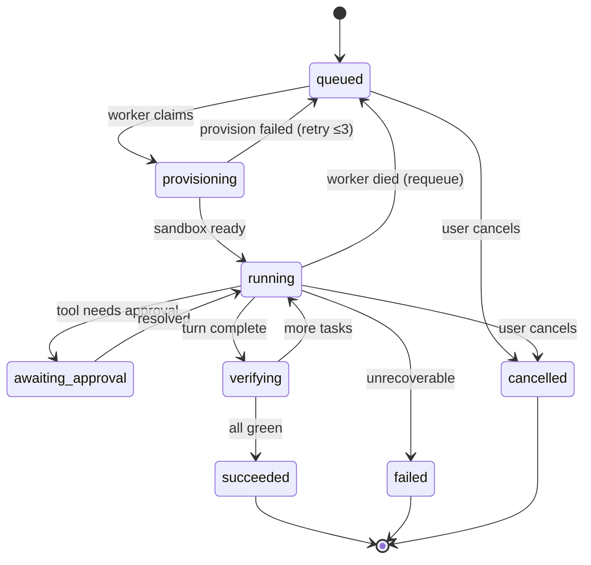

# V3 — Cloud Sandbox

> **Goal:** move execution off your laptop. The agent runs inside a disposable, isolated cloud
> sandbox, one per project, for many users, in parallel.
>
> **Status:** 🔴 not started · **Est.** 3–4 weeks · **Depends on:** [V2](./V2_ISOLATION_AND_CONTROL.md)

---

## Why this version exists

This is **the** architectural pivot — the difference between "a coding agent" and "a product".

Three forcing functions:

1. **Security.** An LLM writing `bash` is arbitrary remote code execution. In V0–V2 that
   executes on your machine, as you, with your `~/.ssh` and your `~/.aws`. That is fine for a
   solo dev tool and unacceptable the moment a stranger can sign up.
2. **Availability.** A build must not stop because your laptop slept.
3. **Concurrency.** One machine = one build. A product needs N.

```
        V0–V2                                    V3
┌─────────────────────────┐          ┌─────────────────────────┐
│ API process             │          │ API   (never executes)  │
│   └── agent loop        │          └────────────┬────────────┘
│         └── bash        │                       ▼
│               └── YOUR  │                  ┌─────────┐
│                   DISK  │                  │  Queue  │
└─────────────────────────┘                  └────┬────┘
                                                  ▼
                                          ┌───────────────┐
                                          │ Sandbox Mgr   │
                                          └───────┬───────┘
                                    ┌─────────────┼─────────────┐
                                    ▼             ▼             ▼
                                Sandbox A     Sandbox B     Sandbox C
                                 worker+agent  worker+agent  worker+agent
```

---

## Acceptance test

1. Deployed at a real URL. Sign up as **user A** from a machine that has never seen this repo.
2. Create a project, send a prompt → a sandbox boots → the agent works inside it → the preview
   loads from `https://preview-<id>.<domain>` (not `localhost`).
3. Sign up as **user B**. User B cannot see, read, or reach user A's project or sandbox.
4. Start builds from both accounts simultaneously → both run, in separate sandboxes.
5. **Kill a worker mid-run.** The job requeues, the user sees a reconnect, and the run finishes.
6. Idle a project for the timeout → the sandbox is reaped → next message boots a fresh one and
   the project files are still there.

---

## Architecture

```
   Browser ──https/SSE──► API Gateway ──────► Postgres
                              │  auth · validate · fan-out
                              ▼
                        Orchestrator          job state machine
                              │
                              ▼
                            Queue             back-pressure
                              │
                              ▼
                        Sandbox Manager       provision · pool · reap
                              │
              ┌───────────────┼───────────────┐
              ▼               ▼               ▼
        ┌───────────┐   ┌───────────┐   ┌───────────┐
        │ SANDBOX   │   │ SANDBOX   │   │ SANDBOX   │
        │  worker   │   │  worker   │   │  worker   │
        │    │      │   └───────────┘   └───────────┘
        │  agent ───┼──► LLM
        │    │      │
        │  fs/bash/ │
        │  git      │
        │    │      │
        │  dev srv ─┼──► preview-<id>.domain
        └─────┬─────┘
              │ snapshot
              ▼
        Object storage
```

### Job state machine (the Orchestrator's job)



Every transition is persisted. **A worker dying is an ordinary transition, not an exception** —
that is what makes acceptance step 5 pass.

---

## TODO

### Slice 1 — Sandbox abstraction
**The boundary is HTTP, not a TypeScript interface**
([D22](../DECISIONS.md#decision-22-the-sandbox-boundary-is-an-http-contract-not-a-typescript-interface--active-target-v3-shapes-v0)).
A sandbox is a box that serves a fixed API. `SandboxProvider` is the **client** for that API.

- [ ] `libs/ts/sandbox/contract.ts` — write the wire contract **first**, in Zod, versioned
      (`/v1/...`) from its first commit. This is the only file that defines what a sandbox is.

```ts
// the box serves these. Nothing else may cross the boundary.
POST /v1/exec         { argv: string[]; cwd?; timeoutMs? }  → { stdout, stderr, code }
POST /v1/files/read   { path }                              → { content, truncated }
POST /v1/files/write  { path, content }                     → { ok }
POST /v1/git/clone|commit|push                              → { sha? }
GET  /v1/events?afterSeq=N                                  → SSE, ordered
GET  /v1/health                                             → { ok, leaseExpiresAt }
POST /v1/browser/*                                          → 501 until V5 — RESERVE THE ROUTE NOW
```

```ts
interface SandboxProvider {
  create(opts: { projectId: string; snapshot?: string }): Promise<Sandbox>;
  destroy(id: string): Promise<void>;
}
interface Sandbox {
  id: string;
  baseUrl: string;                             // ← the boundary. Everything goes through here.
  snapshot(): Promise<string>;                 // → object-storage key
  exposePort(port: number): Promise<string>;   // → public preview URL
}
```

- [ ] `libs/ts/sandbox/supervisor/` — the server that runs **inside** the box and implements the
      contract. The path fence from V0 lives here now: it is enforced on the **inside**, where a
      caller cannot bypass it.
- [ ] **`LocalSandboxProvider`** first — runs the same supervisor as a child process on your
      machine. Ports every caller to the boundary *before* cloud latency, cost, and network
      failure enter your debugging loop.
- [ ] **`E2BSandboxProvider`** second — same supervisor, different box. **E2B is the provider**
      ([D25](../DECISIONS.md#decision-25-e2b-is-the-sandbox-provider--active-target-v3-closes-o1),
      closes O1). If the second adapter requires changing `contract.ts`, the contract was wrong;
      fix it now, while there are two implementations and not five.
- [ ] **Do not build a Firecracker adapter at V3.** It needs Linux + KVM, and it drags in rootfs
      images, a kernel, `jailer`, CNI networking, and capacity scheduling. Deferred with two
      explicit reopen triggers — see D25.
- [ ] Swap by config. **Test it:** run the full V0 acceptance test against `local`, then against
      `e2b`, with only an env var changed. If anything in `libs/ts/agent-core` imports `node:fs`,
      the boundary has already leaked.
- [ ] Reserve `POST /v1/browser/*` returning `501`. One line now; a two-sided protocol migration
      at V5 otherwise ([D20](../DECISIONS.md#decision-20-the-browser-agent-drives-by-meaning-not-pixels--active-target-v5)).

### Slice 2 — Move the agent into the sandbox
- [ ] Decide the split (**recommended:** worker outside, tools execute inside):

| Option | Agent runs | Tools run | Trade-off |
|---|---|---|---|
| A — thin sandbox | on the worker | RPC into the sandbox | Simple; one round-trip per tool call |
| B — fat sandbox | inside the sandbox | inside | Fast; the sandbox needs LLM keys and egress |

  **Take A for V3.** Latency per tool call is tens of milliseconds and irrelevant next to LLM
  latency; keeping API keys out of an environment that runs LLM-authored code is worth far more.
- [ ] Every filesystem/bash tool routes through `Sandbox.exec` / `readFile` / `writeFile`.
- [ ] Git worktrees (V2) now live **inside** the sandbox. Same commands, different host.

### Slice 3 — Queue + Orchestrator
- [ ] Pick a queue. **Recommended: BullMQ on Redis** — you almost certainly need Redis anyway for
      pub/sub and the sandbox registry. (Postgres-backed `pgboss` is a fine alternative that
      avoids a new dependency.)
- [ ] `services/orchestrator` (currently an empty file) owns the job state machine above.
- [ ] `services/agent` (currently an empty file) consumes jobs and drives the agent loop.
- [ ] Job payload is an **id, not a blob** — `{ jobId, sessionId }`. The worker reads state from
      Postgres. Fat payloads go stale the moment anything else writes.
- [ ] Heartbeats: a worker renews a lease every N seconds; a missed lease requeues the job.
- [ ] Idempotency: a requeued job must not duplicate messages. Key writes on
      `(sessionId, seq)` and make the write idempotent.
- [ ] Cancellation: `POST /session/:id/cancel` → flag in Redis → the loop checks it between
      iterations → sandbox torn down.
- [ ] **Checkpoint after every completed task: commit, then push to durable storage**
      ([D17](../DECISIONS.md#decision-17-recovery-model--git-is-the-checkpoint--active-target-v3)).
      A commit that only exists on a dying sandbox's disk is worth nothing. This is what caps the
      loss at one task instead of the whole build.
- [ ] Recovery path: fresh sandbox → restore from the last pushed commit → DAG resumes at the first
      non-green node. Test it by killing a sandbox mid-run, not by reasoning about it.
- [ ] **Wall-clock cap per sandbox**, separate from per-command timeouts. A sandbox running an
      infinite loop in generated code looks perfectly healthy — only a hard deadline catches it.

### Slice 4 — Streaming across process boundaries
- [ ] Worker publishes agent events to Redis pub/sub, channel per session.
- [ ] API subscribes and forwards to connected SSE clients.
- [ ] Worker **also** batches writes into Postgres (durable path) — hot path and durable path
      stay separate.
- [ ] Reconnect still works via `?afterSeq=N` from V1, now reading from Postgres.

```
sandbox ─events─► worker ─┬─pub/sub──► API ──SSE──► browser     (hot, lossy, fast)
                          └─batch────► Postgres                  (durable, ordered)
```

### Slice 5 — Auth & multi-tenancy
- [ ] Real auth. **Recommended:** a hosted provider (Clerk/Auth0/WorkOS) or Lucia if self-hosting.
      Do not hand-roll session management in the version where strangers first arrive.
- [ ] `User` already exists in `libs/ts/db`. Make `Project.userId` **non-null**.
- [ ] **Every** query filters by `userId`. Add a repository layer so the filter cannot be forgotten
      — an ownership check missed in one route is the whole tenancy model gone.
- [ ] Ownership check on: project, session, message, approval, sandbox, preview URL.
- [ ] Preview URLs must be unguessable (a random id, not `preview-1`) and ideally auth-gated.
- [ ] Rate limits per user: requests/min, concurrent sandboxes, tokens/day.

### Slice 6 — Sandbox lifecycle & cost
- [ ] Warm pool: keep K sandboxes pre-booted. Cold start is the single biggest latency cost.
- [ ] Idle reaping: no activity for N minutes → snapshot the filesystem → destroy.
- [ ] Restore: next message → new sandbox from the snapshot.
- [ ] Hard caps per sandbox: CPU, memory, disk, wall-clock. Kill on breach.
- [ ] Egress policy: allow npm/pip/github; deny everything else, especially internal ranges.
- [ ] **No production credentials inside a sandbox, ever.** If it needs a DB, it goes through a
      proxy that holds the real credentials; the sandbox gets a short-lived scoped token.
- [ ] **Cost telemetry per project: sandbox-minutes + tokens**, rolled onto `Session`/`Project`.
      **Load-bearing, not nice-to-have** — this is the instrument that fires D25's first reopen
      trigger. Without it, "should we move off E2B?" stays a preference argument forever.

### Slice 7 — Deploy the platform itself
- [ ] Dockerise `services/api`, `services/orchestrator`, `services/agent`.
- [ ] Managed Postgres + Redis.
- [ ] Wildcard DNS + TLS for `*.preview.<domain>`.
- [ ] Health checks, structured logs with `sessionId`/`jobId` on every line, an error tracker.
- [ ] A staging environment. You will need somewhere to break things.

### Slice 8 — Prove it
- [ ] All six acceptance steps, on the deployed environment.
- [ ] Deliberate tenancy probe: as user B, call every route with user A's ids. Every one 404s.
- [ ] Chaos: kill a worker, kill a sandbox, kill Redis. Confirm each degrades rather than corrupts.
- [ ] **Boundary probe:** run the V0 acceptance test against `SANDBOX=local`, then `SANDBOX=e2b`,
      changing nothing but the env var. Then `grep -r "node:fs" libs/ts/agent-core` — it must be
      empty ([D22](../DECISIONS.md#decision-22-the-sandbox-boundary-is-an-http-contract-not-a-typescript-interface--active-target-v3-shapes-v0)).
- [ ] **Egress probe:** from inside a sandbox, try to reach the control-plane Postgres, the
      metadata endpoint (`169.254.169.254`), and another tenant's sandbox. All three must fail.

---

## Files this version touches

```
NEW  libs/ts/sandbox/src/*             SandboxProvider port + local & E2B adapters
EDIT services/orchestrator/src/index.ts     EMPTY → job state machine
EDIT services/agent/src/index.ts           EMPTY → job consumer + agent driver
EDIT services/api/src/*                  auth middleware, ownership checks, enqueue instead of execute
EDIT libs/ts/agent-core/src/tools/*         tools execute via Sandbox, not node:fs
EDIT libs/ts/db/prisma/schema.prisma   Sandbox, Job; Project.userId non-null
NEW  infra/                             Dockerfiles, compose, deploy config
```

---

## Traps

| Trap | Symptom | Fix |
|---|---|---|
| Ownership check per route | One forgotten route = full cross-tenant read | Repository layer that requires `userId` |
| Fat job payloads | Worker acts on stale state | Pass ids; read from the DB |
| No idempotency | Requeue duplicates half the transcript | Idempotent writes keyed on `(sessionId, seq)` |
| Guessable preview URLs | Strangers browsing user projects | Random ids + auth gate |
| Secrets in the sandbox | LLM-written code exfiltrates your keys | Proxy pattern; scoped short-lived tokens only |
| No wall-clock cap | One runaway loop bills you all weekend | Hard timeout + kill |
| Cold start on every message | 30s before the first token | Warm pool + snapshot restore |
| Cloud provider first | Debugging cloud latency *and* your own bugs at once | Ship `LocalSandboxProvider` first |
| **Boundary leaks** | A tool imports `node:fs` "just this once"; swap-by-config quietly dies | HTTP contract ([D22](../DECISIONS.md#decision-22-the-sandbox-boundary-is-an-http-contract-not-a-typescript-interface--active-target-v3-shapes-v0)) + a lint rule banning `node:fs` in `agent-core` |
| **Unversioned contract** | Supervisor and caller deploy out of step; every sandbox 400s | `/v1/` prefix from the first commit |
| **Building Firecracker yourself** | Six weeks of hosting work, zero product progress | E2B. Rule 5: you have not felt this limitation yet |

---

## Concepts to learn here

Container/microVM isolation · job queues & at-least-once delivery · idempotency · distributed
state machines · multi-tenancy & row-level isolation · pub/sub fan-out · lease/heartbeat
patterns · cost modelling. See [LEARNING.md → V3](../LEARNING.md#v3--distributed-systems--isolation---the-wall).

---

## Definition of done

- [ ] No agent-authored code executes on the API host. Ever.
- [ ] A stranger can sign up and build something without touching your machine.
- [ ] Killing any single worker loses no user-visible work.
- [ ] Cross-tenant probes all fail.
- [ ] Sandbox spend per project is measurable.
