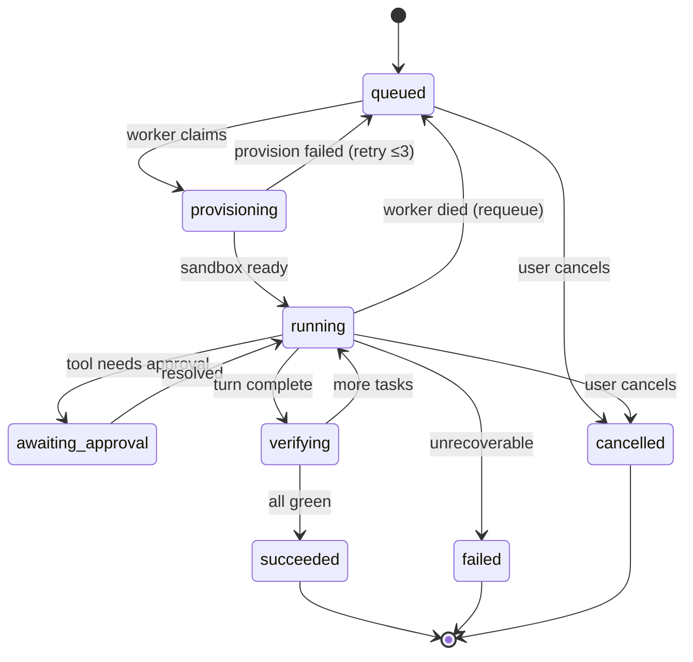

# V3 — Cloud Sandbox

> **Goal:** move execution off your laptop. The agent runs inside a disposable, isolated cloud
> sandbox, one per project, for many users, in parallel.
>
> **Status:** 🟡 local path + E2B adapter wired · deploy/acceptance still open · **Depends on:** [V2](./V2_ISOLATION_AND_CONTROL.md)
>
> **Run locally:** `bun run infra:up` → fill `.env` from `.env.example` (set `EXECUTION_MODE=sandboxed`,
> `SANDBOX_PROVIDER=local|e2b`) → `bun run db:migrate` → `bun run dev:v3` (api + web + agent worker).
> E2B needs `E2B_API_KEY` from https://e2b.dev.

---

## Engineering question ([D71](../DECISIONS.md))

Moves **Q1**, **Q3** (recovery from partial execution).

> How many concurrent agent runs can one orchestrator hold, what happens when 10% of workers die
> mid-task, and how do we guarantee no task executes twice or is lost?

- **Baseline first (hand-built):** in-process queue → worker with lease + heartbeat + bounded retry,
  *before* adopting BullMQ/pg-boss (O3). Measure throughput, p50/p95/p99 dispatch latency, and at
  1×/2×/5×/10× concurrent runs.
- **Then compare** against the chosen production queue: what guarantee did it add, what did it cost.
- **Failure experiments** (→ `FAILURES.md`): kill worker mid-tool-call · stop heartbeats · expire
  lease · network partition to sandbox · partial artifact. Record detection time, recovery time,
  duplicate executions, lost work.
- **Invariants:** single owner per task, expired lease recoverable, checkpoint restore invalidates
  later transcript (D44), budget seat-hold (D45) — see [INVARIANTS.md](../INVARIANTS.md).
- **Hand-written:** lease manager, heartbeat, retry/idempotency, dispatch gates.
  **Hybrid:** E2B adapter, Redis/Postgres plumbing.

---

## Why this version exists

This is **the** architectural pivot — the difference between "a coding agent" and "a product".

Three forcing functions:

1. **Security.** An LLM writing `bash` is arbitrary remote code execution. In V0–V2 that
   executes on your machine, as you, with your `~/.ssh` and your `~/.aws`. That is fine for a
   solo dev tool and unacceptable the moment a stranger can sign up.
2. **Availability.** A build must not stop because your laptop slept.
3. **Concurrency.** One machine = one build. A product needs N.

```
        V0–V2                                    V3
┌─────────────────────────┐          ┌─────────────────────────┐
│ API process             │          │ API   (never executes)  │
│   └── agent loop        │          └────────────┬────────────┘
│         └── bash        │                       ▼
│               └── YOUR  │                  ┌─────────┐
│                   DISK  │                  │  Queue  │
└─────────────────────────┘                  └────┬────┘
                                                  ▼
                                          ┌───────────────┐
                                          │ Sandbox Mgr   │
                                          └───────┬───────┘
                                    ┌─────────────┼─────────────┐
                                    ▼             ▼             ▼
                                Sandbox A     Sandbox B     Sandbox C
                                 worker+agent  worker+agent  worker+agent
```

---

## Acceptance test

1. Deployed at a real URL. Sign up as **user A** from a machine that has never seen this repo.
2. Create a project, send a prompt → a sandbox boots → the agent works inside it → the preview
   loads from `https://preview-<id>.<domain>` (not `localhost`).
3. Sign up as **user B**. User B cannot see, read, or reach user A's project or sandbox.
4. Start builds from both accounts simultaneously → both run, in separate sandboxes.
5. **Kill a worker mid-run.** The job requeues, the user sees a reconnect, and the run finishes.
6. Idle a project for the timeout → the sandbox is reaped → next message boots a fresh one and
   the project files are still there.

---

## Architecture

```
   Browser ──https/SSE──► API Gateway ──────► Postgres
                              │  auth · validate · fan-out
                              ▼
                        Orchestrator          job state machine
                              │
                              ▼
                            Queue             back-pressure
                              │
                              ▼
                        Sandbox Manager       provision · pool · reap
                              │
              ┌───────────────┼───────────────┐
              ▼               ▼               ▼
        ┌───────────┐   ┌───────────┐   ┌───────────┐
        │ SANDBOX   │   │ SANDBOX   │   │ SANDBOX   │
        │  worker   │   │  worker   │   │  worker   │
        │    │      │   └───────────┘   └───────────┘
        │  agent ───┼──► LLM
        │    │      │
        │  fs/bash/ │
        │  git      │
        │    │      │
        │  dev srv ─┼──► preview-<id>.domain
        └─────┬─────┘
              │ snapshot
              ▼
        Object storage
```

### Job state machine (the Orchestrator's job)



Every transition is persisted. **A worker dying is an ordinary transition, not an exception** —
that is what makes acceptance step 5 pass.

---

## TODO

### Slice 1 — Sandbox abstraction

**The boundary is HTTP, not a TypeScript interface**
([D22](../DECISIONS.md#decision-22-the-sandbox-boundary-is-an-http-contract-not-a-typescript-interface--active-target-v3-shapes-v0)).
A sandbox is a box that serves a fixed API. `SandboxProvider` is the **client** for that API.

- [x] `packages/sandbox` contract — Zod wire contract, versioned `/v1/...` (`src/contract/`).

```ts
// the box serves these. Nothing else may cross the boundary.
POST /v1/exec         { argv: string[]; cwd?; timeoutMs? }  → { stdout, stderr, code }
POST /v1/files/read   { path }                              → { content, truncated }
POST /v1/files/write  { path, content }                     → { ok }
POST /v1/git/clone|commit|push                              → { sha? }
GET  /v1/events?afterSeq=N                                  → SSE, ordered
GET  /v1/health                                             → { ok, leaseExpiresAt }
POST /v1/browser/*                                          → 501 until V5 — RESERVE THE ROUTE NOW
```

```ts
interface SandboxProvider {
  create(opts: { projectId: string; snapshot?: string }): Promise<Sandbox>;
  destroy(id: string): Promise<void>;
}
interface Sandbox {
  id: string;
  baseUrl: string; // ← the boundary. Everything goes through here.
  snapshot(): Promise<string>; // → object-storage key
  exposePort(port: number): Promise<string>; // → public preview URL
}
```

- [x] `packages/sandbox/supervisor/` — server inside the box; path fence enforced on the inside.
- [x] **`LocalSandboxProvider`** — same supervisor as a child process on this machine.
- [x] **`E2BSandboxProvider`** — same supervisor, E2B box ([D25](../DECISIONS.md#decision-25-e2b-is-the-sandbox-provider--active-target-v3-closes-o1)).
      Swap with `SANDBOX_PROVIDER=local|e2b` via `createSandboxProviderFromEnv()`.
- [ ] **Do not build a Firecracker adapter at V3.** It needs Linux + KVM, and it drags in rootfs
      images, a kernel, `jailer`, CNI networking, and capacity scheduling. Deferred with two
      explicit reopen triggers — see D25.
- [ ] Swap by config. **Test it:** run the full V0 acceptance test against `local`, then against
      `e2b`, with only an env var changed. If anything in `packages/agent-core` imports `node:fs`,
      the boundary has already leaked.
- [ ] Reserve `POST /v1/browser/*` returning `501`. One line now; a two-sided protocol migration
      at V5 otherwise ([D20](../DECISIONS.md#decision-20-the-browser-agent-drives-by-meaning-not-pixels--active-target-v5)).

### Slice 2 — Move the agent into the sandbox

- [x] Decide the split (**recommended:** worker outside, tools execute inside) — decision stands,
      not yet re-implemented:

| Option           | Agent runs         | Tools run            | Trade-off                                   |
| ---------------- | ------------------ | -------------------- | ------------------------------------------- |
| A — thin sandbox | on the worker      | RPC into the sandbox | Simple; one round-trip per tool call        |
| B — fat sandbox  | inside the sandbox | inside               | Fast; the sandbox needs LLM keys and egress |

**Take A for V3.** Latency per tool call is tens of milliseconds and irrelevant next to LLM
latency; keeping API keys out of an environment that runs LLM-authored code is worth far more.

- [x] Every filesystem/bash tool routes through `Sandbox.exec` / `readFile` / `writeFile` via `SandboxRuntime`.
- [x] Git worktrees (V2) live **inside** the sandbox workspace uploaded/mounted into the box.

### Slice 3 — Queue + Orchestrator

- [x] Pick a queue. Hand-built `MemoryQueue` baseline first ([D71](../DECISIONS.md)) with lease + heartbeat + bounded retry; ready for BullMQ on Redis.
- [x] `apps/orchestrator` owns the job state machine (`job-machine.ts`), lease manager (`lease-manager.ts`), and dispatcher (`dispatcher.ts`).
- [x] `apps/agent` claims Jobs from Postgres (`claimNextJob` + lease) and runs `executeAgentJob` inside sandboxes.
- [x] Job payload is an **id, not a blob** — `{ jobId, sessionId }`. The worker reads state from
      Postgres. Fat payloads go stale the moment anything else writes.
- [x] Heartbeats: a worker renews a lease every N seconds; a missed lease requeues the job.
- [x] Idempotency: message writes keyed on `(sessionId, seq)` in the agent persist path.
- [x] Cancellation: `POST /conversation/:id/stop` → Redis cancel flag → agent loop aborts → sandbox torn down.
- [x] **Checkpoint after completed work** via git commit in the worker (`checkpointSession`).
- [ ] Recovery path: fresh sandbox → restore from the last pushed commit → DAG resumes at the first
      non-green node. Test it by killing a sandbox mid-run, not by reasoning about it.
- [x] **Wall-clock cap per sandbox** (`maxWallClockMs` / `WALL_CLOCK_CAP_MS` on provider + worker).

### Slice 4 — Streaming across process boundaries

- [x] Worker publishes agent events to Redis pub/sub (`session:<id>`) via `@repo/cache`.
- [x] API subscribes and forwards to connected SSE clients.
- [x] Worker **also** batches writes into Postgres (durable path) — hot path and durable path
      stay separate.
- [x] Reconnect still works via `?afterSeq=N` from V1, now reading from Postgres.

```
sandbox ─events─► worker ─┬─pub/sub──► API ──SSE──► browser     (hot, lossy, fast)
                          └─batch────► Postgres                  (durable, ordered)
```

### Slice 5 — Auth & multi-tenancy

- [x] Auth: email/password + argon2id + JWT (`@repo/auth`). Hosted IdP still optional later.
- [x] `User` already exists in `packages/db`. `Project.userId` **non-null**.
- [x] Ownership via `apps/api/src/ownership.ts` — every project-scoped route filters by `userId`.
- [x] Ownership check on: project, session, message, approval, preview URL.
- [x] Preview URLs use unguessable `previewToken` (`/preview/:token`).
- [x] Rate limits per user: conversation requests/min + concurrent sandboxes (`rate-limit.ts`).

### Slice 6 — Sandbox lifecycle & cost

- [ ] Warm pool: keep K sandboxes pre-booted. Cold start is the single biggest latency cost.
- [x] Idle reaping / restore: no separate mechanism needed — a sandbox lives for exactly one job
      and is destroyed in `executeAgentJob`'s `finally`, every time. The project files live in the
      host-mounted worktree (Local) or get re-uploaded (E2B), not in the sandbox itself, so the
      next message always gets a fresh sandbox with the same files, with nothing to restore.
- [x] Wall-clock cap enforced (`maxWallClockMs`); CPU/memory/disk caps are not — Local has no
      OS-level isolation to cap them with, and E2B's own container limits aren't configured here.
- [x] Egress policy for E2B (`EGRESS_ALLOWLIST` in `e2b-provider.ts`: npm/pip/GitHub only). Local
      has none — the sandboxed process shares the host's network, same as V0-V2.
- [x] **No production credentials inside a sandbox** — `buildExecEnv` in the supervisor passes an
      explicit allowlist (`PATH`, `HOME`, …), not the worker process's full `process.env`, so
      `DATABASE_URL`/`AUTH_SECRET`/`OPENAI_API_KEY` never reach LLM-authored `bash`.
- [x] **Cost telemetry per project: sandbox-minutes + tokens**, rolled onto `Session`/`Project`.
      **Load-bearing, not nice-to-have** — this is the instrument that fires D25's first reopen
      trigger. Without it, "should we move off E2B?" stays a preference argument forever.

### Slice 7 — Deploy the platform itself

- [ ] Dockerise `apps/api`, `apps/orchestrator`, `apps/agent`.
- [ ] Managed Postgres + Redis.
- [ ] Wildcard DNS + TLS for `*.preview.<domain>`.
- [ ] Health checks, structured logs with `sessionId`/`jobId` on every line, an error tracker.
- [ ] A staging environment. You will need somewhere to break things.

### Slice 8 — Prove it

- [ ] All six acceptance steps, on the deployed environment.
- [ ] Deliberate tenancy probe: as user B, call every route with user A's ids. Every one 404s.
- [ ] Chaos: kill a worker, kill a sandbox, kill Redis. Confirm each degrades rather than corrupts.
- [ ] **Boundary probe:** run the V0 acceptance test against `SANDBOX=local`, then `SANDBOX=e2b`,
      changing nothing but the env var. Then `grep -r "node:fs" packages/agent-core` — it must be
      empty ([D22](../DECISIONS.md#decision-22-the-sandbox-boundary-is-an-http-contract-not-a-typescript-interface--active-target-v3-shapes-v0)).
- [ ] **Egress probe:** from inside a sandbox, try to reach the control-plane Postgres, the
      metadata endpoint (`169.254.169.254`), and another tenant's sandbox. All three must fail.

---

## Files this version touches

```
NEW  packages/sandbox/src/*             SandboxProvider port + local & E2B adapters
EDIT apps/orchestrator/src/index.ts     EMPTY → job state machine
EDIT apps/agent/src/index.ts           EMPTY → job consumer + agent driver
EDIT apps/api/src/*                  auth middleware, ownership checks, enqueue instead of execute
EDIT packages/agent-core/src/tools/*         tools execute via Sandbox, not node:fs
EDIT packages/db/prisma/schema.prisma   Sandbox, Job; Project.userId non-null
NEW  infra/                             Dockerfiles, compose, deploy config
```

---

## Traps

| Trap                              | Symptom                                                                | Fix                                                                                                                                                                                                |
| --------------------------------- | ---------------------------------------------------------------------- | -------------------------------------------------------------------------------------------------------------------------------------------------------------------------------------------------- |
| Ownership check per route         | One forgotten route = full cross-tenant read                           | Repository layer that requires `userId`                                                                                                                                                            |
| Fat job payloads                  | Worker acts on stale state                                             | Pass ids; read from the DB                                                                                                                                                                         |
| No idempotency                    | Requeue duplicates half the transcript                                 | Idempotent writes keyed on `(sessionId, seq)`                                                                                                                                                      |
| Guessable preview URLs            | Strangers browsing user projects                                       | Random ids + auth gate                                                                                                                                                                             |
| Secrets in the sandbox            | LLM-written code exfiltrates your keys                                 | Proxy pattern; scoped short-lived tokens only                                                                                                                                                      |
| No wall-clock cap                 | One runaway loop bills you all weekend                                 | Hard timeout + kill                                                                                                                                                                                |
| Cold start on every message       | 30s before the first token                                             | Warm pool + snapshot restore                                                                                                                                                                       |
| Cloud provider first              | Debugging cloud latency _and_ your own bugs at once                    | Ship `LocalSandboxProvider` first                                                                                                                                                                  |
| **Boundary leaks**                | A tool imports `node:fs` "just this once"; swap-by-config quietly dies | HTTP contract ([D22](../DECISIONS.md#decision-22-the-sandbox-boundary-is-an-http-contract-not-a-typescript-interface--active-target-v3-shapes-v0)) + a lint rule banning `node:fs` in `agent-core` |
| **Unversioned contract**          | Supervisor and caller deploy out of step; every sandbox 400s           | `/v1/` prefix from the first commit                                                                                                                                                                |
| **Building Firecracker yourself** | Six weeks of hosting work, zero product progress                       | E2B. Rule 5: you have not felt this limitation yet                                                                                                                                                 |

---

## Concepts to learn here

Container/microVM isolation · job queues & at-least-once delivery · idempotency · distributed
state machines · multi-tenancy & row-level isolation · pub/sub fan-out · lease/heartbeat
patterns · cost modelling. See [LEARNING.md → V3](../LEARNING.md#v3--distributed-systems--isolation---the-wall).

---

## Definition of done

- [ ] No agent-authored code executes on the API host. Ever.
- [ ] A stranger can sign up and build something without touching your machine.
- [ ] Killing any single worker loses no user-visible work.
- [ ] Cross-tenant probes all fail.
- [ ] Sandbox spend per project is measurable.
